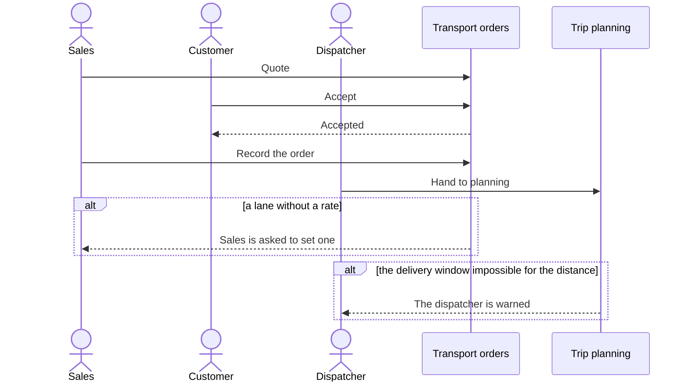

🏠 [Specs](../../../../README.md) › 🏷️ [Sectors](../../../README.md) ›
🚛 [SC07 Transport and logistics](../../README.md) › 📝 [Use cases](../README.md) ›
📝 [Use cases: FL-SC07-01 Orders and planning](README.md) › 📝 UC-SC07-01 Quote and take transport orders

# 📝 UC-SC07-01 Quote and take transport orders

**Status:** ✅ specified

## Summary

Sales quotes a transport by lane, weight and pallets; once the client accepts, the order goes to the dispatcher for
planning.

## Personas

- [U03 Sales](../../../../01-users/personas/u03-sales.md)
- [U29 Dispatcher](../../../../01-users/personas/u29-dispatcher.md)
- [U09 Customer](../../../../01-users/personas/u09-customer.md)

## Goal

Orders priced by lane and ready to plan.

## Trigger

A client asks for a transport.

## Frequency

Many a day.

## Preconditions

- The SC07 sector pack is installed for the company,
  [UC-F14-02](../../../../02-functional/f14-plugin-store/use-cases/01-find-and-install/uc-f14-02-install-a-plugin-or-sector-pack.md),
  and its users have their roles,
  [UC-F1-06](../../../../02-functional/f01-administration/use-cases/04-edit-a-role/uc-f01-06-edit-a-role-and-its-record-rules.md).

## Postconditions

- **Success:** the order is accepted and waits for planning.
- **Failed:** the quote is refused or expires.

## Main flow

1. Sales quotes on [S-SC07-01 Transport orders](../../screens/01-orders-and-planning/s-sc07-01-transport-orders.md) from
   the lane's rate: Lyon to Lille, 12 t, 26 pallets,
   [UC-F6-03](../../../../02-functional/f06-customers-and-sales/use-cases/01-lead-to-quote/uc-f06-03-create-and-send-a-quote.md).
2. The client accepts on the portal or by email.
3. Sales turns it into a transport order with pickup and delivery windows.
4. The order shows in the dispatcher's orders to plan ([UC-SC07-02](uc-sc07-02-plan-trips-and-optimise-routes.md)).

## Alternative flows

- 1a. Recurring orders: orders are created each week from a template.

## Error flows

- 1e. A lane without a rate: sales is asked to set one.
- 4e. The delivery window impossible for the distance: the dispatcher is warned.
- Any step: a call to a service or an outside system fails: it is retried first
  ([BR-F3-32](../../../../02-functional/f03-assistant/business-rules/br-f03-32-retry-before-an-error.md)), then the
  error message pattern ([D122](../../../../06-decisions/ux/d122-error-message-standard.md)) says what failed; what was
  typed is kept.

## Business rules

- [BR-SC07-12 Fuel surcharge from the index](../../business-rules/br-sc07-12-fuel-surcharge-from-the-index.md)

## Entities

- [E-SC07-01 Transport order](../../data/e-sc07-01-transport-order.md)

## Permissions

The sales, dispatcher and customer roles; the record rules of their role and site apply,
[UC-F1-06](../../../../02-functional/f01-administration/use-cases/04-edit-a-role/uc-f01-06-edit-a-role-and-its-record-rules.md).

## Notifications

None beyond the in-app updates of the records concerned.

## Audit events

Every creation, change and state change of transport order records, with who, when and the values before and after (T3).

## AI involvement

The AI assistant answers questions on the transport order records of this use case, with links, and prepares them as
drafts the user confirms. It works within the user's rights,
[BR-F3-34](../../../../02-functional/f03-assistant/business-rules/br-f03-34-every-capability-is-reachable-from-the-assistant.md),
and never deletes or does anything irreversible without the user's confirmation,
[BR-F3-07](../../../../02-functional/f03-assistant/business-rules/br-f03-07-no-deletes-no-irreversible-acts.md).

## API, MCP and A2A exposure

Through the API and webhooks (T5) and the MCP and A2A gateway (T6), with the caller's rights,
[BR-F3-34](../../../../02-functional/f03-assistant/business-rules/br-f03-34-every-capability-is-reachable-from-the-assistant.md),
reading, creating and changing the records of this use case; nothing irreversible without a person's confirmation.

## Screens

- [S-SC07-01 Transport orders](../../screens/01-orders-and-planning/s-sc07-01-transport-orders.md)
- [S-SC07-02 Trip planning](../../screens/01-orders-and-planning/s-sc07-02-trip-planning.md)

## Flowchart

See [FL-SC07-01 Orders and planning](../../flows/fl-sc07-01-orders-and-planning.md#flowchart).

## Sequence diagram

## Acceptance criteria

1. **Given** the example transport company's order from Acme, Lyon to Lille, 12 t, 26 pallets **when** it is accepted
   **then** it shows in the orders to plan.
2. **Given** Lyon to Rennes with no rate **when** a quote is asked **then** sales is asked to set one.

## Non-functional notes

[D408](../../../../06-decisions/technical/d408-performance-and-profiles.md)'s targets
([performance](../../../../05-non-functional/performance.md)): 95 % of screens within 1 second; lists paged on the
server, the first page within 1 second; reports within 5 seconds or in the background. WCAG 2.2 AA and RGAA
([D46](../../../../06-decisions/ux/d46-accessibility-standard.md)).

## Regulatory references

None specific to this use case; the sector's legal rules are listed in [SC07 regulatory](../../regulatory.md).

## Related use cases

- [UC-SC07-02 Plan trips and optimise routes](uc-sc07-02-plan-trips-and-optimise-routes.md)

## Open questions

None.

---

⬆️ [Up](README.md) · ➡️ [UC-SC07-02 Plan trips and optimise routes](uc-sc07-02-plan-trips-and-optimise-routes.md)
