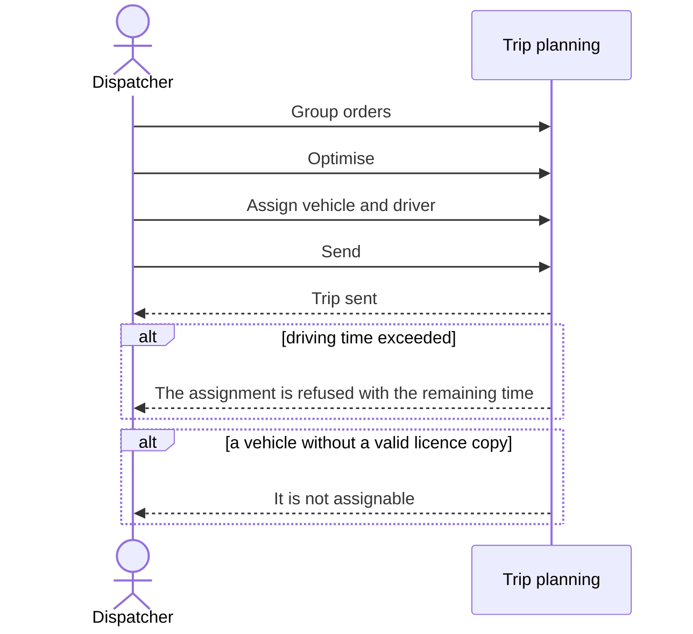

🏠 [Specs](../../../../README.md) › 🏷️ [Sectors](../../../README.md) ›
🚛 [SC07 Transport and logistics](../../README.md) › 📝 [Use cases](../README.md) ›
📝 [Use cases: FL-SC07-01 Orders and planning](README.md) › 📝 UC-SC07-02 Plan trips and optimise routes

# 📝 UC-SC07-02 Plan trips and optimise routes

**Status:** ✅ specified

## Summary

The dispatcher groups orders into trips with the shared rounds optimiser, checks driving times and licences, and assigns
a vehicle and driver.

## Personas

- [U29 Dispatcher](../../../../01-users/personas/u29-dispatcher.md)

## Goal

Trips that fit the drivers' times with the fewest empty kilometres.

## Trigger

Orders to plan.

## Frequency

Daily.

## Preconditions

- The SC07 sector pack is installed for the company,
  [UC-F14-02](../../../../02-functional/f14-plugin-store/use-cases/01-find-and-install/uc-f14-02-install-a-plugin-or-sector-pack.md),
  and its users have their roles,
  [UC-F1-06](../../../../02-functional/f01-administration/use-cases/04-edit-a-role/uc-f01-06-edit-a-role-and-its-record-rules.md).

## Postconditions

- **Success:** trips are planned and sent to drivers' phones.
- **Failed:** orders stay to plan.

## Main flow

1. The dispatcher selects the day's orders on
   [S-SC07-02 Trip planning](../../screens/01-orders-and-planning/s-sc07-02-trip-planning.md).
2. The shared optimiser orders stops by travel time and windows,
   [UC-F9-30](../../../../02-functional/f09-hr-and-projects/use-cases/11-capacity-rounds-and-partners/uc-f09-30-plan-rounds-and-optimise-routes.md),
   [BR-F9-22](../../../../02-functional/f09-hr-and-projects/business-rules/br-f09-22-rounds-respect-travel-skills-continuity-and-working-time.md).
3. The dispatcher assigns them; SimpleERP checks driving times and the licence copy,
   [BR-SC07-03](../../business-rules/br-sc07-03-trips-within-driving-times.md),
   [BR-SC07-02](../../business-rules/br-sc07-02-vehicles-within-the-licence.md).
4. The trip goes to the driver's phone.

## Alternative flows

- 3a. Relay drivers: the trip is split between two drivers at a relay point.

## Error flows

- 3e. Driving time exceeded: the assignment is refused with the remaining time.
- 3f. A vehicle without a valid licence copy: it is not assignable.
- Any step: a call to a service or an outside system fails: it is retried first
  ([BR-F3-32](../../../../02-functional/f03-assistant/business-rules/br-f03-32-retry-before-an-error.md)), then the
  error message pattern ([D122](../../../../06-decisions/ux/d122-error-message-standard.md)) says what failed; what was
  typed is kept.

## Business rules

- [BR-SC07-03 Trips within driving times](../../business-rules/br-sc07-03-trips-within-driving-times.md)
- [BR-SC07-02 Vehicles within the licence](../../business-rules/br-sc07-02-vehicles-within-the-licence.md)
- [BR-F9-22 Rounds respect travel, skills, continuity and working time](../../../../02-functional/f09-hr-and-projects/business-rules/br-f09-22-rounds-respect-travel-skills-continuity-and-working-time.md)

## Entities

- [E-SC07-02 Trip](../../data/e-sc07-02-trip.md)
- [E-F9-26 Round](../../../../02-functional/f09-hr-and-projects/data/e-f09-26-round.md)

## Permissions

The dispatcher roles; the record rules of their role and site apply,
[UC-F1-06](../../../../02-functional/f01-administration/use-cases/04-edit-a-role/uc-f01-06-edit-a-role-and-its-record-rules.md).

## Notifications

None beyond the in-app updates of the records concerned.

## Audit events

Every creation, change and state change of trip, round records, with who, when and the values before and after (T3).

## AI involvement

The AI assistant answers questions on the trip, round records of this use case, with links, and prepares them as drafts
the user confirms. It works within the user's rights,
[BR-F3-34](../../../../02-functional/f03-assistant/business-rules/br-f03-34-every-capability-is-reachable-from-the-assistant.md),
and never deletes or does anything irreversible without the user's confirmation,
[BR-F3-07](../../../../02-functional/f03-assistant/business-rules/br-f03-07-no-deletes-no-irreversible-acts.md).

## API, MCP and A2A exposure

Through the API and webhooks (T5) and the MCP and A2A gateway (T6), with the caller's rights,
[BR-F3-34](../../../../02-functional/f03-assistant/business-rules/br-f03-34-every-capability-is-reachable-from-the-assistant.md),
reading, creating and changing the records of this use case; nothing irreversible without a person's confirmation.

## Screens

- [S-SC07-02 Trip planning](../../screens/01-orders-and-planning/s-sc07-02-trip-planning.md)

## Flowchart

See [FL-SC07-01 Orders and planning](../../flows/fl-sc07-01-orders-and-planning.md#flowchart).

## Sequence diagram

## Acceptance criteria

1. **Given** the example transport company's trip T-881 with 4 stops, 610 km, 80 km empty **when** it is assigned to M.
   D. on AB-123 **then** M. D. sees T-881 on his phone.
2. **Given** M. D. with 3 hours left and a 7-hour trip **when** he is assigned **then** the assignment is refused with
   the remaining time.

## Non-functional notes

[D408](../../../../06-decisions/technical/d408-performance-and-profiles.md)'s targets
([performance](../../../../05-non-functional/performance.md)): 95 % of screens within 1 second; lists paged on the
server, the first page within 1 second; reports within 5 seconds or in the background. WCAG 2.2 AA and RGAA
([D46](../../../../06-decisions/ux/d46-accessibility-standard.md)).

## Regulatory references

Legal values from the France country pack:
[CR-FR-117 Driving and rest times](../../../../10-country-packs/france/transport/cr-fr-117-driving-and-rest-times.md),
[CR-FR-115 Haulage registration and licences](../../../../10-country-packs/france/transport/cr-fr-115-haulage-registration.md).

## Related use cases

- [UC-SC07-06 Drive with the phone](../03-on-the-road/uc-sc07-06-drive-with-the-phone.md)

## Open questions

None.

---

⬅️ [UC-SC07-01 Quote and take transport orders](uc-sc07-01-quote-and-take-transport-orders.md) · ⬆️ [Up](README.md) ·
➡️ [UC-SC07-03 Manage the fleet and trailers](../02-fleet-and-drivers/uc-sc07-03-manage-the-fleet-and-trailers.md)
