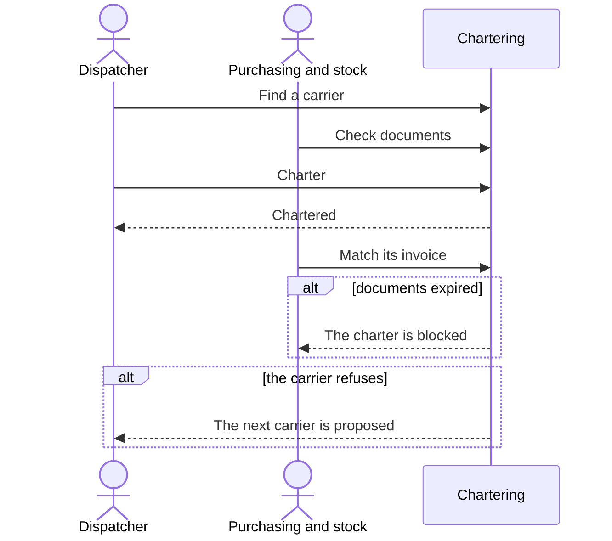

🏠 [Specs](../../../../README.md) › 🏷️ [Sectors](../../../README.md) ›
🚛 [SC07 Transport and logistics](../../README.md) › 📝 [Use cases](../README.md) ›
📝 [Use cases: FL-SC07-01 Orders and planning](README.md) › 📝 UC-SC07-12 Subcontract to other carriers

# 📝 UC-SC07-12 Subcontract to other carriers

**Status:** ✅ specified

## Summary

The dispatcher and purchasing charter an order to another carrier, checking its licence and vigilance documents first.

## Personas

- [U29 Dispatcher](../../../../01-users/personas/u29-dispatcher.md)
- [U04 Purchasing and stock](../../../../01-users/personas/u04-purchasing.md)

## Goal

Orders carried by checked carriers when the fleet is full.

## Trigger

No vehicle free for an order.

## Frequency

Weekly.

## Preconditions

- The SC07 sector pack is installed for the company,
  [UC-F14-02](../../../../02-functional/f14-plugin-store/use-cases/01-find-and-install/uc-f14-02-install-a-plugin-or-sector-pack.md),
  and its users have their roles,
  [UC-F1-06](../../../../02-functional/f01-administration/use-cases/04-edit-a-role/uc-f01-06-edit-a-role-and-its-record-rules.md).

## Postconditions

- **Success:** the order is chartered and followed to delivery.
- **Failed:** the order stays to plan.

## Main flow

1. The dispatcher picks a carrier on
   [S-SC07-12 Chartering](../../screens/01-orders-and-planning/s-sc07-12-chartering.md).
2. Purchasing checks the licence and vigilance documents,
   [BR-SC07-11](../../business-rules/br-sc07-11-chartered-carriers-checked.md),
   [BR-F9-24](../../../../02-functional/f09-hr-and-projects/business-rules/br-f09-24-no-work-without-vigilance-documents.md).
3. The dispatcher sends the charter order with the price.
4. Purchasing matches the carrier's invoice to the charter,
   [UC-F7-04](../../../../02-functional/f07-purchasing-and-stock/use-cases/01-procure/uc-f07-04-capture-and-match-supplier-invoices.md).

## Alternative flows

- 1a. A freight exchange: the load is posted through its connector (T12).

## Error flows

- 2e. Documents expired: the charter is blocked.
- 3e. The carrier refuses: the next carrier is proposed.
- Any step: a call to a service or an outside system fails: it is retried first
  ([BR-F3-32](../../../../02-functional/f03-assistant/business-rules/br-f03-32-retry-before-an-error.md)), then the
  error message pattern ([D122](../../../../06-decisions/ux/d122-error-message-standard.md)) says what failed; what was
  typed is kept.

## Business rules

- [BR-SC07-11 Chartered carriers checked](../../business-rules/br-sc07-11-chartered-carriers-checked.md)
- [BR-F9-24 No work without vigilance documents](../../../../02-functional/f09-hr-and-projects/business-rules/br-f09-24-no-work-without-vigilance-documents.md)

## Entities

- [E-SC07-12 Charter](../../data/e-sc07-12-charter.md)

## Permissions

The dispatcher and purchasing and stock roles; the record rules of their role and site apply,
[UC-F1-06](../../../../02-functional/f01-administration/use-cases/04-edit-a-role/uc-f01-06-edit-a-role-and-its-record-rules.md).

## Notifications

None beyond the in-app updates of the records concerned.

## Audit events

Every creation, change and state change of charter records, with who, when and the values before and after (T3).

## AI involvement

The AI assistant answers questions on the charter records of this use case, with links, and prepares them as drafts the
user confirms. It works within the user's rights,
[BR-F3-34](../../../../02-functional/f03-assistant/business-rules/br-f03-34-every-capability-is-reachable-from-the-assistant.md),
and never deletes or does anything irreversible without the user's confirmation,
[BR-F3-07](../../../../02-functional/f03-assistant/business-rules/br-f03-07-no-deletes-no-irreversible-acts.md).

## API, MCP and A2A exposure

Through the API and webhooks (T5) and the MCP and A2A gateway (T6), with the caller's rights,
[BR-F3-34](../../../../02-functional/f03-assistant/business-rules/br-f03-34-every-capability-is-reachable-from-the-assistant.md),
reading, creating and changing the records of this use case; nothing irreversible without a person's confirmation.

## Screens

- [S-SC07-12 Chartering](../../screens/01-orders-and-planning/s-sc07-12-chartering.md)

## Flowchart

See [FL-SC07-01 Orders and planning](../../flows/fl-sc07-01-orders-and-planning.md#flowchart).

## Sequence diagram

## Acceptance criteria

1. **Given** the example transport company's Acme order chartered to Carrier B at 780 EUR **when** documents are valid
   **then** the charter is sent.
2. **Given** Carrier B's vigilance certificate over 6 months old **when** the order is chartered **then** the charter is
   blocked.

## Non-functional notes

[D408](../../../../06-decisions/technical/d408-performance-and-profiles.md)'s targets
([performance](../../../../05-non-functional/performance.md)): 95 % of screens within 1 second; lists paged on the
server, the first page within 1 second; reports within 5 seconds or in the background. WCAG 2.2 AA and RGAA
([D46](../../../../06-decisions/ux/d46-accessibility-standard.md)).

## Regulatory references

Legal values from the France country pack:
[CR-FR-085 Vigilance over subcontractors](../../../../10-country-packs/france/construction/cr-fr-085-subcontractor-vigilance.md).

## Related use cases

- [UC-SC07-02 Plan trips and optimise routes](uc-sc07-02-plan-trips-and-optimise-routes.md)

## Open questions

None.

---

⬅️ [UC-SC07-11](../02-fleet-and-drivers/uc-sc07-11-maintain-vehicles-and-their-inspections.md) · ⬆️ [Up](README.md) ·
➡️ [UC-SC07-13](../05-billing-and-performance/uc-sc07-13-bill-transport-with-surcharges.md)
