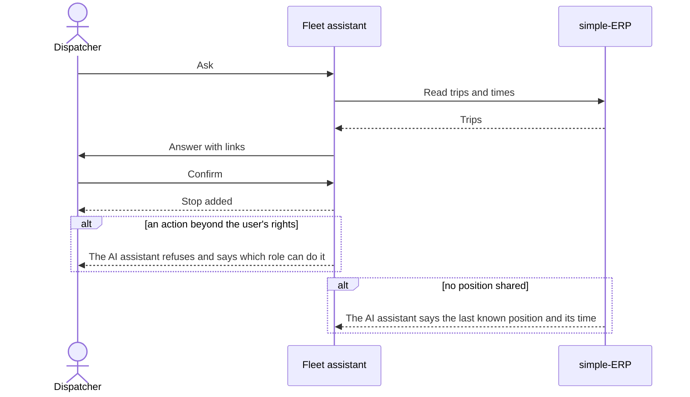

🏠 [Specs](../../../../README.md) › 🏷️ [Sectors](../../../README.md) ›
🚛 [SC07 Transport and logistics](../../README.md) › 📝 [Use cases](../README.md) ›
📝 [Use cases: FL-SC07-01 Orders and planning](README.md) › 📝 UC-SC07-20 Ask the AI assistant about the fleet

# 📝 UC-SC07-20 Ask the AI assistant about the fleet

**Status:** ✅ specified

## Summary

The dispatcher or a driver asks the AI assistant where a truck is, who can take a load or a driver's remaining time,
within their role's rights.

## Personas

- [U29 Dispatcher](../../../../01-users/personas/u29-dispatcher.md)
- [U30 Driver](../../../../01-users/personas/u30-driver.md)

## Goal

Answers without hunting through screens.

## Trigger

A question to the AI assistant.

## Frequency

Many times a day.

## Preconditions

- The SC07 sector pack is installed for the company,
  [UC-F14-02](../../../../02-functional/f14-plugin-store/use-cases/01-find-and-install/uc-f14-02-install-a-plugin-or-sector-pack.md),
  and its users have their roles,
  [UC-F1-06](../../../../02-functional/f01-administration/use-cases/04-edit-a-role/uc-f01-06-edit-a-role-and-its-record-rules.md).

## Postconditions

- **Success:** the answer cites the records, or the prepared action is confirmed.
- **Failed:** the AI assistant says it cannot answer or act, and why.

## Main flow

1. The dispatcher asks on
   [S-SC07-20 Fleet assistant](../../screens/01-orders-and-planning/s-sc07-20-fleet-assistant.md): "Who can take 8
   pallets to Grenoble this afternoon?".
2. The AI assistant reads trips, positions and driving times within the user's rights.
3. The AI assistant proposes two drivers with their remaining time.
4. The dispatcher picks one; the AI assistant adds the stop once confirmed,
   [UC-F3-03](../../../../02-functional/f03-assistant/use-cases/03-act-through-the-assistant/uc-f03-03-have-the-assistant-create-or-change-records.md).

## Alternative flows

- 1a. A driver asks for the next stop aloud: the AI assistant reads it on the phone,
  [UC-F3-09](../../../../02-functional/f03-assistant/use-cases/09-assistant-on-a-phone/uc-f03-09-use-the-assistant-on-a-phone.md).

## Error flows

- 4e. An action beyond the user's rights: the AI assistant refuses and says which role can do it.
- 2e. No position shared: the AI assistant says the last known position and its time.
- Any step: a call to a service or an outside system fails: it is retried first
  ([BR-F3-32](../../../../02-functional/f03-assistant/business-rules/br-f03-32-retry-before-an-error.md)), then the
  error message pattern ([D122](../../../../06-decisions/ux/d122-error-message-standard.md)) says what failed; what was
  typed is kept.

## Business rules

- [BR-SC07-01 Transport follows the country pack](../../business-rules/br-sc07-01-transport-follows-the-country-pack.md)
- [BR-SC07-08 Location only while working](../../business-rules/br-sc07-08-location-only-while-working.md)
- [BR-F3-34 All capabilities via the AI assistant](../../../../02-functional/f03-assistant/business-rules/br-f03-34-every-capability-is-reachable-from-the-assistant.md)
- [BR-F3-07 No deletes, no irreversible acts](../../../../02-functional/f03-assistant/business-rules/br-f03-07-no-deletes-no-irreversible-acts.md)

## Entities

- [E-SC07-02 Trip](../../data/e-sc07-02-trip.md)
- [E-SC07-06 Stop](../../data/e-sc07-06-stop.md)

## Permissions

The dispatcher and driver roles; the record rules of their role and site apply,
[UC-F1-06](../../../../02-functional/f01-administration/use-cases/04-edit-a-role/uc-f01-06-edit-a-role-and-its-record-rules.md).

## Notifications

None beyond the in-app updates of the records concerned.

## Audit events

Every creation, change and state change of trip, stop records, with who, when and the values before and after (T3).

## AI involvement

The AI assistant answers questions on the trip, stop records of this use case, with links, and prepares them as drafts
the user confirms. It works within the user's rights,
[BR-F3-34](../../../../02-functional/f03-assistant/business-rules/br-f03-34-every-capability-is-reachable-from-the-assistant.md),
and never deletes or does anything irreversible without the user's confirmation,
[BR-F3-07](../../../../02-functional/f03-assistant/business-rules/br-f03-07-no-deletes-no-irreversible-acts.md).

## API, MCP and A2A exposure

Through the API and webhooks (T5) and the MCP and A2A gateway (T6), with the caller's rights,
[BR-F3-34](../../../../02-functional/f03-assistant/business-rules/br-f03-34-every-capability-is-reachable-from-the-assistant.md),
reading, creating and changing the records of this use case; nothing irreversible without a person's confirmation.

## Screens

- [S-SC07-20 Fleet assistant](../../screens/01-orders-and-planning/s-sc07-20-fleet-assistant.md)

## Flowchart

See [FL-SC07-01 Orders and planning](../../flows/fl-sc07-01-orders-and-planning.md#flowchart).

## Sequence diagram

## Acceptance criteria

1. **Given** the example transport company's M. D. with 4 hours left near Lyon **when** the dispatcher asks who can take
   a Grenoble load **then** M. D. is proposed with his remaining time.
2. **Given** M. D. driving **when** he asks **then** the AI assistant reads it on the phone,
   [UC-F3-09](../../../../02-functional/f03-assistant/use-cases/09-assistant-on-a-phone/uc-f03-09-use-the-assistant-on-a-phone.md).
3. **Given** a driver asking to change a price **when** he asks **then** the AI assistant refuses and says which role
   can do it.

## Non-functional notes

[D408](../../../../06-decisions/technical/d408-performance-and-profiles.md)'s targets
([performance](../../../../05-non-functional/performance.md)): 95 % of screens within 1 second; lists paged on the
server, the first page within 1 second; reports within 5 seconds or in the background. WCAG 2.2 AA and RGAA
([D46](../../../../06-decisions/ux/d46-accessibility-standard.md)).

## Regulatory references

None specific to this use case; the sector's legal rules are listed in [SC07 regulatory](../../regulatory.md).

## Related use cases

- [UC-SC07-02 Plan trips and optimise routes](uc-sc07-02-plan-trips-and-optimise-routes.md)

## Open questions

None.

---

⬅️ [UC-SC07-19](../04-compliance/uc-sc07-19-follow-cabotage-and-international-trips.md) · ⬆️ [Up](README.md) ·
➡️ [UC-SC07-21](../07-passengers-removals-courier-and-freight/uc-sc07-21-run-passenger-transport.md)
