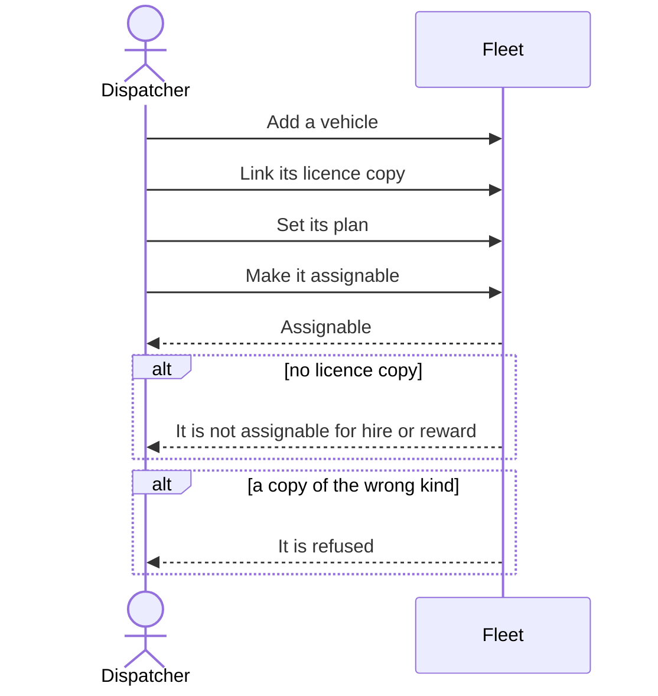

🏠 [Specs](../../../../README.md) › 🏷️ [Sectors](../../../README.md) ›
🚛 [SC07 Transport and logistics](../../README.md) › 📝 [Use cases](../README.md) ›
📝 [Use cases: FL-SC07-02 Fleet and drivers](README.md) › 📝 UC-SC07-03 Manage the fleet and trailers

# 📝 UC-SC07-03 Manage the fleet and trailers

**Status:** ✅ specified

## Summary

The dispatcher adds vehicles and trailers, links each to its licence copy, and follows them.

## Personas

- [U29 Dispatcher](../../../../01-users/personas/u29-dispatcher.md)

## Goal

Every vehicle used legally.

## Trigger

A new or rented vehicle.

## Frequency

A few a month.

## Preconditions

- The SC07 sector pack is installed for the company,
  [UC-F14-02](../../../../02-functional/f14-plugin-store/use-cases/01-find-and-install/uc-f14-02-install-a-plugin-or-sector-pack.md),
  and its users have their roles,
  [UC-F1-06](../../../../02-functional/f01-administration/use-cases/04-edit-a-role/uc-f01-06-edit-a-role-and-its-record-rules.md).

## Postconditions

- **Success:** the vehicle is assignable.
- **Failed:** the vehicle is not assignable.

## Main flow

1. The dispatcher adds the vehicle on [S-SC07-03 Fleet](../../screens/02-fleet-and-drivers/s-sc07-03-fleet.md),
   [UC-F9-12](../../../../02-functional/f09-hr-and-projects/use-cases/05-workplace-services/uc-f09-12-manage-the-fleet.md).
2. The dispatcher links the licence copy ([BR-SC07-02](../../business-rules/br-sc07-02-vehicles-within-the-licence.md)).
3. The dispatcher sets inspection and maintenance dates
   ([UC-SC07-11](uc-sc07-11-maintain-vehicles-and-their-inspections.md)).
4. The vehicle becomes assignable.

## Alternative flows

- 1a. A rented vehicle: the rental's end date is set and the vehicle leaves the fleet then.

## Error flows

- 2e. No licence copy: it is not assignable for hire or reward.
- 2f. A copy of the wrong kind: it is refused.
- Any step: a call to a service or an outside system fails: it is retried first
  ([BR-F3-32](../../../../02-functional/f03-assistant/business-rules/br-f03-32-retry-before-an-error.md)), then the
  error message pattern ([D122](../../../../06-decisions/ux/d122-error-message-standard.md)) says what failed; what was
  typed is kept.

## Business rules

- [BR-SC07-02 Vehicles within the licence](../../business-rules/br-sc07-02-vehicles-within-the-licence.md)

## Entities

- [E-SC07-03 Fleet vehicle](../../data/e-sc07-03-fleet-vehicle.md)

## Permissions

The dispatcher roles; the record rules of their role and site apply,
[UC-F1-06](../../../../02-functional/f01-administration/use-cases/04-edit-a-role/uc-f01-06-edit-a-role-and-its-record-rules.md).

## Notifications

None beyond the in-app updates of the records concerned.

## Audit events

Every creation, change and state change of vehicle records, with who, when and the values before and after (T3).

## AI involvement

The AI assistant answers questions on the vehicle records of this use case, with links, and prepares them as drafts the
user confirms. It works within the user's rights,
[BR-F3-34](../../../../02-functional/f03-assistant/business-rules/br-f03-34-every-capability-is-reachable-from-the-assistant.md),
and never deletes or does anything irreversible without the user's confirmation,
[BR-F3-07](../../../../02-functional/f03-assistant/business-rules/br-f03-07-no-deletes-no-irreversible-acts.md).

## API, MCP and A2A exposure

Through the API and webhooks (T5) and the MCP and A2A gateway (T6), with the caller's rights,
[BR-F3-34](../../../../02-functional/f03-assistant/business-rules/br-f03-34-every-capability-is-reachable-from-the-assistant.md),
reading, creating and changing the records of this use case; nothing irreversible without a person's confirmation.

## Screens

- [S-SC07-03 Fleet](../../screens/02-fleet-and-drivers/s-sc07-03-fleet.md)

## Flowchart

See [FL-SC07-02 Fleet and drivers](../../flows/fl-sc07-02-fleet-and-drivers.md#flowchart).

## Sequence diagram

## Acceptance criteria

1. **Given** the example transport company's AB-123, 19 t, with copy 14 **when** it is added **then** it is assignable.
2. **Given** a new 19 t without its copy **when** it is assigned **then** it is not assignable for hire or reward.

## Non-functional notes

[D408](../../../../06-decisions/technical/d408-performance-and-profiles.md)'s targets
([performance](../../../../05-non-functional/performance.md)): 95 % of screens within 1 second; lists paged on the
server, the first page within 1 second; reports within 5 seconds or in the background. WCAG 2.2 AA and RGAA
([D46](../../../../06-decisions/ux/d46-accessibility-standard.md)).

## Regulatory references

Legal values from the France country pack:
[CR-FR-115 Haulage registration and licences](../../../../10-country-packs/france/transport/cr-fr-115-haulage-registration.md).

## Related use cases

- [UC-SC07-11 Maintain vehicles and their inspections](uc-sc07-11-maintain-vehicles-and-their-inspections.md)

## Open questions

None.

---

⬅️ [UC-SC07-02 Plan trips and optimise routes](../01-orders-and-planning/uc-sc07-02-plan-trips-and-optimise-routes.md) ·
⬆️ [Up](README.md) ·
➡️ [UC-SC07-04 Manage drivers and their documents](uc-sc07-04-manage-drivers-and-their-documents.md)
