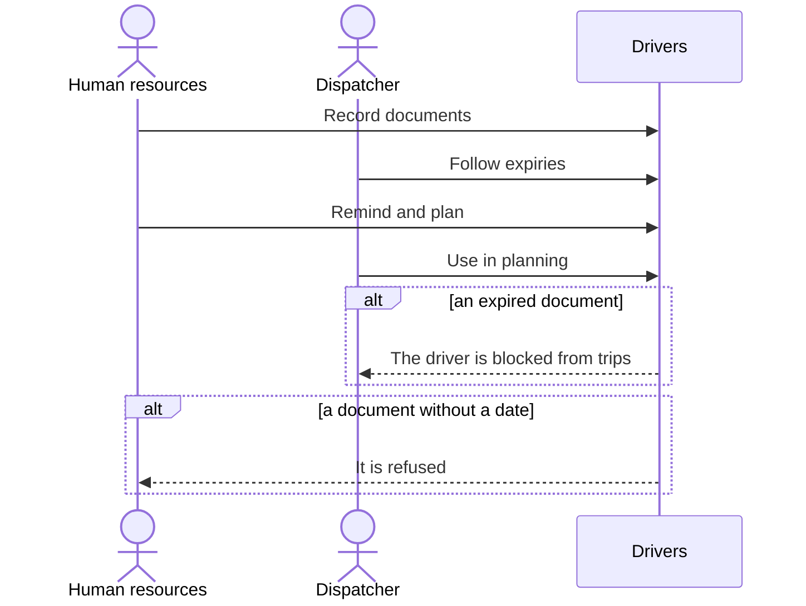

🏠 [Specs](../../../../README.md) › 🏷️ [Sectors](../../../README.md) ›
🚛 [SC07 Transport and logistics](../../README.md) › 📝 [Use cases](../README.md) ›
📝 [Use cases: FL-SC07-02 Fleet and drivers](README.md) › 📝 UC-SC07-04 Manage drivers and their documents

# 📝 UC-SC07-04 Manage drivers and their documents

**Status:** 🔄 waiting for the owner

## Summary

The dispatcher and HR record drivers' licences, driver cards, training and medical checks, follow expiries and remind
renewals.

## Personas

- [U29 Dispatcher](../../../../01-users/personas/u29-dispatcher.md)
- [U06 Human resources](../../../../01-users/personas/u06-hr.md)

## Goal

Every driver assigned with current documents.

## Trigger

A new driver or an expiry.

## Frequency

Monthly review.

## Preconditions

- The SC07 sector pack is installed for the company,
  [UC-F14-02](../../../../02-functional/f14-plugin-store/use-cases/01-find-and-install/uc-f14-02-install-a-plugin-or-sector-pack.md),
  and its users have their roles,
  [UC-F1-06](../../../../02-functional/f01-administration/use-cases/04-edit-a-role/uc-f01-06-edit-a-role-and-its-record-rules.md).

## Postconditions

- **Success:** documents are current; renewals are planned.
- **Failed:** the driver is blocked.

## Main flow

1. HR records documents on [S-SC07-04 Drivers](../../screens/02-fleet-and-drivers/s-sc07-04-drivers.md).
2. The dispatcher sees expiries ahead.
3. HR plans renewals and training,
   [UC-F9-25](../../../../02-functional/f09-hr-and-projects/use-cases/09-train-and-protect/uc-f09-25-run-the-training-plan-with-opco-funding.md).
4. Planning uses only current documents
   ([BR-SC07-05](../../business-rules/br-sc07-05-drivers-qualified-and-current.md)).

## Alternative flows

- 1a. Temporary drivers: the agency's documents are recorded for the mission.

## Error flows

- 4e. An expired document: the driver is blocked from trips.
- 1e. A document without a date: it is refused.
- Any step: a call to a service or an outside system fails: it is retried first
  ([BR-F3-32](../../../../02-functional/f03-assistant/business-rules/br-f03-32-retry-before-an-error.md)), then the
  error message pattern ([D122](../../../../06-decisions/ux/d122-error-message-standard.md)) says what failed; what was
  typed is kept.

## Business rules

- [BR-SC07-05 Drivers qualified and current](../../business-rules/br-sc07-05-drivers-qualified-and-current.md)
- [BR-F9-17 Mandatory trainings must be current for the work that needs them](../../../../02-functional/f09-hr-and-projects/business-rules/br-f09-17-mandatory-trainings-must-be-current-for-the-work-that-needs-them.md)

## Entities

- [E-SC07-04 Driver document](../../data/e-sc07-04-driver-document.md)

## Permissions

The dispatcher and human resources roles; the record rules of their role and site apply,
[UC-F1-06](../../../../02-functional/f01-administration/use-cases/04-edit-a-role/uc-f01-06-edit-a-role-and-its-record-rules.md).

## Notifications

None beyond the in-app updates of the records concerned.

## Audit events

Every creation, change and state change of driver document records, with who, when and the values before and after (T3).

## AI involvement

The AI assistant answers questions on the driver document records of this use case, with links, and prepares them as
drafts the user confirms. It works within the user's rights,
[BR-F3-34](../../../../02-functional/f03-assistant/business-rules/br-f03-34-every-capability-is-reachable-from-the-assistant.md),
and never deletes or does anything irreversible without the user's confirmation,
[BR-F3-07](../../../../02-functional/f03-assistant/business-rules/br-f03-07-no-deletes-no-irreversible-acts.md).

## API, MCP and A2A exposure

Through the API and webhooks (T5) and the MCP and A2A gateway (T6), with the caller's rights,
[BR-F3-34](../../../../02-functional/f03-assistant/business-rules/br-f03-34-every-capability-is-reachable-from-the-assistant.md),
reading, creating and changing the records of this use case; nothing irreversible without a person's confirmation.

## Screens

- [S-SC07-04 Drivers](../../screens/02-fleet-and-drivers/s-sc07-04-drivers.md)

## Flowchart

See [FL-SC07-02 Fleet and drivers](../../flows/fl-sc07-02-fleet-and-drivers.md#flowchart).

## Sequence diagram

## Acceptance criteria

1. **Given** the example transport company's M. D. with a driver card valid to 2028-04 **when** the renewal is due
   **then** HR is reminded ((Proposed) 60 days before).
2. **Given** M. D.'s card ending 2028-04 **when** he is assigned in May 2028 **then** the driver is blocked from trips.

## Non-functional notes

[D408](../../../../06-decisions/technical/d408-performance-and-profiles.md)'s targets
([performance](../../../../05-non-functional/performance.md)): 95 % of screens within 1 second; lists paged on the
server, the first page within 1 second; reports within 5 seconds or in the background. WCAG 2.2 AA and RGAA
([D46](../../../../06-decisions/ux/d46-accessibility-standard.md)).

## Regulatory references

Legal values from the France country pack:
[CR-FR-119 Drivers' initial and continuous training](../../../../10-country-packs/france/transport/cr-fr-119-driver-training.md).

## Related use cases

- [UC-SC07-02 Plan trips and optimise routes](../01-orders-and-planning/uc-sc07-02-plan-trips-and-optimise-routes.md)

## Open questions

None open; the items marked (Proposed) wait for the owner in the [waiting list](../../../../09-waiting/README.md).

---

⬅️ [UC-SC07-03 Manage the fleet and trailers](uc-sc07-03-manage-the-fleet-and-trailers.md) · ⬆️ [Up](README.md) ·
➡️ [UC-SC07-05](../03-on-the-road/uc-sc07-05-issue-consignment-notes-paper-or-e-cmr.md)
