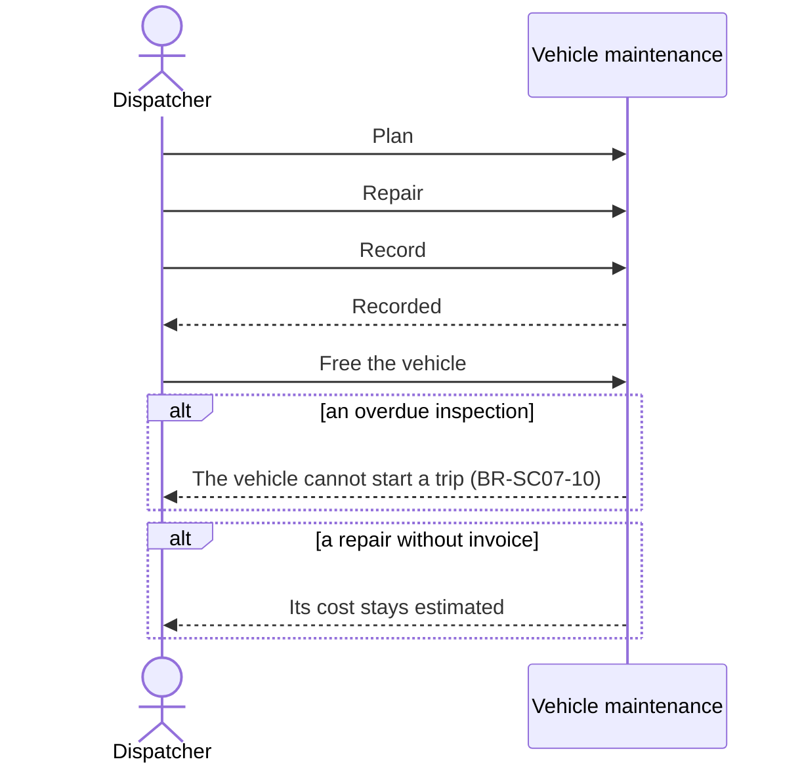

🏠 [Specs](../../../../README.md) › 🏷️ [Sectors](../../../README.md) ›
🚛 [SC07 Transport and logistics](../../README.md) › 📝 [Use cases](../README.md) ›
📝 [Use cases: FL-SC07-02 Fleet and drivers](README.md) › 📝 UC-SC07-11 Maintain vehicles and their inspections

# 📝 UC-SC07-11 Maintain vehicles and their inspections

**Status:** ✅ specified

## Summary

The dispatcher plans maintenance and technical inspections, records repairs and their cost; an overdue vehicle cannot
start a trip.

## Personas

- [U29 Dispatcher](../../../../01-users/personas/u29-dispatcher.md)

## Goal

Vehicles safe and inspected.

## Trigger

A due date or a breakdown.

## Frequency

Weekly.

## Preconditions

- The SC07 sector pack is installed for the company,
  [UC-F14-02](../../../../02-functional/f14-plugin-store/use-cases/01-find-and-install/uc-f14-02-install-a-plugin-or-sector-pack.md),
  and its users have their roles,
  [UC-F1-06](../../../../02-functional/f01-administration/use-cases/04-edit-a-role/uc-f01-06-edit-a-role-and-its-record-rules.md).

## Postconditions

- **Success:** the work is recorded and the next date set.
- **Failed:** the vehicle is blocked.

## Main flow

1. The dispatcher plans maintenance on
   [S-SC07-11 Vehicle maintenance](../../screens/02-fleet-and-drivers/s-sc07-11-vehicle-maintenance.md).
2. The garage repairs,
   [UC-F12-06](../../../../02-functional/f12-manufacturing/use-cases/03-make-the-products/uc-f12-06-consume-components-trace-lots-and-serials.md).
3. The dispatcher records work, cost and next date.
4. The vehicle is assignable again.

## Alternative flows

- 2a. A breakdown on the road: the driver reports it from the phone and the trip is reassigned.

## Error flows

- 1e. An overdue inspection: the vehicle cannot start a trip
  ([BR-SC07-10](../../business-rules/br-sc07-10-vehicles-inspected-on-time.md)).
- 3e. A repair without invoice: its cost stays estimated.
- Any step: a call to a service or an outside system fails: it is retried first
  ([BR-F3-32](../../../../02-functional/f03-assistant/business-rules/br-f03-32-retry-before-an-error.md)), then the
  error message pattern ([D122](../../../../06-decisions/ux/d122-error-message-standard.md)) says what failed; what was
  typed is kept.

## Business rules

- [BR-SC07-10 Vehicles inspected on time](../../business-rules/br-sc07-10-vehicles-inspected-on-time.md)

## Entities

- [E-SC07-03 Fleet vehicle](../../data/e-sc07-03-fleet-vehicle.md)
- [E-SC07-11 Vehicle repair](../../data/e-sc07-11-vehicle-repair.md)

## Permissions

The dispatcher roles; the record rules of their role and site apply,
[UC-F1-06](../../../../02-functional/f01-administration/use-cases/04-edit-a-role/uc-f01-06-edit-a-role-and-its-record-rules.md).

## Notifications

None beyond the in-app updates of the records concerned.

## Audit events

Every creation, change and state change of vehicle, vehicle repair records, with who, when and the values before and
after (T3).

## AI involvement

The AI assistant answers questions on the vehicle, vehicle repair records of this use case, with links, and prepares
them as drafts the user confirms. It works within the user's rights,
[BR-F3-34](../../../../02-functional/f03-assistant/business-rules/br-f03-34-every-capability-is-reachable-from-the-assistant.md),
and never deletes or does anything irreversible without the user's confirmation,
[BR-F3-07](../../../../02-functional/f03-assistant/business-rules/br-f03-07-no-deletes-no-irreversible-acts.md).

## API, MCP and A2A exposure

Through the API and webhooks (T5) and the MCP and A2A gateway (T6), with the caller's rights,
[BR-F3-34](../../../../02-functional/f03-assistant/business-rules/br-f03-34-every-capability-is-reachable-from-the-assistant.md),
reading, creating and changing the records of this use case; nothing irreversible without a person's confirmation.

## Screens

- [S-SC07-11 Vehicle maintenance](../../screens/02-fleet-and-drivers/s-sc07-11-vehicle-maintenance.md)

## Flowchart

See [FL-SC07-02 Fleet and drivers](../../flows/fl-sc07-02-fleet-and-drivers.md#flowchart).

## Sequence diagram

## Acceptance criteria

1. **Given** the example transport company's AB-123 brakes repaired on 3 November for 840 EUR **when** it is recorded
   **then** the cost shows on AB-123's costs.
2. **Given** AB-123 due in March 2027 **when** a trip starts in April 2027 **then** the vehicle cannot start a trip
   ([BR-SC07-10](../../business-rules/br-sc07-10-vehicles-inspected-on-time.md)).

## Non-functional notes

[D408](../../../../06-decisions/technical/d408-performance-and-profiles.md)'s targets
([performance](../../../../05-non-functional/performance.md)): 95 % of screens within 1 second; lists paged on the
server, the first page within 1 second; reports within 5 seconds or in the background. WCAG 2.2 AA and RGAA
([D46](../../../../06-decisions/ux/d46-accessibility-standard.md)).

## Regulatory references

None specific to this use case; the sector's legal rules are listed in [SC07 regulatory](../../regulatory.md).

## Related use cases

- [UC-SC07-18 Follow cost and margin](../05-billing-and-performance/uc-sc07-18-follow-cost-and-margin.md)

## Open questions

None.

---

⬅️ [UC-SC07-10 Manage fuel cards and tolls](../05-billing-and-performance/uc-sc07-10-manage-fuel-cards-and-tolls.md) ·
⬆️ [Up](README.md) ·
➡️ [UC-SC07-12 Subcontract to other carriers](../01-orders-and-planning/uc-sc07-12-subcontract-to-other-carriers.md)
