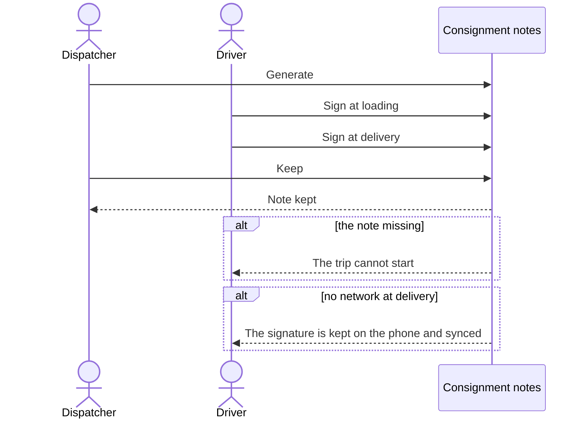

🏠 [Specs](../../../../README.md) › 🏷️ [Sectors](../../../README.md) ›
🚛 [SC07 Transport and logistics](../../README.md) › 📝 [Use cases](../README.md) ›
📝 [Use cases: FL-SC07-03 On the road](README.md) › 📝 UC-SC07-05 Issue consignment notes, paper or e-CMR

# 📝 UC-SC07-05 Issue consignment notes, paper or e-CMR

**Status:** ✅ specified

## Summary

The dispatcher generates a consignment note per shipment; the driver has it signed at loading and at delivery, on paper
or electronically.

## Personas

- [U29 Dispatcher](../../../../01-users/personas/u29-dispatcher.md)
- [U30 Driver](../../../../01-users/personas/u30-driver.md)

## Goal

Every shipment with its note signed at both ends.

## Trigger

A trip is planned.

## Frequency

Per shipment.

## Preconditions

- The SC07 sector pack is installed for the company,
  [UC-F14-02](../../../../02-functional/f14-plugin-store/use-cases/01-find-and-install/uc-f14-02-install-a-plugin-or-sector-pack.md),
  and its users have their roles,
  [UC-F1-06](../../../../02-functional/f01-administration/use-cases/04-edit-a-role/uc-f01-06-edit-a-role-and-its-record-rules.md).

## Postconditions

- **Success:** the note is signed at both ends.
- **Failed:** the trip is blocked.

## Main flow

1. The dispatcher generates the note on
   [S-SC07-05 Consignment notes](../../screens/03-on-the-road/s-sc07-05-consignment-notes.md).
2. The shipper signs on the driver's phone.
3. The consignee signs, with reservations if any.
4. The signed note is kept with the order
   ([BR-SC07-04](../../business-rules/br-sc07-04-documents-on-board-complete.md)).

## Alternative flows

- 1a. An electronic note: the e-CMR is sent through its connector (T12).

## Error flows

- 2e. The note missing: the trip cannot start.
- 3e. No network at delivery: the signature is kept on the phone and synced.
- Any step: a call to a service or an outside system fails: it is retried first
  ([BR-F3-32](../../../../02-functional/f03-assistant/business-rules/br-f03-32-retry-before-an-error.md)), then the
  error message pattern ([D122](../../../../06-decisions/ux/d122-error-message-standard.md)) says what failed; what was
  typed is kept.

## Business rules

- [BR-SC07-04 Documents on board complete](../../business-rules/br-sc07-04-documents-on-board-complete.md)

## Entities

- [E-SC07-05 Consignment note](../../data/e-sc07-05-consignment-note.md)

## Permissions

The dispatcher and driver roles; the record rules of their role and site apply,
[UC-F1-06](../../../../02-functional/f01-administration/use-cases/04-edit-a-role/uc-f01-06-edit-a-role-and-its-record-rules.md).

## Notifications

None beyond the in-app updates of the records concerned.

## Audit events

Every creation, change and state change of consignment note records, with who, when and the values before and after
(T3).

## AI involvement

The AI assistant answers questions on the consignment note records of this use case, with links, and prepares them as
drafts the user confirms. It works within the user's rights,
[BR-F3-34](../../../../02-functional/f03-assistant/business-rules/br-f03-34-every-capability-is-reachable-from-the-assistant.md),
and never deletes or does anything irreversible without the user's confirmation,
[BR-F3-07](../../../../02-functional/f03-assistant/business-rules/br-f03-07-no-deletes-no-irreversible-acts.md).

## API, MCP and A2A exposure

Through the API and webhooks (T5) and the MCP and A2A gateway (T6), with the caller's rights,
[BR-F3-34](../../../../02-functional/f03-assistant/business-rules/br-f03-34-every-capability-is-reachable-from-the-assistant.md),
reading, creating and changing the records of this use case; nothing irreversible without a person's confirmation.

## Screens

- [S-SC07-05 Consignment notes](../../screens/03-on-the-road/s-sc07-05-consignment-notes.md)

## Flowchart

See [FL-SC07-03 On the road](../../flows/fl-sc07-03-on-the-road.md#flowchart).

## Sequence diagram

## Acceptance criteria

1. **Given** the example transport company's note CN-4471 **when** both parties sign **then** it shows both signatures.
2. **Given** trip T-881 with no note for CN-4471 **when** M. D. starts it **then** the trip cannot start.

## Non-functional notes

[D408](../../../../06-decisions/technical/d408-performance-and-profiles.md)'s targets
([performance](../../../../05-non-functional/performance.md)): 95 % of screens within 1 second; lists paged on the
server, the first page within 1 second; reports within 5 seconds or in the background. WCAG 2.2 AA and RGAA
([D46](../../../../06-decisions/ux/d46-accessibility-standard.md)).

## Regulatory references

Legal values from the France country pack:
[CR-FR-118 Documents on board and the consignment note](../../../../10-country-packs/france/transport/cr-fr-118-documents-on-board.md).

## Related use cases

- [UC-SC07-07 Collect proofs of delivery and report incidents](uc-sc07-07-collect-proofs-of-delivery-and-report-incidents.md)

## Open questions

None.

---

⬅️ [UC-SC07-04](../02-fleet-and-drivers/uc-sc07-04-manage-drivers-and-their-documents.md) · ⬆️ [Up](README.md) ·
➡️ [UC-SC07-06 Drive with the phone](uc-sc07-06-drive-with-the-phone.md)
