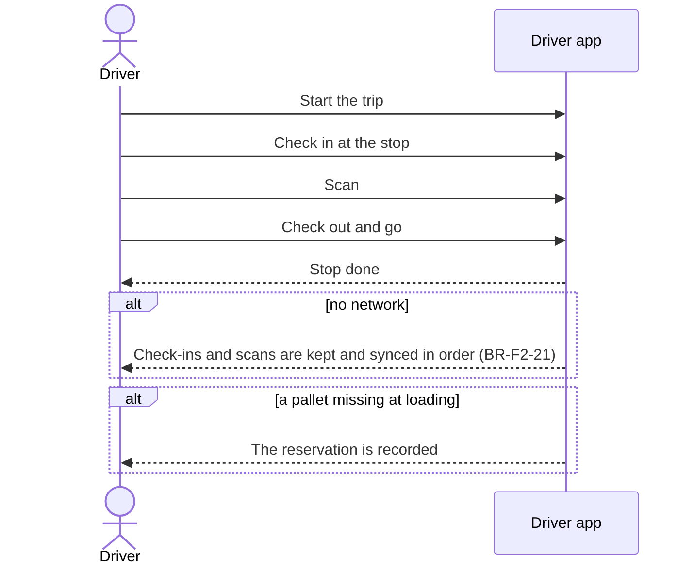

🏠 [Specs](../../../../README.md) › 🏷️ [Sectors](../../../README.md) ›
🚛 [SC07 Transport and logistics](../../README.md) › 📝 [Use cases](../README.md) ›
📝 [Use cases: FL-SC07-03 On the road](README.md) › 📝 UC-SC07-06 Drive with the phone

# 📝 UC-SC07-06 Drive with the phone

**Status:** ✅ specified

## Summary

The driver starts the trip on the phone, checks in at each stop, scans the goods and goes on, offline when needed
through the offline phone forms.

## Personas

- [U30 Driver](../../../../01-users/personas/u30-driver.md)

## Goal

The trip followed live, even without network.

## Trigger

The trip's start.

## Frequency

Daily per driver.

## Preconditions

- The SC07 sector pack is installed for the company,
  [UC-F14-02](../../../../02-functional/f14-plugin-store/use-cases/01-find-and-install/uc-f14-02-install-a-plugin-or-sector-pack.md),
  and its users have their roles,
  [UC-F1-06](../../../../02-functional/f01-administration/use-cases/04-edit-a-role/uc-f01-06-edit-a-role-and-its-record-rules.md).
- The trip form is set to work offline,
  [UC-F2-21](../../../../02-functional/f02-no-code-configuration/use-cases/09-portals-and-offline-forms/uc-f02-21-make-a-phone-form-work-offline.md).

## Postconditions

- **Success:** each stop is done with its times and scans.
- **Failed:** stops wait on the phone until synced.

## Main flow

1. The driver starts the trip on [S-SC07-06 Driver app](../../screens/03-on-the-road/s-sc07-06-driver-app.md),
   [UC-F2-22](../../../../02-functional/f02-no-code-configuration/use-cases/09-portals-and-offline-forms/uc-f02-22-fill-a-form-offline-on-the-phone.md);
   the location is shared only now ([BR-SC07-08](../../business-rules/br-sc07-08-location-only-while-working.md)).
2. The driver checks in; waiting time starts counting
   ([BR-SC07-07](../../business-rules/br-sc07-07-waiting-time-recorded.md)).
3. The driver scans the pallets.
4. The driver checks out to the next stop.

## Alternative flows

- 2a. A change from the dispatcher: the new stop appears on the phone.

## Error flows

- 2e. No network: check-ins and scans are kept and synced in order,
  [BR-F2-21](../../../../02-functional/f02-no-code-configuration/business-rules/br-f02-21-offline-forms-keep-only-what-is-needed-and-sync-in-order.md).
- 3e. A pallet missing at loading: the reservation is recorded.
- Any step: a call to a service or an outside system fails: it is retried first
  ([BR-F3-32](../../../../02-functional/f03-assistant/business-rules/br-f03-32-retry-before-an-error.md)), then the
  error message pattern ([D122](../../../../06-decisions/ux/d122-error-message-standard.md)) says what failed; what was
  typed is kept.

## Business rules

- [BR-SC07-08 Location only while working](../../business-rules/br-sc07-08-location-only-while-working.md)
- [BR-SC07-07 Waiting time recorded](../../business-rules/br-sc07-07-waiting-time-recorded.md)
- [BR-F2-21 Offline forms keep only what is needed and sync in order](../../../../02-functional/f02-no-code-configuration/business-rules/br-f02-21-offline-forms-keep-only-what-is-needed-and-sync-in-order.md)

## Entities

- [E-SC07-06 Stop](../../data/e-sc07-06-stop.md)

## Permissions

The driver roles; the record rules of their role and site apply,
[UC-F1-06](../../../../02-functional/f01-administration/use-cases/04-edit-a-role/uc-f01-06-edit-a-role-and-its-record-rules.md).

## Notifications

None beyond the in-app updates of the records concerned.

## Audit events

Every creation, change and state change of stop records, with who, when and the values before and after (T3).

## AI involvement

The AI assistant answers questions on the stop records of this use case, with links, and prepares them as drafts the
user confirms. It works within the user's rights,
[BR-F3-34](../../../../02-functional/f03-assistant/business-rules/br-f03-34-every-capability-is-reachable-from-the-assistant.md),
and never deletes or does anything irreversible without the user's confirmation,
[BR-F3-07](../../../../02-functional/f03-assistant/business-rules/br-f03-07-no-deletes-no-irreversible-acts.md).

## API, MCP and A2A exposure

Through the API and webhooks (T5) and the MCP and A2A gateway (T6), with the caller's rights,
[BR-F3-34](../../../../02-functional/f03-assistant/business-rules/br-f03-34-every-capability-is-reachable-from-the-assistant.md),
reading, creating and changing the records of this use case; nothing irreversible without a person's confirmation.

## Screens

- [S-SC07-06 Driver app](../../screens/03-on-the-road/s-sc07-06-driver-app.md)

## Flowchart

See [FL-SC07-03 On the road](../../flows/fl-sc07-03-on-the-road.md#flowchart).

## Sequence diagram

## Acceptance criteria

1. **Given** the example transport company's stop at Lille on T-881 **when** M. D. checks in at 10:00 and out at 12:05
   **then** the stop shows 2 hours 5 minutes.
2. **Given** a stop in a valley with no network **when** M. D. checks out **then** check-ins and scans are kept and
   synced in order,
   [BR-F2-21](../../../../02-functional/f02-no-code-configuration/business-rules/br-f02-21-offline-forms-keep-only-what-is-needed-and-sync-in-order.md).

## Non-functional notes

Works offline on the phone,
[UC-F2-21](../../../../02-functional/f02-no-code-configuration/use-cases/09-portals-and-offline-forms/uc-f02-21-make-a-phone-form-work-offline.md).
[D408](../../../../06-decisions/technical/d408-performance-and-profiles.md)'s targets
([performance](../../../../05-non-functional/performance.md)): 95 % of screens within 1 second; lists paged on the
server, the first page within 1 second; reports within 5 seconds or in the background. WCAG 2.2 AA and RGAA
([D46](../../../../06-decisions/ux/d46-accessibility-standard.md)).

## Regulatory references

Legal values from the France country pack:
[CR-FR-054 Location only when needed and announced](../../../../10-country-packs/france/data-protection/cr-fr-054-location-with-consent.md).

## Related use cases

- [UC-SC07-07 Collect proofs of delivery and report incidents](uc-sc07-07-collect-proofs-of-delivery-and-report-incidents.md)

## Open questions

None.

---

⬅️ [UC-SC07-05 Issue consignment notes, paper or e-CMR](uc-sc07-05-issue-consignment-notes-paper-or-e-cmr.md) ·
⬆️ [Up](README.md) · ➡️ [UC-SC07-07](uc-sc07-07-collect-proofs-of-delivery-and-report-incidents.md)
