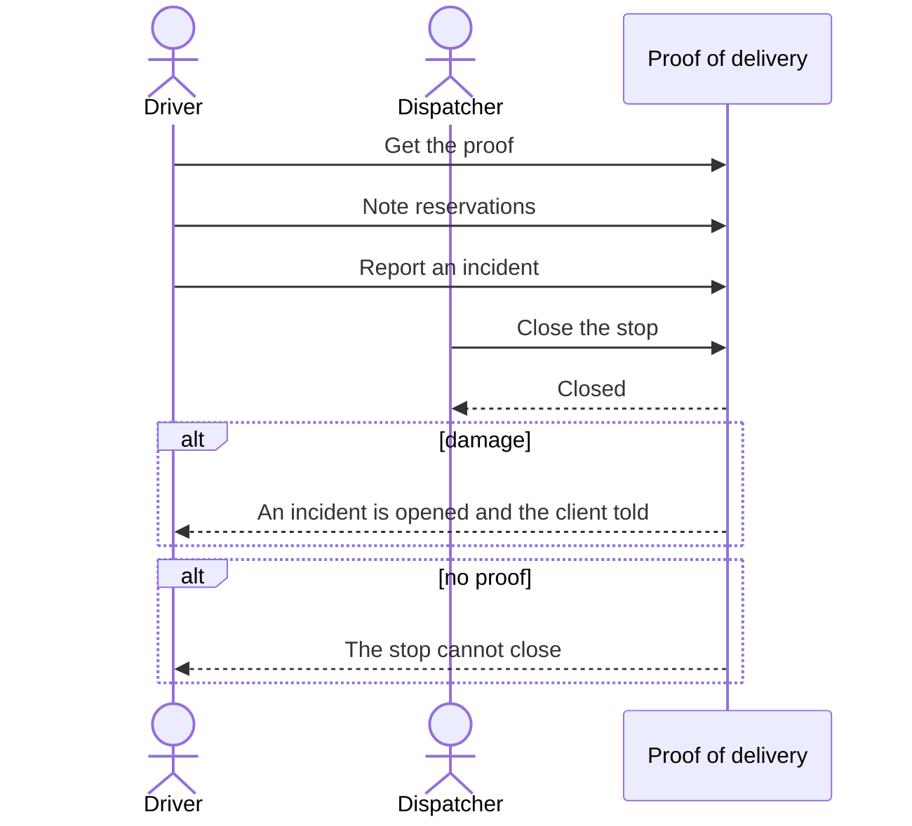

🏠 [Specs](../../../../README.md) › 🏷️ [Sectors](../../../README.md) ›
🚛 [SC07 Transport and logistics](../../README.md) › 📝 [Use cases](../README.md) ›
📝 [Use cases: FL-SC07-03 On the road](README.md) › 📝 UC-SC07-07 Collect proofs of delivery and report incidents

# 📝 UC-SC07-07 Collect proofs of delivery and report incidents

**Status:** ✅ specified

## Summary

At delivery the driver collects a signature, photo or code, notes the consignee's reservations and reports incidents to
the dispatcher.

## Personas

- [U30 Driver](../../../../01-users/personas/u30-driver.md)
- [U29 Dispatcher](../../../../01-users/personas/u29-dispatcher.md)

## Goal

Every delivery proved, every incident known.

## Trigger

A delivery.

## Frequency

Per stop.

## Preconditions

- The SC07 sector pack is installed for the company,
  [UC-F14-02](../../../../02-functional/f14-plugin-store/use-cases/01-find-and-install/uc-f14-02-install-a-plugin-or-sector-pack.md),
  and its users have their roles,
  [UC-F1-06](../../../../02-functional/f01-administration/use-cases/04-edit-a-role/uc-f01-06-edit-a-role-and-its-record-rules.md).

## Postconditions

- **Success:** the stop closes with its proof.
- **Failed:** the stop stays open.

## Main flow

1. The driver gets a signature, photo or code on
   [S-SC07-07 Proof of delivery](../../screens/03-on-the-road/s-sc07-07-proof-of-delivery.md)
   ([BR-SC07-06](../../business-rules/br-sc07-06-proof-of-delivery-closes-the-stop.md)).
2. The driver notes the consignee's reservations.
3. The driver reports damage with photos.
4. The dispatcher sees the stop closed.

## Alternative flows

- 1a. The consignee absent: a photo of the drop place and a code are taken, or the goods come back.

## Error flows

- 3e. Damage: an incident is opened and the client told.
- 1e. No proof: the stop cannot close.
- Any step: a call to a service or an outside system fails: it is retried first
  ([BR-F3-32](../../../../02-functional/f03-assistant/business-rules/br-f03-32-retry-before-an-error.md)), then the
  error message pattern ([D122](../../../../06-decisions/ux/d122-error-message-standard.md)) says what failed; what was
  typed is kept.

## Business rules

- [BR-SC07-06 Proof of delivery closes the stop](../../business-rules/br-sc07-06-proof-of-delivery-closes-the-stop.md)
- [BR-SC07-07 Waiting time recorded](../../business-rules/br-sc07-07-waiting-time-recorded.md)

## Entities

- [E-SC07-06 Stop](../../data/e-sc07-06-stop.md)
- [E-SC07-07 Transport incident](../../data/e-sc07-07-transport-incident.md)
- [E-SC07-16 Proof of delivery](../../data/e-sc07-16-proof-of-delivery.md)

## Permissions

The driver and dispatcher roles; the record rules of their role and site apply,
[UC-F1-06](../../../../02-functional/f01-administration/use-cases/04-edit-a-role/uc-f01-06-edit-a-role-and-its-record-rules.md).

## Notifications

None beyond the in-app updates of the records concerned.

## Audit events

Every creation, change and state change of stop, transport incident records, with who, when and the values before and
after (T3).

## AI involvement

The AI assistant answers questions on the stop, transport incident records of this use case, with links, and prepares
them as drafts the user confirms. It works within the user's rights,
[BR-F3-34](../../../../02-functional/f03-assistant/business-rules/br-f03-34-every-capability-is-reachable-from-the-assistant.md),
and never deletes or does anything irreversible without the user's confirmation,
[BR-F3-07](../../../../02-functional/f03-assistant/business-rules/br-f03-07-no-deletes-no-irreversible-acts.md).

## API, MCP and A2A exposure

Through the API and webhooks (T5) and the MCP and A2A gateway (T6), with the caller's rights,
[BR-F3-34](../../../../02-functional/f03-assistant/business-rules/br-f03-34-every-capability-is-reachable-from-the-assistant.md),
reading, creating and changing the records of this use case; nothing irreversible without a person's confirmation.

## Screens

- [S-SC07-07 Proof of delivery](../../screens/03-on-the-road/s-sc07-07-proof-of-delivery.md)

## Flowchart

See [FL-SC07-03 On the road](../../flows/fl-sc07-03-on-the-road.md#flowchart).

## Sequence diagram

## Acceptance criteria

1. **Given** the example transport company's stop at Lille with a signature **when** it closes **then** the proof shows
   on the client's portal.
2. **Given** a box damaged at Lille **when** the driver reports it **then** an incident is opened and the client told.

## Non-functional notes

[D408](../../../../06-decisions/technical/d408-performance-and-profiles.md)'s targets
([performance](../../../../05-non-functional/performance.md)): 95 % of screens within 1 second; lists paged on the
server, the first page within 1 second; reports within 5 seconds or in the background. WCAG 2.2 AA and RGAA
([D46](../../../../06-decisions/ux/d46-accessibility-standard.md)).

## Regulatory references

None specific to this use case; the sector's legal rules are listed in [SC07 regulatory](../../regulatory.md).

## Related use cases

- [UC-SC07-13 Bill transport with surcharges](../05-billing-and-performance/uc-sc07-13-bill-transport-with-surcharges.md)
- [UC-SC07-16 Give clients tracking and documents in the portal](../06-logistics-for-clients/uc-sc07-16-give-clients-tracking-and-documents-in-the-portal.md)

## Open questions

None.

---

⬅️ [UC-SC07-06 Drive with the phone](uc-sc07-06-drive-with-the-phone.md) · ⬆️ [Up](README.md) ·
➡️ [UC-SC07-08](../04-compliance/uc-sc07-08-import-tachograph-data-and-check-driving-times.md)
