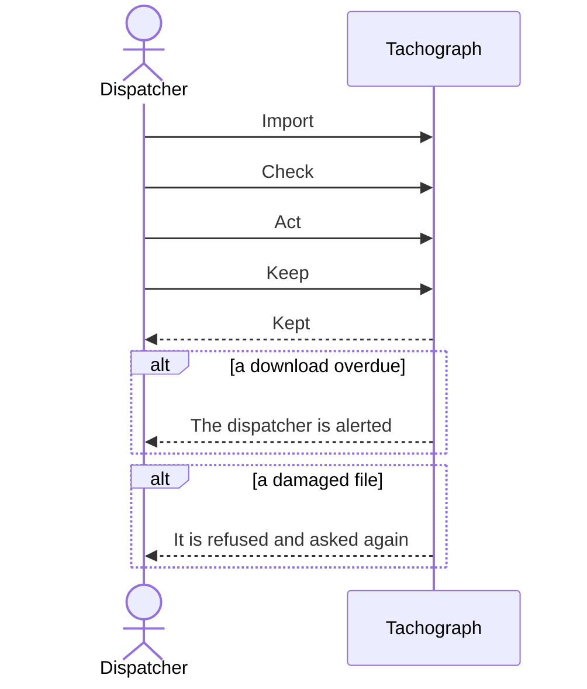

🏠 [Specs](../../../../README.md) › 🏷️ [Sectors](../../../README.md) ›
🚛 [SC07 Transport and logistics](../../README.md) › 📝 [Use cases](../README.md) ›
📝 [Use cases: FL-SC07-04 Compliance](README.md) › 📝 UC-SC07-08 Import tachograph data and check driving times

# 📝 UC-SC07-08 Import tachograph data and check driving times

**Status:** ✅ specified

## Summary

The dispatcher imports tachograph downloads, checks driving and rest times and acts on infringements.

## Personas

- [U29 Dispatcher](../../../../01-users/personas/u29-dispatcher.md)

## Goal

Driving times kept and proved.

## Trigger

The download schedule.

## Frequency

Weekly per driver.

## Preconditions

- The SC07 sector pack is installed for the company,
  [UC-F14-02](../../../../02-functional/f14-plugin-store/use-cases/01-find-and-install/uc-f14-02-install-a-plugin-or-sector-pack.md),
  and its users have their roles,
  [UC-F1-06](../../../../02-functional/f01-administration/use-cases/04-edit-a-role/uc-f01-06-edit-a-role-and-its-record-rules.md).

## Postconditions

- **Success:** files are imported and infringements handled.
- **Failed:** an overdue download alerts.

## Main flow

1. The dispatcher imports files on [S-SC07-08 Tachograph](../../screens/04-compliance/s-sc07-08-tachograph.md).
2. SimpleERP lists infringements.
3. The dispatcher talks with the driver and records it.
4. Files are kept for the legal period.

## Alternative flows

- 1a. Automatic download: files come through the connector (T12).

## Error flows

- 1e. A download overdue: the dispatcher is alerted.
- 2e. A damaged file: it is refused and asked again.
- Any step: a call to a service or an outside system fails: it is retried first
  ([BR-F3-32](../../../../02-functional/f03-assistant/business-rules/br-f03-32-retry-before-an-error.md)), then the
  error message pattern ([D122](../../../../06-decisions/ux/d122-error-message-standard.md)) says what failed; what was
  typed is kept.

## Business rules

- [BR-SC07-03 Trips within driving times](../../business-rules/br-sc07-03-trips-within-driving-times.md)

## Entities

- [E-SC07-08 Tachograph file](../../data/e-sc07-08-tachograph-file.md)

## Permissions

The dispatcher roles; the record rules of their role and site apply,
[UC-F1-06](../../../../02-functional/f01-administration/use-cases/04-edit-a-role/uc-f01-06-edit-a-role-and-its-record-rules.md).

## Notifications

None beyond the in-app updates of the records concerned.

## Audit events

Every creation, change and state change of tachograph file records, with who, when and the values before and after (T3).

## AI involvement

The AI assistant answers questions on the tachograph file records of this use case, with links, and prepares them as
drafts the user confirms. It works within the user's rights,
[BR-F3-34](../../../../02-functional/f03-assistant/business-rules/br-f03-34-every-capability-is-reachable-from-the-assistant.md),
and never deletes or does anything irreversible without the user's confirmation,
[BR-F3-07](../../../../02-functional/f03-assistant/business-rules/br-f03-07-no-deletes-no-irreversible-acts.md).

## API, MCP and A2A exposure

Through the API and webhooks (T5) and the MCP and A2A gateway (T6), with the caller's rights,
[BR-F3-34](../../../../02-functional/f03-assistant/business-rules/br-f03-34-every-capability-is-reachable-from-the-assistant.md),
reading, creating and changing the records of this use case; nothing irreversible without a person's confirmation.

## Screens

- [S-SC07-08 Tachograph](../../screens/04-compliance/s-sc07-08-tachograph.md)

## Flowchart

See [FL-SC07-04 Compliance](../../flows/fl-sc07-04-compliance.md#flowchart).

## Sequence diagram

## Acceptance criteria

1. **Given** the example transport company's M. D. with 1 short rest on 1 November **when** the file is imported
   **then** the infringement is listed for the dispatcher.
2. **Given** M. D.'s card not downloaded **when** the period passes **then** the dispatcher is alerted.

## Non-functional notes

[D408](../../../../06-decisions/technical/d408-performance-and-profiles.md)'s targets
([performance](../../../../05-non-functional/performance.md)): 95 % of screens within 1 second; lists paged on the
server, the first page within 1 second; reports within 5 seconds or in the background. WCAG 2.2 AA and RGAA
([D46](../../../../06-decisions/ux/d46-accessibility-standard.md)).

## Regulatory references

Legal values from the France country pack:
[CR-FR-117 Driving and rest times](../../../../10-country-packs/france/transport/cr-fr-117-driving-and-rest-times.md).

## Related use cases

- [UC-SC07-02 Plan trips and optimise routes](../01-orders-and-planning/uc-sc07-02-plan-trips-and-optimise-routes.md)

## Open questions

None.

---

⬅️ [UC-SC07-07](../03-on-the-road/uc-sc07-07-collect-proofs-of-delivery-and-report-incidents.md) · ⬆️ [Up](README.md) ·
➡️ [UC-SC07-09 Handle dangerous goods](uc-sc07-09-handle-dangerous-goods.md)
