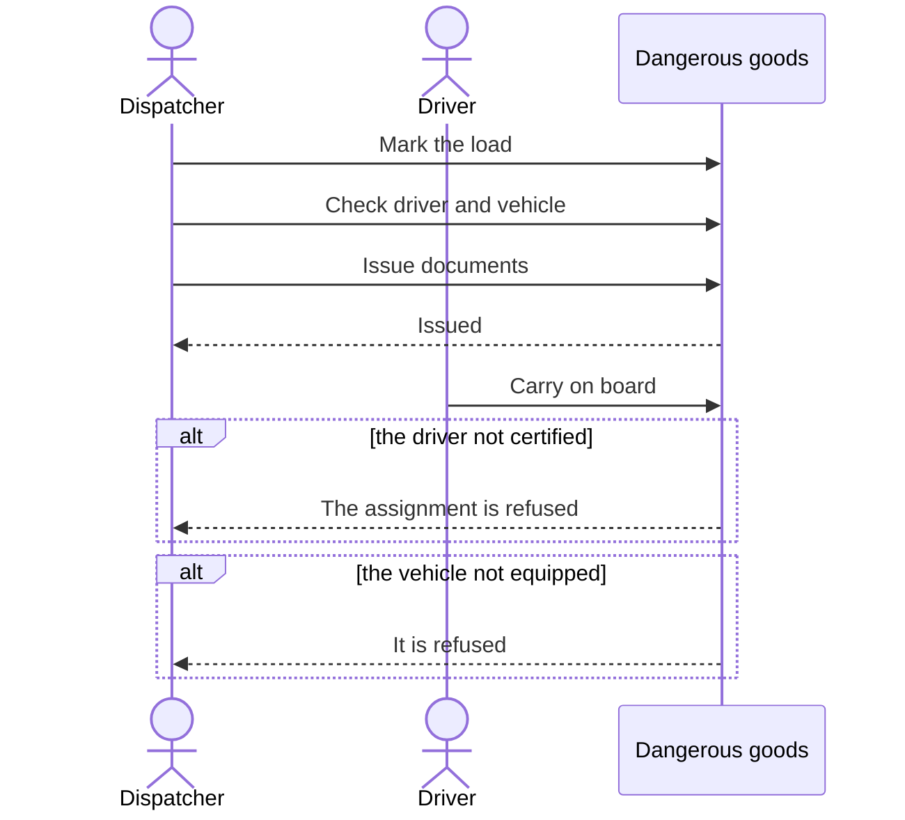

🏠 [Specs](../../../../README.md) › 🏷️ [Sectors](../../../README.md) ›
🚛 [SC07 Transport and logistics](../../README.md) › 📝 [Use cases](../README.md) ›
📝 [Use cases: FL-SC07-04 Compliance](README.md) › 📝 UC-SC07-09 Handle dangerous goods

# 📝 UC-SC07-09 Handle dangerous goods

**Status:** ✅ specified

## Summary

The dispatcher marks a load as dangerous goods, checks the driver's training and the vehicle's equipment, and issues the
documents.

## Personas

- [U29 Dispatcher](../../../../01-users/personas/u29-dispatcher.md)
- [U30 Driver](../../../../01-users/personas/u30-driver.md)

## Goal

Dangerous goods carried legally.

## Trigger

An order with dangerous goods.

## Frequency

Weekly.

## Preconditions

- The SC07 sector pack is installed for the company,
  [UC-F14-02](../../../../02-functional/f14-plugin-store/use-cases/01-find-and-install/uc-f14-02-install-a-plugin-or-sector-pack.md),
  and its users have their roles,
  [UC-F1-06](../../../../02-functional/f01-administration/use-cases/04-edit-a-role/uc-f01-06-edit-a-role-and-its-record-rules.md).

## Postconditions

- **Success:** documents are issued and the trip can start.
- **Failed:** the trip is blocked.

## Main flow

1. The dispatcher records class and quantity on
   [S-SC07-09 Dangerous goods](../../screens/04-compliance/s-sc07-09-dangerous-goods.md).
2. SimpleERP checks training and equipment ([BR-SC07-09](../../business-rules/br-sc07-09-dangerous-goods-checked.md)).
3. The declaration is issued.
4. The driver has it on the phone and on paper.

## Alternative flows

- 1a. Limited quantities: lighter rules apply and are shown.

## Error flows

- 2e. The driver not certified: the assignment is refused.
- 2f. The vehicle not equipped: it is refused.
- Any step: a call to a service or an outside system fails: it is retried first
  ([BR-F3-32](../../../../02-functional/f03-assistant/business-rules/br-f03-32-retry-before-an-error.md)), then the
  error message pattern ([D122](../../../../06-decisions/ux/d122-error-message-standard.md)) says what failed; what was
  typed is kept.

## Business rules

- [BR-SC07-09 Dangerous goods checked](../../business-rules/br-sc07-09-dangerous-goods-checked.md)

## Entities

- [E-SC07-09 Dangerous goods declaration](../../data/e-sc07-09-dangerous-goods-declaration.md)

## Permissions

The dispatcher and driver roles; the record rules of their role and site apply,
[UC-F1-06](../../../../02-functional/f01-administration/use-cases/04-edit-a-role/uc-f01-06-edit-a-role-and-its-record-rules.md).

## Notifications

None beyond the in-app updates of the records concerned.

## Audit events

Every creation, change and state change of dangerous goods declaration records, with who, when and the values before and
after (T3).

## AI involvement

The AI assistant answers questions on the dangerous goods declaration records of this use case, with links, and prepares
them as drafts the user confirms. It works within the user's rights,
[BR-F3-34](../../../../02-functional/f03-assistant/business-rules/br-f03-34-every-capability-is-reachable-from-the-assistant.md),
and never deletes or does anything irreversible without the user's confirmation,
[BR-F3-07](../../../../02-functional/f03-assistant/business-rules/br-f03-07-no-deletes-no-irreversible-acts.md).

## API, MCP and A2A exposure

Through the API and webhooks (T5) and the MCP and A2A gateway (T6), with the caller's rights,
[BR-F3-34](../../../../02-functional/f03-assistant/business-rules/br-f03-34-every-capability-is-reachable-from-the-assistant.md),
reading, creating and changing the records of this use case; nothing irreversible without a person's confirmation.

## Screens

- [S-SC07-09 Dangerous goods](../../screens/04-compliance/s-sc07-09-dangerous-goods.md)

## Flowchart

See [FL-SC07-04 Compliance](../../flows/fl-sc07-04-compliance.md#flowchart).

## Sequence diagram

## Acceptance criteria

1. **Given** the example transport company's CN-4471 with 800 l of class 3 **when** a trained driver is assigned
   **then** the declaration is issued.
2. **Given** class 3, 800 l, with a driver without training **when** he is assigned **then** the assignment is refused.

## Non-functional notes

[D408](../../../../06-decisions/technical/d408-performance-and-profiles.md)'s targets
([performance](../../../../05-non-functional/performance.md)): 95 % of screens within 1 second; lists paged on the
server, the first page within 1 second; reports within 5 seconds or in the background. WCAG 2.2 AA and RGAA
([D46](../../../../06-decisions/ux/d46-accessibility-standard.md)).

## Regulatory references

Legal values from the France country pack:
[CR-FR-121 Dangerous goods (ADR)](../../../../10-country-packs/france/transport/cr-fr-121-dangerous-goods.md).

## Related use cases

- [UC-SC07-05 Issue consignment notes, paper or e-CMR](../03-on-the-road/uc-sc07-05-issue-consignment-notes-paper-or-e-cmr.md)

## Open questions

None.

---

⬅️ [UC-SC07-08](uc-sc07-08-import-tachograph-data-and-check-driving-times.md) · ⬆️ [Up](README.md) ·
➡️ [UC-SC07-10 Manage fuel cards and tolls](../05-billing-and-performance/uc-sc07-10-manage-fuel-cards-and-tolls.md)
