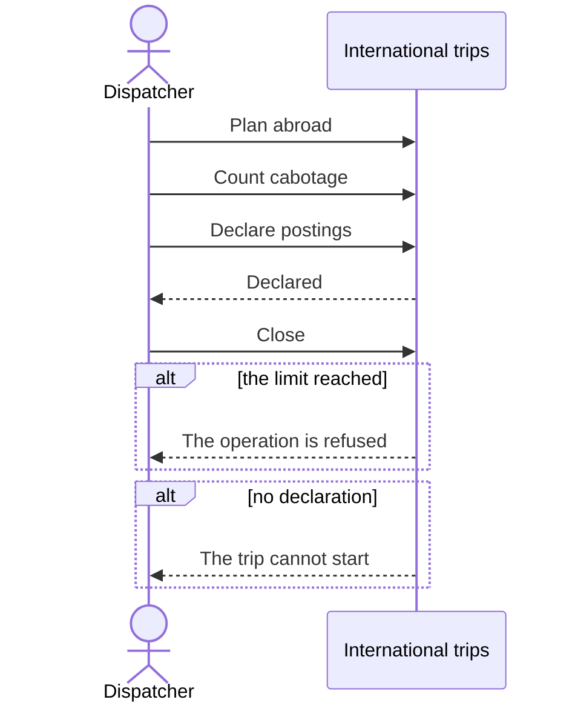

🏠 [Specs](../../../../README.md) › 🏷️ [Sectors](../../../README.md) ›
🚛 [SC07 Transport and logistics](../../README.md) › 📝 [Use cases](../README.md) ›
📝 [Use cases: FL-SC07-04 Compliance](README.md) › 📝 UC-SC07-19 Follow cabotage and international trips

# 📝 UC-SC07-19 Follow cabotage and international trips

**Status:** ✅ specified

## Summary

The dispatcher plans trips abroad, counts cabotage operations against their limits and declares posted drivers.

## Personas

- [U29 Dispatcher](../../../../01-users/personas/u29-dispatcher.md)

## Goal

International work within its limits.

## Trigger

A trip abroad.

## Frequency

Weekly.

## Preconditions

- The SC07 sector pack is installed for the company,
  [UC-F14-02](../../../../02-functional/f14-plugin-store/use-cases/01-find-and-install/uc-f14-02-install-a-plugin-or-sector-pack.md),
  and its users have their roles,
  [UC-F1-06](../../../../02-functional/f01-administration/use-cases/04-edit-a-role/uc-f01-06-edit-a-role-and-its-record-rules.md).

## Postconditions

- **Success:** cabotage is counted and postings declared.
- **Failed:** the operation is refused.

## Main flow

1. The dispatcher plans the trip on
   [S-SC07-19 International trips](../../screens/04-compliance/s-sc07-19-international-trips.md).
2. SimpleERP counts operations ([BR-SC07-15](../../business-rules/br-sc07-15-cabotage-counted.md)).
3. The dispatcher records the posting declaration.
4. The count resets as the rules say.

## Alternative flows

- 1a. Combined transport: the road legs are counted apart.

## Error flows

- 2e. The limit reached: the operation is refused.
- 3e. No declaration: the trip cannot start.
- Any step: a call to a service or an outside system fails: it is retried first
  ([BR-F3-32](../../../../02-functional/f03-assistant/business-rules/br-f03-32-retry-before-an-error.md)), then the
  error message pattern ([D122](../../../../06-decisions/ux/d122-error-message-standard.md)) says what failed; what was
  typed is kept.

## Business rules

- [BR-SC07-15 Cabotage counted](../../business-rules/br-sc07-15-cabotage-counted.md)

## Entities

- [E-SC07-02 Trip](../../data/e-sc07-02-trip.md)
- [E-SC07-15 Cabotage operation](../../data/e-sc07-15-cabotage-operation.md)

## Permissions

The dispatcher roles; the record rules of their role and site apply,
[UC-F1-06](../../../../02-functional/f01-administration/use-cases/04-edit-a-role/uc-f01-06-edit-a-role-and-its-record-rules.md).

## Notifications

None beyond the in-app updates of the records concerned.

## Audit events

Every creation, change and state change of trip, cabotage operation records, with who, when and the values before and
after (T3).

## AI involvement

The AI assistant answers questions on the trip, cabotage operation records of this use case, with links, and prepares
them as drafts the user confirms. It works within the user's rights,
[BR-F3-34](../../../../02-functional/f03-assistant/business-rules/br-f03-34-every-capability-is-reachable-from-the-assistant.md),
and never deletes or does anything irreversible without the user's confirmation,
[BR-F3-07](../../../../02-functional/f03-assistant/business-rules/br-f03-07-no-deletes-no-irreversible-acts.md).

## API, MCP and A2A exposure

Through the API and webhooks (T5) and the MCP and A2A gateway (T6), with the caller's rights,
[BR-F3-34](../../../../02-functional/f03-assistant/business-rules/br-f03-34-every-capability-is-reachable-from-the-assistant.md),
reading, creating and changing the records of this use case; nothing irreversible without a person's confirmation.

## Screens

- [S-SC07-19 International trips](../../screens/04-compliance/s-sc07-19-international-trips.md)

## Flowchart

See [FL-SC07-04 Compliance](../../flows/fl-sc07-04-compliance.md#flowchart).

## Sequence diagram

## Acceptance criteria

1. **Given** the example transport company's T-882 in Germany on 14 November with declaration DE-77 **when** it is
   planned **then** the operation is counted.
2. **Given** a fourth operation in Germany **when** T-882 is planned **then** the operation is refused.

## Non-functional notes

[D408](../../../../06-decisions/technical/d408-performance-and-profiles.md)'s targets
([performance](../../../../05-non-functional/performance.md)): 95 % of screens within 1 second; lists paged on the
server, the first page within 1 second; reports within 5 seconds or in the background. WCAG 2.2 AA and RGAA
([D46](../../../../06-decisions/ux/d46-accessibility-standard.md)).

## Regulatory references

Legal values from the France country pack:
[CR-FR-122 Cabotage limits](../../../../10-country-packs/france/transport/cr-fr-122-cabotage-limits.md).

## Related use cases

- [UC-SC07-02 Plan trips and optimise routes](../01-orders-and-planning/uc-sc07-02-plan-trips-and-optimise-routes.md)

## Open questions

None.

---

⬅️ [UC-SC07-18 Follow cost and margin](../05-billing-and-performance/uc-sc07-18-follow-cost-and-margin.md) ·
⬆️ [Up](README.md) · ➡️ [UC-SC07-20](../01-orders-and-planning/uc-sc07-20-ask-the-assistant-about-the-fleet.md)
