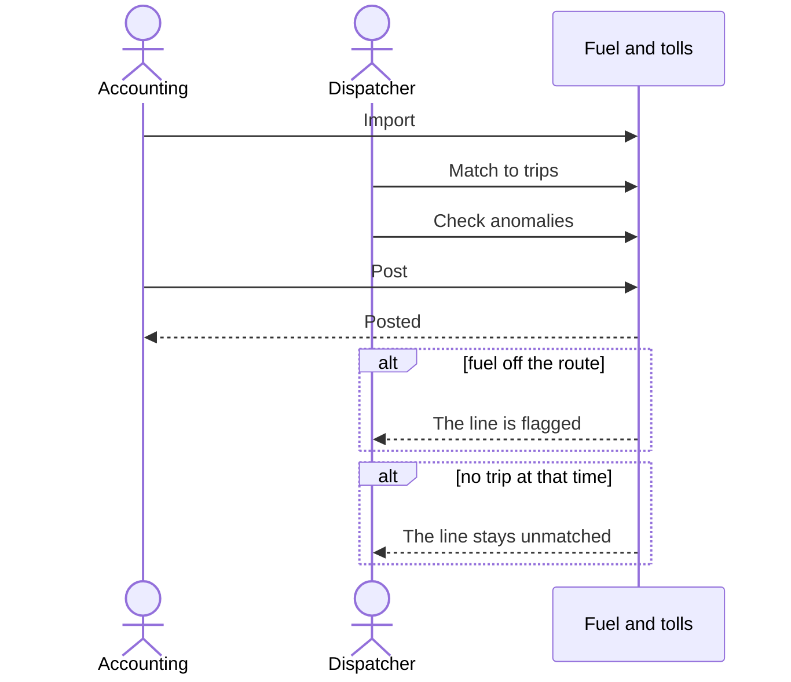

🏠 [Specs](../../../../README.md) › 🏷️ [Sectors](../../../README.md) ›
🚛 [SC07 Transport and logistics](../../README.md) › 📝 [Use cases](../README.md) ›
📝 [Use cases: FL-SC07-05 Billing and performance](README.md) › 📝 UC-SC07-10 Manage fuel cards and tolls

# 📝 UC-SC07-10 Manage fuel cards and tolls

**Status:** ✅ specified

## Summary

The dispatcher and accounting import fuel card and toll lines, match them to vehicles and trips and check anomalies.

## Personas

- [U29 Dispatcher](../../../../01-users/personas/u29-dispatcher.md)
- [U05 Accounting](../../../../01-users/personas/u05-accounting.md)

## Goal

Fuel and tolls charged to the right trip.

## Trigger

The issuers' files.

## Frequency

Weekly.

## Preconditions

- The SC07 sector pack is installed for the company,
  [UC-F14-02](../../../../02-functional/f14-plugin-store/use-cases/01-find-and-install/uc-f14-02-install-a-plugin-or-sector-pack.md),
  and its users have their roles,
  [UC-F1-06](../../../../02-functional/f01-administration/use-cases/04-edit-a-role/uc-f01-06-edit-a-role-and-its-record-rules.md).

## Postconditions

- **Success:** lines are matched and posted.
- **Failed:** unmatched lines stay to check.

## Main flow

1. Accounting imports the files on
   [S-SC07-10 Fuel and tolls](../../screens/05-billing-and-performance/s-sc07-10-fuel-and-tolls.md) (T12).
2. Lines are matched by vehicle and time.
3. The dispatcher checks flagged lines.
4. Accounting posts them,
   [UC-F8-02](../../../../02-functional/f08-accounting/use-cases/01-set-up-and-post/uc-f08-02-post-and-review-entries.md).

## Alternative flows

- 1a. A card lost: it is blocked and lines after are flagged.

## Error flows

- 3e. Fuel off the route: the line is flagged.
- 2e. No trip at that time: the line stays unmatched.
- Any step: a call to a service or an outside system fails: it is retried first
  ([BR-F3-32](../../../../02-functional/f03-assistant/business-rules/br-f03-32-retry-before-an-error.md)), then the
  error message pattern ([D122](../../../../06-decisions/ux/d122-error-message-standard.md)) says what failed; what was
  typed is kept.

## Business rules

- [BR-SC07-01 Transport follows the country pack](../../business-rules/br-sc07-01-transport-follows-the-country-pack.md)
- [BR-F8-12 Spend follows card and approval limits](../../../../02-functional/f08-accounting/business-rules/br-f08-12-spend-follows-limits.md)

## Entities

- [E-SC07-10 Fuel and toll line](../../data/e-sc07-10-fuel-and-toll-line.md)

## Permissions

The dispatcher and accounting roles; the record rules of their role and site apply,
[UC-F1-06](../../../../02-functional/f01-administration/use-cases/04-edit-a-role/uc-f01-06-edit-a-role-and-its-record-rules.md).

## Notifications

None beyond the in-app updates of the records concerned.

## Audit events

Every creation, change and state change of fuel and toll line records, with who, when and the values before and after
(T3).

## AI involvement

The AI assistant answers questions on the fuel and toll line records of this use case, with links, and prepares them as
drafts the user confirms. It works within the user's rights,
[BR-F3-34](../../../../02-functional/f03-assistant/business-rules/br-f03-34-every-capability-is-reachable-from-the-assistant.md),
and never deletes or does anything irreversible without the user's confirmation,
[BR-F3-07](../../../../02-functional/f03-assistant/business-rules/br-f03-07-no-deletes-no-irreversible-acts.md).

## API, MCP and A2A exposure

Through the API and webhooks (T5) and the MCP and A2A gateway (T6), with the caller's rights,
[BR-F3-34](../../../../02-functional/f03-assistant/business-rules/br-f03-34-every-capability-is-reachable-from-the-assistant.md),
reading, creating and changing the records of this use case; nothing irreversible without a person's confirmation.

## Screens

- [S-SC07-10 Fuel and tolls](../../screens/05-billing-and-performance/s-sc07-10-fuel-and-tolls.md)

## Flowchart

See [FL-SC07-05 Billing and performance](../../flows/fl-sc07-05-billing-and-performance.md#flowchart).

## Sequence diagram

## Acceptance criteria

1. **Given** the example transport company's AB-123 fuel of 312.40 EUR on 12 November **when** it is imported **then**
   it is matched to T-881.
2. **Given** 312.40 EUR at a station 80 km off T-881 **when** it is matched **then** the line is flagged.

## Non-functional notes

[D408](../../../../06-decisions/technical/d408-performance-and-profiles.md)'s targets
([performance](../../../../05-non-functional/performance.md)): 95 % of screens within 1 second; lists paged on the
server, the first page within 1 second; reports within 5 seconds or in the background. WCAG 2.2 AA and RGAA
([D46](../../../../06-decisions/ux/d46-accessibility-standard.md)).

## Regulatory references

None specific to this use case; the sector's legal rules are listed in [SC07 regulatory](../../regulatory.md).

## Related use cases

- [UC-SC07-18 Follow cost and margin](uc-sc07-18-follow-cost-and-margin.md)

## Open questions

None.

---

⬅️ [UC-SC07-09 Handle dangerous goods](../04-compliance/uc-sc07-09-handle-dangerous-goods.md) · ⬆️ [Up](README.md) ·
➡️ [UC-SC07-11](../02-fleet-and-drivers/uc-sc07-11-maintain-vehicles-and-their-inspections.md)
