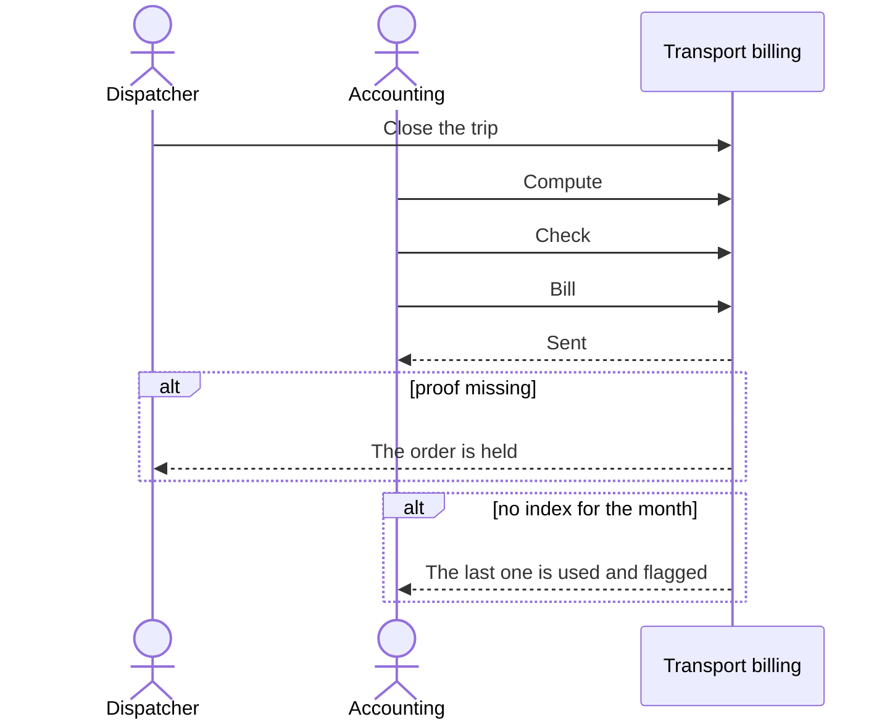

🏠 [Specs](../../../../README.md) › 🏷️ [Sectors](../../../README.md) ›
🚛 [SC07 Transport and logistics](../../README.md) › 📝 [Use cases](../README.md) ›
📝 [Use cases: FL-SC07-05 Billing and performance](README.md) › 📝 UC-SC07-13 Bill transport with surcharges

# 📝 UC-SC07-13 Bill transport with surcharges

**Status:** ✅ specified

## Summary

Accounting closes the trip and bills freight, fuel surcharge from the index, waiting time and extras.

## Personas

- [U05 Accounting](../../../../01-users/personas/u05-accounting.md)
- [U29 Dispatcher](../../../../01-users/personas/u29-dispatcher.md)

## Goal

Every transport billed with its surcharges.

## Trigger

A delivered trip, or month end.

## Frequency

Daily or monthly.

## Preconditions

- The SC07 sector pack is installed for the company,
  [UC-F14-02](../../../../02-functional/f14-plugin-store/use-cases/01-find-and-install/uc-f14-02-install-a-plugin-or-sector-pack.md),
  and its users have their roles,
  [UC-F1-06](../../../../02-functional/f01-administration/use-cases/04-edit-a-role/uc-f01-06-edit-a-role-and-its-record-rules.md).

## Postconditions

- **Success:** the invoice is sent.
- **Failed:** the order is held.

## Main flow

1. The dispatcher closes the trip on
   [S-SC07-13 Transport billing](../../screens/05-billing-and-performance/s-sc07-13-transport-billing.md).
2. SimpleERP computes freight, fuel surcharge
   ([BR-SC07-12](../../business-rules/br-sc07-12-fuel-surcharge-from-the-index.md)) and waiting time
   ([BR-SC07-07](../../business-rules/br-sc07-07-waiting-time-recorded.md)).
3. Accounting checks the lines.
4. Accounting sends the invoice with the CO2 figure ([UC-SC07-17](uc-sc07-17-inform-clients-of-co2-per-transport.md)).

## Alternative flows

- 4a. A monthly invoice per client: orders are grouped.

## Error flows

- 1e. Proof missing: the order is held.
- 2e. No index for the month: the last one is used and flagged.
- Any step: a call to a service or an outside system fails: it is retried first
  ([BR-F3-32](../../../../02-functional/f03-assistant/business-rules/br-f03-32-retry-before-an-error.md)), then the
  error message pattern ([D122](../../../../06-decisions/ux/d122-error-message-standard.md)) says what failed; what was
  typed is kept.

## Business rules

- [BR-SC07-12 Fuel surcharge from the index](../../business-rules/br-sc07-12-fuel-surcharge-from-the-index.md)
- [BR-SC07-07 Waiting time recorded](../../business-rules/br-sc07-07-waiting-time-recorded.md)

## Entities

- [E-SC07-13 Transport invoice line](../../data/e-sc07-13-transport-invoice-line.md)

## Permissions

The accounting and dispatcher roles; the record rules of their role and site apply,
[UC-F1-06](../../../../02-functional/f01-administration/use-cases/04-edit-a-role/uc-f01-06-edit-a-role-and-its-record-rules.md).

## Notifications

None beyond the in-app updates of the records concerned.

## Audit events

Every creation, change and state change of transport invoice line records, with who, when and the values before and
after (T3).

## AI involvement

The AI assistant answers questions on the transport invoice line records of this use case, with links, and prepares them
as drafts the user confirms. It works within the user's rights,
[BR-F3-34](../../../../02-functional/f03-assistant/business-rules/br-f03-34-every-capability-is-reachable-from-the-assistant.md),
and never deletes or does anything irreversible without the user's confirmation,
[BR-F3-07](../../../../02-functional/f03-assistant/business-rules/br-f03-07-no-deletes-no-irreversible-acts.md).

## API, MCP and A2A exposure

Through the API and webhooks (T5) and the MCP and A2A gateway (T6), with the caller's rights,
[BR-F3-34](../../../../02-functional/f03-assistant/business-rules/br-f03-34-every-capability-is-reachable-from-the-assistant.md),
reading, creating and changing the records of this use case; nothing irreversible without a person's confirmation.

## Screens

- [S-SC07-13 Transport billing](../../screens/05-billing-and-performance/s-sc07-13-transport-billing.md)

## Flowchart

See [FL-SC07-05 Billing and performance](../../flows/fl-sc07-05-billing-and-performance.md#flowchart).

## Sequence diagram

## Acceptance criteria

1. **Given** the example transport company's CN-4471 with a fuel surcharge of 38.20 EUR **when** it is billed **then**
   the invoice shows 38.20 EUR fuel surcharge apart.
2. **Given** CN-4471 without proof **when** billing runs **then** the order is held.

## Non-functional notes

[D408](../../../../06-decisions/technical/d408-performance-and-profiles.md)'s targets
([performance](../../../../05-non-functional/performance.md)): 95 % of screens within 1 second; lists paged on the
server, the first page within 1 second; reports within 5 seconds or in the background. WCAG 2.2 AA and RGAA
([D46](../../../../06-decisions/ux/d46-accessibility-standard.md)).

## Regulatory references

Legal values from the France country pack:
[CR-FR-123 Fuel price indexation](../../../../10-country-packs/france/transport/cr-fr-123-fuel-indexation.md).

## Related use cases

- [UC-SC07-17 Inform clients of CO2 per transport](uc-sc07-17-inform-clients-of-co2-per-transport.md)

## Open questions

None.

---

⬅️ [UC-SC07-12 Subcontract to other carriers](../01-orders-and-planning/uc-sc07-12-subcontract-to-other-carriers.md) ·
⬆️ [Up](README.md) · ➡️ [UC-SC07-14](../06-logistics-for-clients/uc-sc07-14-run-warehouse-logistics-for-clients.md)
