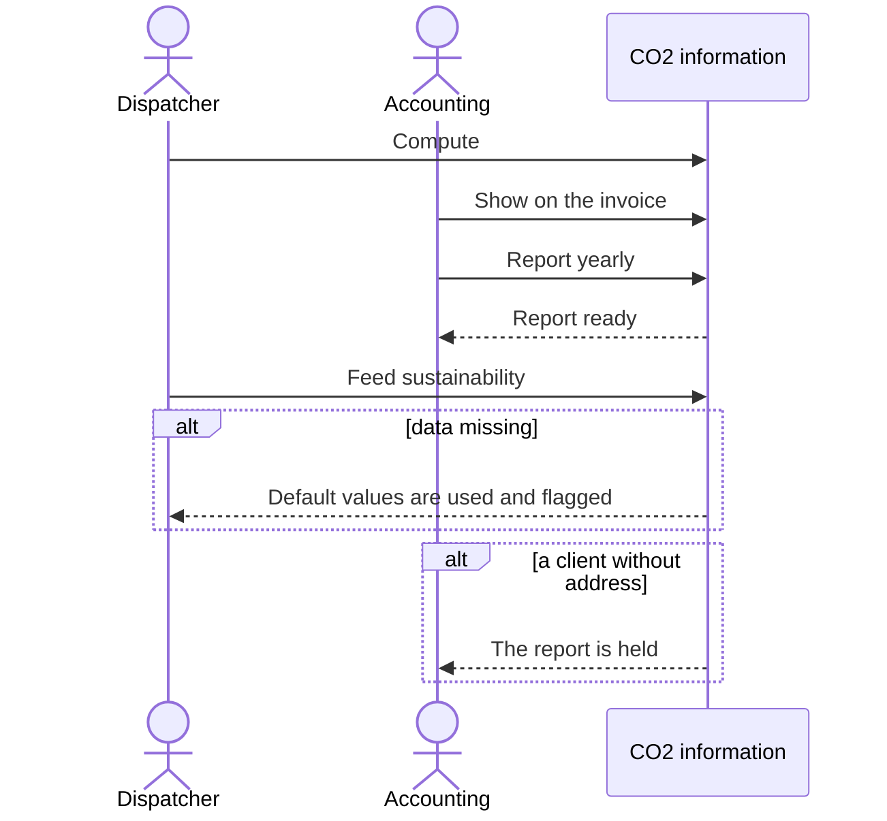

🏠 [Specs](../../../../README.md) › 🏷️ [Sectors](../../../README.md) ›
🚛 [SC07 Transport and logistics](../../README.md) › 📝 [Use cases](../README.md) ›
📝 [Use cases: FL-SC07-05 Billing and performance](README.md) › 📝 UC-SC07-17 Inform clients of CO2 per transport

# 📝 UC-SC07-17 Inform clients of CO2 per transport

**Status:** ✅ specified

## Summary

Simple-ERP computes each transport's emissions, shows them on the invoice and reports them yearly.

## Personas

- [U29 Dispatcher](../../../../01-users/personas/u29-dispatcher.md)
- [U05 Accounting](../../../../01-users/personas/u05-accounting.md)

## Goal

Clients informed of each transport's CO2.

## Trigger

A transport is billed.

## Frequency

Per transport; yearly report.

## Preconditions

- The SC07 sector pack is installed for the company,
  [UC-F14-02](../../../../02-functional/f14-plugin-store/use-cases/01-find-and-install/uc-f14-02-install-a-plugin-or-sector-pack.md),
  and its users have their roles,
  [UC-F1-06](../../../../02-functional/f01-administration/use-cases/04-edit-a-role/uc-f01-06-edit-a-role-and-its-record-rules.md).

## Postconditions

- **Success:** the figure is on the invoice and in the yearly report.
- **Failed:** default values are used and flagged.

## Main flow

1. Simple-ERP computes emissions on
   [S-SC07-17 CO2 information](../../screens/05-billing-and-performance/s-sc07-17-co2-information.md) from fuel and
   distance ([BR-SC07-14](../../business-rules/br-sc07-14-co2-shown-per-transport.md)).
2. The figure goes on the invoice.
3. The yearly report is made per client.
4. Figures go to the sustainability report,
   [UC-F8-28](../../../../02-functional/f08-accounting/use-cases/09-pay-analyse-and-report/uc-f08-28-prepare-the-sustainability-report.md).

## Alternative flows

- 1a. The client's own method: the client's method is used and named.

## Error flows

- 1e. Data missing: default values are used and flagged.
- 3e. A client without address: the report is held.
- Any step: a call to a service or an outside system fails: it is retried first
  ([BR-F3-32](../../../../02-functional/f03-assistant/business-rules/br-f03-32-retry-before-an-error.md)), then the
  error message pattern ([D122](../../../../06-decisions/ux/d122-error-message-standard.md)) says what failed; what was
  typed is kept.

## Business rules

- [BR-SC07-14 CO2 shown per transport](../../business-rules/br-sc07-14-co2-shown-per-transport.md)

## Entities

- [E-SC07-13 Transport invoice line](../../data/e-sc07-13-transport-invoice-line.md)
- [E-SC07-17 Transport CO2 statement](../../data/e-sc07-17-transport-co2-statement.md)

## Permissions

The dispatcher and accounting roles; the record rules of their role and site apply,
[UC-F1-06](../../../../02-functional/f01-administration/use-cases/04-edit-a-role/uc-f01-06-edit-a-role-and-its-record-rules.md).

## Notifications

None beyond the in-app updates of the records concerned.

## Audit events

Every creation, change and state change of transport invoice line records, with who, when and the values before and
after (T3).

## AI involvement

The AI assistant answers questions on the transport invoice line records of this use case, with links, and prepares them
as drafts the user confirms. It works within the user's rights,
[BR-F3-34](../../../../02-functional/f03-assistant/business-rules/br-f03-34-every-capability-is-reachable-from-the-assistant.md),
and never deletes or does anything irreversible without the user's confirmation,
[BR-F3-07](../../../../02-functional/f03-assistant/business-rules/br-f03-07-no-deletes-no-irreversible-acts.md).

## API, MCP and A2A exposure

Through the API and webhooks (T5) and the MCP and A2A gateway (T6), with the caller's rights,
[BR-F3-34](../../../../02-functional/f03-assistant/business-rules/br-f03-34-every-capability-is-reachable-from-the-assistant.md),
reading, creating and changing the records of this use case; nothing irreversible without a person's confirmation.

## Screens

- [S-SC07-17 CO2 information](../../screens/05-billing-and-performance/s-sc07-17-co2-information.md)

## Flowchart

See [FL-SC07-05 Billing and performance](../../flows/fl-sc07-05-billing-and-performance.md#flowchart).

## Sequence diagram

## Acceptance criteria

1. **Given** the example transport company's CN-4471 **when** emissions are computed **then** 412 kg of CO2 shows on the
   invoice.
2. **Given** a chartered trip with no fuel data **when** emissions are computed **then** default values are used and
   flagged.

## Non-functional notes

[D408](../../../../06-decisions/technical/d408-performance-and-profiles.md)'s targets
([performance](../../../../05-non-functional/performance.md)): 95 % of screens within 1 second; lists paged on the
server, the first page within 1 second; reports within 5 seconds or in the background. WCAG 2.2 AA and RGAA
([D46](../../../../06-decisions/ux/d46-accessibility-standard.md)).

## Regulatory references

Legal values from the France country pack:
[CR-FR-120 CO2 information to clients](../../../../10-country-packs/france/transport/cr-fr-120-co2-information.md).

## Related use cases

- [UC-SC07-13 Bill transport with surcharges](uc-sc07-13-bill-transport-with-surcharges.md)

## Open questions

None.

---

⬅️ [UC-SC07-16](../06-logistics-for-clients/uc-sc07-16-give-clients-tracking-and-documents-in-the-portal.md) ·
⬆️ [Up](README.md) · ➡️ [UC-SC07-18 Follow cost and margin](uc-sc07-18-follow-cost-and-margin.md)
