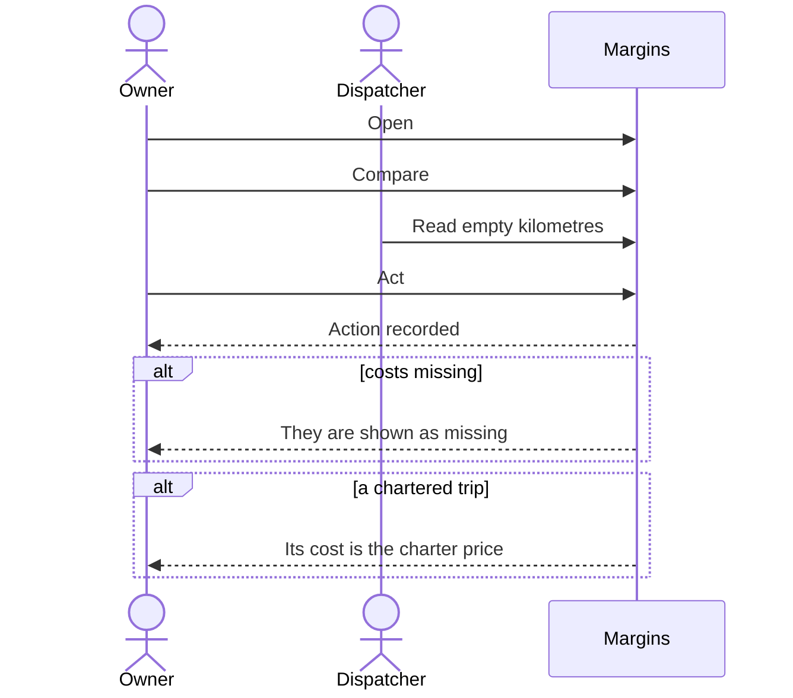

🏠 [Specs](../../../../README.md) › 🏷️ [Sectors](../../../README.md) ›
🚛 [SC07 Transport and logistics](../../README.md) › 📝 [Use cases](../README.md) ›
📝 [Use cases: FL-SC07-05 Billing and performance](README.md) › 📝 UC-SC07-18 Follow cost and margin

# 📝 UC-SC07-18 Follow cost and margin

**Status:** ✅ specified

## Summary

The owner and the dispatcher follow cost and margin per trip, vehicle, driver and client.

## Personas

- [U13 Owner](../../../../01-users/personas/u13-owner.md)
- [U29 Dispatcher](../../../../01-users/personas/u29-dispatcher.md)

## Goal

Know which trips and clients pay.

## Trigger

Weekly review.

## Frequency

Weekly.

## Preconditions

- The SC07 sector pack is installed for the company,
  [UC-F14-02](../../../../02-functional/f14-plugin-store/use-cases/01-find-and-install/uc-f14-02-install-a-plugin-or-sector-pack.md),
  and its users have their roles,
  [UC-F1-06](../../../../02-functional/f01-administration/use-cases/04-edit-a-role/uc-f01-06-edit-a-role-and-its-record-rules.md).

## Postconditions

- **Success:** margins are read and acted on.
- **Failed:** missing costs are shown.

## Main flow

1. The owner opens [S-SC07-18 Margins](../../screens/05-billing-and-performance/s-sc07-18-margins.md).
2. The owner compares clients and vehicles,
   [UC-F8-20](../../../../02-functional/f08-accounting/use-cases/06-benchmark-additions/uc-f08-20-analyse-profitability.md).
3. The dispatcher reads empty kilometres per trip.
4. The owner reprices a lane.

## Alternative flows

- 3a. A lane with high empty kilometres: back loads are searched.

## Error flows

- 1e. Costs missing: they are shown as missing.
- 2e. A chartered trip: its cost is the charter price.
- Any step: a call to a service or an outside system fails: it is retried first
  ([BR-F3-32](../../../../02-functional/f03-assistant/business-rules/br-f03-32-retry-before-an-error.md)), then the
  error message pattern ([D122](../../../../06-decisions/ux/d122-error-message-standard.md)) says what failed; what was
  typed is kept.

## Business rules

- [BR-SC07-01 Transport follows the country pack](../../business-rules/br-sc07-01-transport-follows-the-country-pack.md)

## Entities

- [E-SC07-02 Trip](../../data/e-sc07-02-trip.md)
- [E-SC07-13 Transport invoice line](../../data/e-sc07-13-transport-invoice-line.md)

## Permissions

The owner and dispatcher roles; the record rules of their role and site apply,
[UC-F1-06](../../../../02-functional/f01-administration/use-cases/04-edit-a-role/uc-f01-06-edit-a-role-and-its-record-rules.md).

## Notifications

None beyond the in-app updates of the records concerned.

## Audit events

Every creation, change and state change of trip, transport invoice line records, with who, when and the values before
and after (T3).

## AI involvement

The AI assistant answers questions on the trip, transport invoice line records of this use case, with links, and
prepares them as drafts the user confirms. It works within the user's rights,
[BR-F3-34](../../../../02-functional/f03-assistant/business-rules/br-f03-34-every-capability-is-reachable-from-the-assistant.md),
and never deletes or does anything irreversible without the user's confirmation,
[BR-F3-07](../../../../02-functional/f03-assistant/business-rules/br-f03-07-no-deletes-no-irreversible-acts.md).

## API, MCP and A2A exposure

Through the API and webhooks (T5) and the MCP and A2A gateway (T6), with the caller's rights,
[BR-F3-34](../../../../02-functional/f03-assistant/business-rules/br-f03-34-every-capability-is-reachable-from-the-assistant.md),
reading, creating and changing the records of this use case; nothing irreversible without a person's confirmation.

## Screens

- [S-SC07-18 Margins](../../screens/05-billing-and-performance/s-sc07-18-margins.md)

## Flowchart

See [FL-SC07-05 Billing and performance](../../flows/fl-sc07-05-billing-and-performance.md#flowchart).

## Sequence diagram

## Acceptance criteria

1. **Given** the example transport company's T-881 with 610 km and 80 km empty **when** it is read **then** empty
   kilometres show 13 %.
2. **Given** a trip without fuel lines **when** it is read **then** they are shown as missing.

## Non-functional notes

[D408](../../../../06-decisions/technical/d408-performance-and-profiles.md)'s targets
([performance](../../../../05-non-functional/performance.md)): 95 % of screens within 1 second; lists paged on the
server, the first page within 1 second; reports within 5 seconds or in the background. WCAG 2.2 AA and RGAA
([D46](../../../../06-decisions/ux/d46-accessibility-standard.md)).

## Regulatory references

None specific to this use case; the sector's legal rules are listed in [SC07 regulatory](../../regulatory.md).

## Related use cases

- [UC-SC07-10 Manage fuel cards and tolls](uc-sc07-10-manage-fuel-cards-and-tolls.md)

## Open questions

None.

---

⬅️ [UC-SC07-17 Inform clients of CO2 per transport](uc-sc07-17-inform-clients-of-co2-per-transport.md) ·
⬆️ [Up](README.md) · ➡️ [UC-SC07-19](../04-compliance/uc-sc07-19-follow-cabotage-and-international-trips.md)
