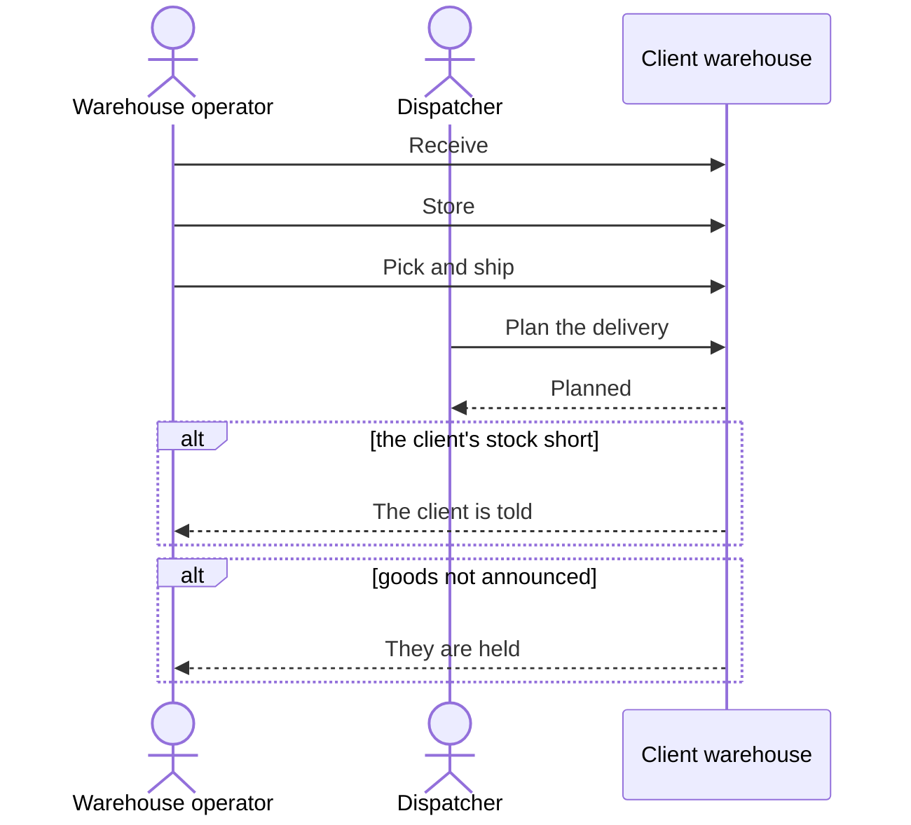

🏠 [Specs](../../../../README.md) › 🏷️ [Sectors](../../../README.md) ›
🚛 [SC07 Transport and logistics](../../README.md) › 📝 [Use cases](../README.md) ›
📝 [Use cases: FL-SC07-06 Logistics for clients](README.md) › 📝 UC-SC07-14 Run warehouse logistics for clients

# 📝 UC-SC07-14 Run warehouse logistics for clients

**Status:** ✅ specified

## Summary

The warehouse operator receives, stores and picks clients' goods; the client's stock is kept apart.

## Personas

- [U15 Warehouse operator](../../../../01-users/personas/u15-warehouse-operator.md)
- [U29 Dispatcher](../../../../01-users/personas/u29-dispatcher.md)

## Goal

Clients' goods stored and shipped as asked.

## Trigger

A client's receipt or order.

## Frequency

Daily.

## Preconditions

- The SC07 sector pack is installed for the company,
  [UC-F14-02](../../../../02-functional/f14-plugin-store/use-cases/01-find-and-install/uc-f14-02-install-a-plugin-or-sector-pack.md),
  and its users have their roles,
  [UC-F1-06](../../../../02-functional/f01-administration/use-cases/04-edit-a-role/uc-f01-06-edit-a-role-and-its-record-rules.md).

## Postconditions

- **Success:** the goods are stored or shipped.
- **Failed:** the client is told of a shortage.

## Main flow

1. The warehouse operator receives on
   [S-SC07-14 Client warehouse](../../screens/06-logistics-for-clients/s-sc07-14-client-warehouse.md),
   [UC-F7-03](../../../../02-functional/f07-purchasing-and-stock/use-cases/02-receive-and-store/uc-f07-03-receive-goods.md).
2. The operator stores by location.
3. The operator picks the client's order,
   [UC-F7-06](../../../../02-functional/f07-purchasing-and-stock/use-cases/04-pick-pack-and-ship/uc-f07-06-pick-pack-and-ship.md).
4. The dispatcher plans its transport.

## Alternative flows

- 3a. Kitting for a client: items are assembled as asked.

## Error flows

- 3e. The client's stock short: the client is told.
- 1e. Goods not announced: they are held.
- Any step: a call to a service or an outside system fails: it is retried first
  ([BR-F3-32](../../../../02-functional/f03-assistant/business-rules/br-f03-32-retry-before-an-error.md)), then the
  error message pattern ([D122](../../../../06-decisions/ux/d122-error-message-standard.md)) says what failed; what was
  typed is kept.

## Business rules

- [BR-SC07-13 Storage billed by the contract](../../business-rules/br-sc07-13-storage-billed-by-the-contract.md)
- [BR-F7-01 Purchases approved by amount and budget](../../../../02-functional/f07-purchasing-and-stock/business-rules/br-f07-01-purchases-approved-by-amount-and-budget.md)

## Entities

- [E-SC07-14 Client stock](../../data/e-sc07-14-client-stock.md)

## Permissions

The warehouse operator and dispatcher roles; the record rules of their role and site apply,
[UC-F1-06](../../../../02-functional/f01-administration/use-cases/04-edit-a-role/uc-f01-06-edit-a-role-and-its-record-rules.md).

## Notifications

None beyond the in-app updates of the records concerned.

## Audit events

Every creation, change and state change of client stock records, with who, when and the values before and after (T3).

## AI involvement

The AI assistant answers questions on the client stock records of this use case, with links, and prepares them as drafts
the user confirms. It works within the user's rights,
[BR-F3-34](../../../../02-functional/f03-assistant/business-rules/br-f03-34-every-capability-is-reachable-from-the-assistant.md),
and never deletes or does anything irreversible without the user's confirmation,
[BR-F3-07](../../../../02-functional/f03-assistant/business-rules/br-f03-07-no-deletes-no-irreversible-acts.md).

## API, MCP and A2A exposure

Through the API and webhooks (T5) and the MCP and A2A gateway (T6), with the caller's rights,
[BR-F3-34](../../../../02-functional/f03-assistant/business-rules/br-f03-34-every-capability-is-reachable-from-the-assistant.md),
reading, creating and changing the records of this use case; nothing irreversible without a person's confirmation.

## Screens

- [S-SC07-14 Client warehouse](../../screens/06-logistics-for-clients/s-sc07-14-client-warehouse.md)

## Flowchart

See [FL-SC07-06 Logistics for clients](../../flows/fl-sc07-06-logistics-for-clients.md#flowchart).

## Sequence diagram

## Acceptance criteria

1. **Given** the example transport company's 40 pallets of Acme's box B2 in A-12 since 1 November **when** 10 are picked
   **then** 30 remain in A-12.
2. **Given** Acme's box B2 with 40 pallets and 50 asked **when** the order is picked **then** the client is told.

## Non-functional notes

[D408](../../../../06-decisions/technical/d408-performance-and-profiles.md)'s targets
([performance](../../../../05-non-functional/performance.md)): 95 % of screens within 1 second; lists paged on the
server, the first page within 1 second; reports within 5 seconds or in the background. WCAG 2.2 AA and RGAA
([D46](../../../../06-decisions/ux/d46-accessibility-standard.md)).

## Regulatory references

None specific to this use case; the sector's legal rules are listed in [SC07 regulatory](../../regulatory.md).

## Related use cases

- [UC-SC07-15 Bill storage and handling](uc-sc07-15-bill-storage-and-handling.md)

## Open questions

None.

---

⬅️ [UC-SC07-13](../05-billing-and-performance/uc-sc07-13-bill-transport-with-surcharges.md) · ⬆️ [Up](README.md) ·
➡️ [UC-SC07-15 Bill storage and handling](uc-sc07-15-bill-storage-and-handling.md)
