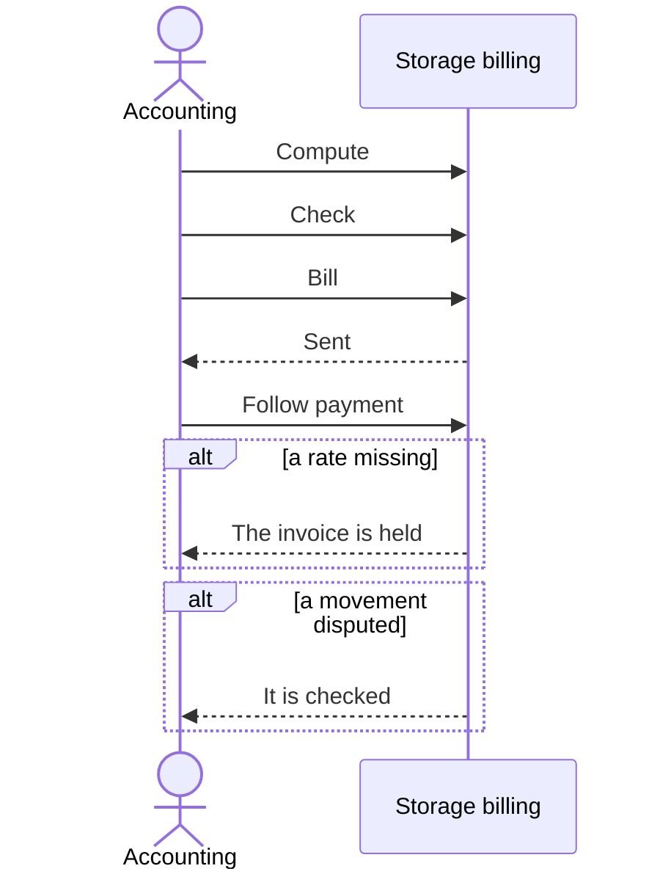

🏠 [Specs](../../../../README.md) › 🏷️ [Sectors](../../../README.md) ›
🚛 [SC07 Transport and logistics](../../README.md) › 📝 [Use cases](../README.md) ›
📝 [Use cases: FL-SC07-06 Logistics for clients](README.md) › 📝 UC-SC07-15 Bill storage and handling

# 📝 UC-SC07-15 Bill storage and handling

**Status:** ✅ specified

## Summary

Accounting computes pallet-days and movements per client from the warehouse's records and bills them per the contract.

## Personas

- [U05 Accounting](../../../../01-users/personas/u05-accounting.md)

## Goal

Storage billed from real records.

## Trigger

Month end.

## Frequency

Monthly.

## Preconditions

- The SC07 sector pack is installed for the company,
  [UC-F14-02](../../../../02-functional/f14-plugin-store/use-cases/01-find-and-install/uc-f14-02-install-a-plugin-or-sector-pack.md),
  and its users have their roles,
  [UC-F1-06](../../../../02-functional/f01-administration/use-cases/04-edit-a-role/uc-f01-06-edit-a-role-and-its-record-rules.md).

## Postconditions

- **Success:** the invoice is sent.
- **Failed:** the invoice is held.

## Main flow

1. SimpleERP computes pallet-days and movements on
   [S-SC07-15 Storage billing](../../screens/06-logistics-for-clients/s-sc07-15-storage-billing.md).
2. Accounting checks with the warehouse.
3. Accounting bills per the contract ([BR-SC07-13](../../business-rules/br-sc07-13-storage-billed-by-the-contract.md)).
4. Accounting follows the payment,
   [UC-F6-08](../../../../02-functional/f06-customers-and-sales/use-cases/03-invoice-and-get-paid/uc-f06-08-remind-late-payers.md).

## Alternative flows

- 3a. A minimum monthly fee: the minimum is billed if higher.

## Error flows

- 1e. A rate missing: the invoice is held.
- 2e. A movement disputed: it is checked.
- Any step: a call to a service or an outside system fails: it is retried first
  ([BR-F3-32](../../../../02-functional/f03-assistant/business-rules/br-f03-32-retry-before-an-error.md)), then the
  error message pattern ([D122](../../../../06-decisions/ux/d122-error-message-standard.md)) says what failed; what was
  typed is kept.

## Business rules

- [BR-SC07-13 Storage billed by the contract](../../business-rules/br-sc07-13-storage-billed-by-the-contract.md)

## Entities

- [E-SC07-13 Transport invoice line](../../data/e-sc07-13-transport-invoice-line.md)
- [E-SC07-14 Client stock](../../data/e-sc07-14-client-stock.md)

## Permissions

The accounting roles; the record rules of their role and site apply,
[UC-F1-06](../../../../02-functional/f01-administration/use-cases/04-edit-a-role/uc-f01-06-edit-a-role-and-its-record-rules.md).

## Notifications

None beyond the in-app updates of the records concerned.

## Audit events

Every creation, change and state change of transport invoice line, client stock records, with who, when and the values
before and after (T3).

## AI involvement

The AI assistant answers questions on the transport invoice line, client stock records of this use case, with links, and
prepares them as drafts the user confirms. It works within the user's rights,
[BR-F3-34](../../../../02-functional/f03-assistant/business-rules/br-f03-34-every-capability-is-reachable-from-the-assistant.md),
and never deletes or does anything irreversible without the user's confirmation,
[BR-F3-07](../../../../02-functional/f03-assistant/business-rules/br-f03-07-no-deletes-no-irreversible-acts.md).

## API, MCP and A2A exposure

Through the API and webhooks (T5) and the MCP and A2A gateway (T6), with the caller's rights,
[BR-F3-34](../../../../02-functional/f03-assistant/business-rules/br-f03-34-every-capability-is-reachable-from-the-assistant.md),
reading, creating and changing the records of this use case; nothing irreversible without a person's confirmation.

## Screens

- [S-SC07-15 Storage billing](../../screens/06-logistics-for-clients/s-sc07-15-storage-billing.md)

## Flowchart

See [FL-SC07-06 Logistics for clients](../../flows/fl-sc07-06-logistics-for-clients.md#flowchart).

## Sequence diagram

## Acceptance criteria

1. **Given** the example transport company's Acme with 40 pallets for 30 days **when** November is billed **then** 1,200
   pallet-days are billed.
2. **Given** Acme's handling rate missing **when** the month is billed **then** the invoice is held.

## Non-functional notes

[D408](../../../../06-decisions/technical/d408-performance-and-profiles.md)'s targets
([performance](../../../../05-non-functional/performance.md)): 95 % of screens within 1 second; lists paged on the
server, the first page within 1 second; reports within 5 seconds or in the background. WCAG 2.2 AA and RGAA
([D46](../../../../06-decisions/ux/d46-accessibility-standard.md)).

## Regulatory references

None specific to this use case; the sector's legal rules are listed in [SC07 regulatory](../../regulatory.md).

## Related use cases

- [UC-SC07-14 Run warehouse logistics for clients](uc-sc07-14-run-warehouse-logistics-for-clients.md)

## Open questions

None.

---

⬅️ [UC-SC07-14 Run warehouse logistics for clients](uc-sc07-14-run-warehouse-logistics-for-clients.md) ·
⬆️ [Up](README.md) · ➡️ [UC-SC07-16](uc-sc07-16-give-clients-tracking-and-documents-in-the-portal.md)
