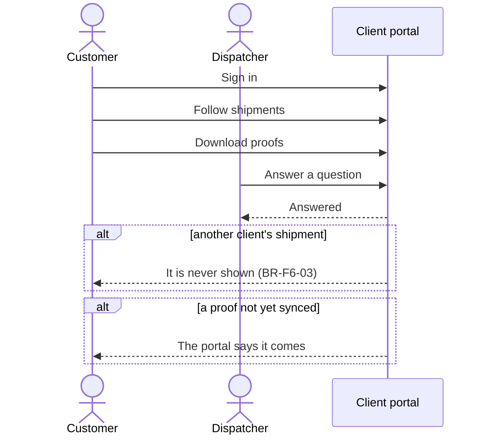

🏠 [Specs](../../../../README.md) › 🏷️ [Sectors](../../../README.md) ›
🚛 [SC07 Transport and logistics](../../README.md) › 📝 [Use cases](../README.md) ›
📝 [Use cases: FL-SC07-06 Logistics for clients](README.md) ›
📝 UC-SC07-16 Give clients tracking and documents in the portal

# 📝 UC-SC07-16 Give clients tracking and documents in the portal

**Status:** ✅ specified

## Summary

Clients sign in to the portal to follow shipments, see ETAs and download proofs and invoices.

## Personas

- [U09 Customer](../../../../01-users/personas/u09-customer.md)
- [U29 Dispatcher](../../../../01-users/personas/u29-dispatcher.md)

## Goal

Clients informed without calling.

## Trigger

A client wants news.

## Frequency

Daily.

## Preconditions

- The SC07 sector pack is installed for the company,
  [UC-F14-02](../../../../02-functional/f14-plugin-store/use-cases/01-find-and-install/uc-f14-02-install-a-plugin-or-sector-pack.md),
  and its users have their roles,
  [UC-F1-06](../../../../02-functional/f01-administration/use-cases/04-edit-a-role/uc-f01-06-edit-a-role-and-its-record-rules.md).

## Postconditions

- **Success:** the client sees their shipments and documents.
- **Failed:** the client sees nothing of others.

## Main flow

1. The client signs in on [S-SC07-16 Client portal](../../screens/06-logistics-for-clients/s-sc07-16-client-portal.md),
   [UC-F6-11](../../../../02-functional/f06-customers-and-sales/use-cases/02-quote-to-order/uc-f06-11-use-the-customer-portal.md).
2. The client sees status and ETA.
3. The client downloads proofs and invoices.
4. The dispatcher answers a client's message.

## Alternative flows

- 1a. A tracking link without login: the consignee follows one shipment by link.

## Error flows

- 2e. Another client's shipment: it is never shown,
  [BR-F6-03](../../../../02-functional/f06-customers-and-sales/business-rules/br-f06-03-portal-shows-only-the-customer-s-own.md).
- 3e. A proof not yet synced: the portal says it comes.
- Any step: a call to a service or an outside system fails: it is retried first
  ([BR-F3-32](../../../../02-functional/f03-assistant/business-rules/br-f03-32-retry-before-an-error.md)), then the
  error message pattern ([D122](../../../../06-decisions/ux/d122-error-message-standard.md)) says what failed; what was
  typed is kept.

## Business rules

- [BR-SC07-06 Proof of delivery closes the stop](../../business-rules/br-sc07-06-proof-of-delivery-closes-the-stop.md)
- [BR-F6-03 The portal shows only the customer's own](../../../../02-functional/f06-customers-and-sales/business-rules/br-f06-03-portal-shows-only-the-customer-s-own.md)

## Entities

- [E-SC07-06 Stop](../../data/e-sc07-06-stop.md)
- [E-SC07-05 Consignment note](../../data/e-sc07-05-consignment-note.md)

## Permissions

The customer and dispatcher roles; the record rules of their role and site apply,
[UC-F1-06](../../../../02-functional/f01-administration/use-cases/04-edit-a-role/uc-f01-06-edit-a-role-and-its-record-rules.md).

## Notifications

None beyond the in-app updates of the records concerned.

## Audit events

Every creation, change and state change of stop, consignment note records, with who, when and the values before and
after (T3).

## AI involvement

The AI assistant answers questions on the stop, consignment note records of this use case, with links, and prepares them
as drafts the user confirms. It works within the user's rights,
[BR-F3-34](../../../../02-functional/f03-assistant/business-rules/br-f03-34-every-capability-is-reachable-from-the-assistant.md),
and never deletes or does anything irreversible without the user's confirmation,
[BR-F3-07](../../../../02-functional/f03-assistant/business-rules/br-f03-07-no-deletes-no-irreversible-acts.md).

## API, MCP and A2A exposure

Through the API and webhooks (T5) and the MCP and A2A gateway (T6), with the caller's rights,
[BR-F3-34](../../../../02-functional/f03-assistant/business-rules/br-f03-34-every-capability-is-reachable-from-the-assistant.md),
reading, creating and changing the records of this use case; nothing irreversible without a person's confirmation.

## Screens

- [S-SC07-16 Client portal](../../screens/06-logistics-for-clients/s-sc07-16-client-portal.md)

## Flowchart

See [FL-SC07-06 Logistics for clients](../../flows/fl-sc07-06-logistics-for-clients.md#flowchart).

## Sequence diagram

## Acceptance criteria

1. **Given** the example transport company's Acme user **when** he opens CN-4471 **then** he sees its proof of delivery.
2. **Given** Acme's user **when** he opens a shipment of another client **then** it is never shown,
   [BR-F6-03](../../../../02-functional/f06-customers-and-sales/business-rules/br-f06-03-portal-shows-only-the-customer-s-own.md).

## Non-functional notes

[D408](../../../../06-decisions/technical/d408-performance-and-profiles.md)'s targets
([performance](../../../../05-non-functional/performance.md)): 95 % of screens within 1 second; lists paged on the
server, the first page within 1 second; reports within 5 seconds or in the background. WCAG 2.2 AA and RGAA
([D46](../../../../06-decisions/ux/d46-accessibility-standard.md)).

## Regulatory references

None specific to this use case; the sector's legal rules are listed in [SC07 regulatory](../../regulatory.md).

## Related use cases

- [UC-SC07-07 Collect proofs of delivery and report incidents](../03-on-the-road/uc-sc07-07-collect-proofs-of-delivery-and-report-incidents.md)

## Open questions

None.

---

⬅️ [UC-SC07-15 Bill storage and handling](uc-sc07-15-bill-storage-and-handling.md) · ⬆️ [Up](README.md) ·
➡️ [UC-SC07-17](../05-billing-and-performance/uc-sc07-17-inform-clients-of-co2-per-transport.md)
