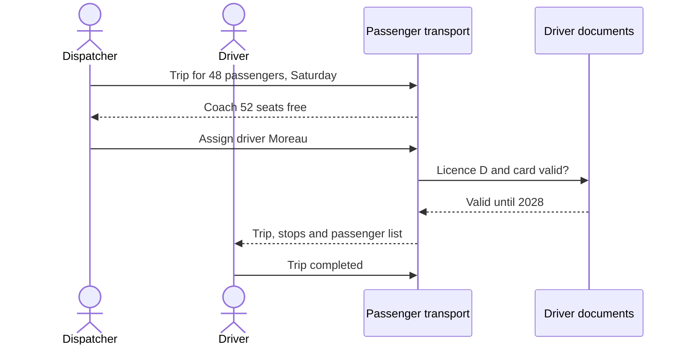

🏠 [Specs](../../../../README.md) › 🏷️ [Sectors](../../../README.md) ›
🚛 [SC07 Transport and logistics](../../README.md) › 📝 [Use cases](../README.md) ›
📝 [Use cases: FL-SC07-07 Passengers, removals, courier and freight](README.md) › 📝 UC-SC07-21 Run passenger transport

# 📝 UC-SC07-21 Run passenger transport

**Status:** ✅ specified, ⚖️ lawyer review before launch (D574)

## Summary

A coach, minibus or taxi company carries people, not goods: transfers, school runs, excursions and private hire. The
dispatcher plans each passenger trip with its vehicle and driver, checking that the driver holds the licence for the
vehicle's class, and the driver follows the trip on the phone with the passenger list.

## Personas

- [U29 Dispatcher](../../../../01-users/personas/u29-dispatcher.md)
- [U30 Driver](../../../../01-users/personas/u30-driver.md)

## Goal

Every passenger trip is driven by a driver whose licence and professional card cover the vehicle, with the right number
of seats and the passengers' list, and is billed as agreed.

## Trigger

A customer books a transfer or a group trip, or the dispatcher assigns a driver to a trip.

## Frequency

Dozens of trips a day for a coach company, with peaks at the start and end of school terms.

## Preconditions

- The vehicles have their class and seats ([E-SC07-03 Fleet vehicle](../../data/e-sc07-03-fleet-vehicle.md)).
- The drivers' licences and professional cards are recorded
  ([E-SC07-04 Driver document](../../data/e-sc07-04-driver-document.md)).
- The customer or the organiser is a record
  ([E-F6-01](../../../../02-functional/f06-customers-and-sales/data/e-f06-01-customer-record.md)) with an accepted quote
  ([E-F6-03 Quote](../../../../02-functional/f06-customers-and-sales/data/e-f06-03-quote.md)).

## Postconditions

- **Succeeded:** the trip is saved ([E-SC07-18 Passenger trip](../../data/e-sc07-18-passenger-trip.md)) with its
  vehicle, driver, passenger count and route, and its invoice line follows the quote.
- **Failed:** no driver is assigned without the licence class and the trip stays Planned with the missing document
  named.

## Main flow

1. The dispatcher opens the passenger screen
   ([S-SC07-21](../../screens/07-passengers-removals-courier-and-freight/s-sc07-21-passenger-transport.md)) and creates
   the trip: date, pick-up and drop-off places, the number of passengers and the vehicle class needed.
2. SimpleERP proposes the free vehicles with enough seats and the free drivers.
3. The dispatcher chooses a driver; SimpleERP checks that the driver holds the licence category and the professional
   card for the vehicle's class
   ([BR-SC07-16](../../business-rules/br-sc07-16-drivers-hold-the-licence-for-the-vehicle-class.md)).
4. The driver sees the trip on the phone ([UC-SC07-06](../03-on-the-road/uc-sc07-06-drive-with-the-phone.md)) with the
   passenger list and the stops.
5. At each stop the driver records the passengers boarded and the incidents
   ([UC-SC07-07](../03-on-the-road/uc-sc07-07-collect-proofs-of-delivery-and-report-incidents.md)).
6. When the trip is completed it is billed according to the quote
   ([UC-SC07-13](../05-billing-and-performance/uc-sc07-13-bill-transport-with-surcharges.md)).

## Alternative flows

- 2a. A group is larger than any vehicle: the dispatcher splits it between two vehicles or subcontracts one
  ([UC-SC07-12](../01-orders-and-planning/uc-sc07-12-subcontract-to-other-carriers.md)).
- 3a. The trip is a regular school run: it is created as a series with its calendar and holidays.
- 5a. A passenger is a minor or has reduced mobility: the list shows it and the vehicle needs the equipment.

## Error flows

- 3e. The driver's licence does not cover the vehicle class: the assignment is refused and the drivers who qualify are
  listed.
- 3f. The driver would exceed the driving or rest time: the assignment is refused
  ([BR-SC07-03](../../business-rules/br-sc07-03-trips-within-driving-times.md)).
- 5e. The passenger count exceeds the seats: the trip cannot start.
- Any step: a service does not answer; the call is retried first
  ([BR-F3-32](../../../../02-functional/f03-assistant/business-rules/br-f03-32-retry-before-an-error.md)), then the
  message follows the error pattern ([D122](../../../../06-decisions/ux/d122-error-message-standard.md)) and what the
  user typed stays on the screen.

## Business rules

- [BR-SC07-16](../../business-rules/br-sc07-16-drivers-hold-the-licence-for-the-vehicle-class.md)
- [BR-SC07-03](../../business-rules/br-sc07-03-trips-within-driving-times.md)
- [BR-SC07-05](../../business-rules/br-sc07-05-drivers-qualified-and-current.md)

## Entities

- [E-SC07-18 Passenger trip](../../data/e-sc07-18-passenger-trip.md): created, changed, completed
- [E-SC07-03 Fleet vehicle](../../data/e-sc07-03-fleet-vehicle.md): read, the vehicle's class and seats
- [E-SC07-04 Driver document](../../data/e-sc07-04-driver-document.md): read, the driver's licence and card
- [E-SC07-13 Transport invoice line](../../data/e-sc07-13-transport-invoice-line.md): created, the invoice line of the
  trip

## Permissions

Dispatcher creates and assigns trips; driver reads their own trips and records stops. The customer sees the
vehicle and the driver's first name on the day of the trip.

## Notifications

The driver, on the phone: a trip is assigned or changed. The dispatcher, in the app: a driver's licence ends within
sixty days.

## Audit events

Each trip created, assigned, changed, started, completed or cancelled, each licence check, who and when.

## AI involvement

No AI step of its own. The AI assistant may open the screen and prefill it from the user's words; the user checks and
confirms
[BR-F3-07](../../../../02-functional/f03-assistant/business-rules/br-f03-07-no-deletes-no-irreversible-acts.md).

## API, MCP and A2A exposure

T5 operations of the capability for the personas above: create, read, update and list. The MCP tool of the
capability may read and propose, never confirm alone. No A2A skill.

## Screens

- [S-SC07-21](../../screens/07-passengers-removals-courier-and-freight/s-sc07-21-passenger-transport.md)

## Flowchart

See
[FL-SC07-07 Passengers, removals, courier and freight](../../flows/fl-sc07-07-passengers-removals-courier-and-freight.md#flowchart).

## Sequence diagram

## Acceptance criteria

1. **Given** a coach of class D and a driver whose licence is category D valid until 2028 **when** the dispatcher
   assigns the driver **then** the assignment is accepted.
2. **Given** a driver whose licence is category B only **when** the dispatcher assigns them to a coach **then** it is
   refused and the drivers who qualify are listed.
3. **Given** a trip for 48 passengers and a vehicle with 40 seats **when** the dispatcher saves it **then** the trip
   cannot start and the seats missing are shown.
4. **Given** a driver's licence that ends in 40 days **when** the dispatcher plans a trip in 60 days **then** the
   assignment is refused for that date.

## Non-functional notes

The screen answers within 2 seconds for 10,000 records; every change is audited.

## Regulatory references

A company carrying passengers for a fee is entered in the national register of road transport and holds the
licence for its activity: coaches, taxis or hired cars with a driver. Each driver holds the licence category for the
vehicle (a bus category above eight passengers) and the professional card or training the activity requires. Driving and
rest times and the tachograph apply to coaches. The France-pack rule is listed below. Related:
[CR-FR-115](../../../../10-country-packs/france/transport/cr-fr-115-haulage-registration.md),
[CR-FR-116](../../../../10-country-packs/france/transport/cr-fr-116-smart-tachograph.md),
[CR-FR-117](../../../../10-country-packs/france/transport/cr-fr-117-driving-and-rest-times.md),
[CR-FR-119](../../../../10-country-packs/france/transport/cr-fr-119-driver-training.md).

- France-pack rule, (⚖️ lawyer review before launch, D574) until the coach, bus and taxi regimes of the Code des transports and the
  driving-licence categories of the Code de la route are read:
  [CR-FR-236 Passenger transport registration and licences](../../../../10-country-packs/france/transport/cr-fr-236-passenger-transport-licences.md)

## Related use cases

- [UC-SC07-22 Quote and run house removals](uc-sc07-22-quote-and-run-house-removals.md)
- [UC-SC07-02](../01-orders-and-planning/uc-sc07-02-plan-trips-and-optimise-routes.md)
- [UC-SC07-04](../02-fleet-and-drivers/uc-sc07-04-manage-drivers-and-their-documents.md)
- [UC-SC07-08](../04-compliance/uc-sc07-08-import-tachograph-data-and-check-driving-times.md)

## Open questions

None.

---

⬅️ [UC-SC07-20](../01-orders-and-planning/uc-sc07-20-ask-the-assistant-about-the-fleet.md) · ⬆️ [Up](README.md) ·
➡️ [UC-SC07-22 Quote and run house removals](uc-sc07-22-quote-and-run-house-removals.md)
