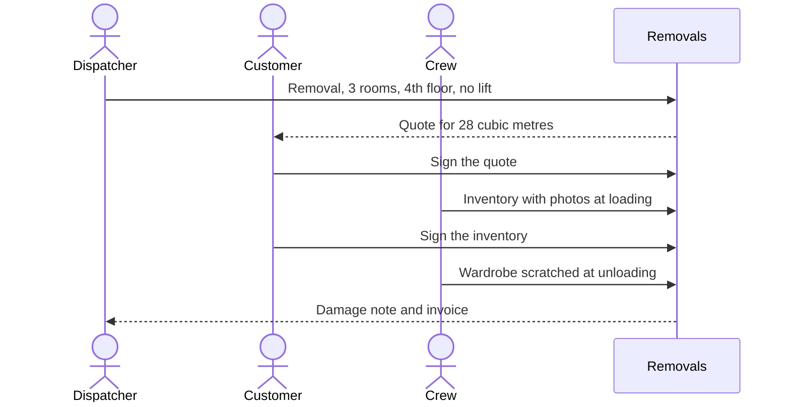

🏠 [Specs](../../../../README.md) › 🏷️ [Sectors](../../../README.md) ›
🚛 [SC07 Transport and logistics](../../README.md) › 📝 [Use cases](../README.md) ›
📝 [Use cases: FL-SC07-07 Passengers, removals, courier and freight](README.md) ›
📝 UC-SC07-22 Quote and run house removals

# 📝 UC-SC07-22 Quote and run house removals

**Status:** ✅ specified

## Summary

A removal company visits or videos the home, measures the volume, quotes the move with its crew, truck, lift and
packing, and holds the customer to a signed quote. On the day the crew lists the furniture and its condition at loading
and at unloading, and any damage is recorded at once with its photo.

## Personas

- [U29 Dispatcher](../../../../01-users/personas/u29-dispatcher.md)
- [U09 Customer](../../../../01-users/personas/u09-customer.md)

## Goal

Every removal has a quote that binds the company and the customer once signed, a list of what was loaded with its
condition, and a damage claim that can be settled from the records.

## Trigger

A customer asks for a quote, signs it, or the day of the move arrives.

## Frequency

A few moves a day, more at the end of the month and in summer.

## Preconditions

- The crew, trucks and lift are resources of the company
  ([E-SC07-03 Fleet vehicle](../../data/e-sc07-03-fleet-vehicle.md)).
- The customer is a record
  ([E-F6-01](../../../../02-functional/f06-customers-and-sales/data/e-f06-01-customer-record.md)).
- The price per cubic metre, per crew-hour and for each service is in the price list
  ([E-F6-08](../../../../02-functional/f06-customers-and-sales/data/e-f06-08-sales-price-list.md)).

## Postconditions

- **Succeeded:** the removal is saved ([E-SC07-19 Removal](../../data/e-sc07-19-removal.md)) with its signed quote, its
  inventory with conditions, its delivery proof and its invoice.
- **Failed:** the quote stays a proposal, nothing binds either party and the missing information is named.

## Main flow

1. The dispatcher opens the removals screen
   ([S-SC07-22](../../screens/07-passengers-removals-courier-and-freight/s-sc07-22-removals.md)) and creates a removal
   with the two addresses, the floors, the access and the date wished.
2. A surveyor measures the volume on a visit or on a video call and lists the rooms and the large items.
3. SimpleERP computes the crew, the truck, the time, the packing material, the insurance and the price, and sends the
   quote to the customer's phone.
4. The customer signs the quote; from then the price binds both parties
   ([BR-SC07-17](../../business-rules/br-sc07-17-the-removal-quote-binds-once-signed.md)).
5. On the day the crew lists the items loaded with their condition and photos on the phone and the customer signs the
   list.
6. At unloading the customer checks the items; damage is noted on the spot and the removal is invoiced
   ([UC-SC07-13](../05-billing-and-performance/uc-sc07-13-bill-transport-with-surcharges.md)).

## Alternative flows

- 3a. The customer asks to add a service (packing, piano, storage) before the signature: the quote is recomputed and
  sent again.
- 6a. The move takes longer than quoted because of a cause on the customer's side (no parking, lift out of order): the
  extra time is billed by the rate the quote states.
- 4a. The customer signs at home away from the office: the withdrawal period is shown. For a move within it, the
  customer's express request to start before the end of the period is recorded on paper or a durable medium, with the
  notice that a customer who then withdraws pays the part already done (Code de la consommation L221-25,
  [CR-FR-276](../../../../10-country-packs/france/transport/cr-fr-276-removal-quotes.md)). No payment or deposit is taken for 7 days from the signature (Code de la consommation L221-10,
  [CR-FR-036](../../../../10-country-packs/france/consumer/cr-fr-036-withdrawal-right.md),
  [D575](../../../../06-decisions/foundations/d575-answers-of-2026-11-27-on-the-last-open-points.md)).

## Error flows

- 4e. The quote is changed after the signature: the change needs a new signature and the old one is kept.
- 6e. The customer refuses to sign the list at unloading: the crew records the refusal with the photos and the
  dispatcher is told.
- 3e. The truck or the crew is not free on the date: the dispatcher proposes other dates.
- Any step: a service does not answer; the call is retried first
  ([BR-F3-32](../../../../02-functional/f03-assistant/business-rules/br-f03-32-retry-before-an-error.md)), then the
  message follows the error pattern ([D122](../../../../06-decisions/ux/d122-error-message-standard.md)) and what the
  user typed stays on the screen.

## Business rules

- [BR-SC07-17](../../business-rules/br-sc07-17-the-removal-quote-binds-once-signed.md)
- [BR-SC07-13](../../business-rules/br-sc07-13-storage-billed-by-the-contract.md)

## Entities

- [E-SC07-19 Removal](../../data/e-sc07-19-removal.md): created, changed, closed
- [E-SC07-03 Fleet vehicle](../../data/e-sc07-03-fleet-vehicle.md): read, the truck and its capacity
- [E-F6-03 Quote](../../../../02-functional/f06-customers-and-sales/data/e-f06-03-quote.md): created, the quote the
  customer signs
- [E-SC07-16 Proof of delivery](../../data/e-sc07-16-proof-of-delivery.md): created, the proof of delivery at unloading

## Permissions

Dispatcher creates and plans removals; surveyor enters the volume; the customer signs and reads their own removal.
The crew sees the list and the access notes, never the prices.

## Notifications

The customer, by email and on the phone: the quote, the day before the move and the invoice. The dispatcher, in the app:
damage is recorded on a move.

## Audit events

Each quote version and signature, each item with its condition and photos, each damage note, each signature at loading
and unloading, who and when.

## AI involvement

No AI step of its own. The AI assistant may open the screen and prefill it from the user's words; the user checks and
confirms
[BR-F3-07](../../../../02-functional/f03-assistant/business-rules/br-f03-07-no-deletes-no-irreversible-acts.md).

## API, MCP and A2A exposure

T5 operations of the capability for the personas above: create, read, update and list. The MCP tool of the
capability may read and propose, never confirm alone. No A2A skill.

## Screens

- [S-SC07-22](../../screens/07-passengers-removals-courier-and-freight/s-sc07-22-removals.md)

## Flowchart

See
[FL-SC07-07 Passengers, removals, courier and freight](../../flows/fl-sc07-07-passengers-removals-courier-and-freight.md#flowchart).

## Sequence diagram

## Acceptance criteria

1. **Given** a signed quote for 28 cubic metres and 3 crew members **when** the move takes the quoted time **then** the
   invoice equals the quote.
2. **Given** a signed quote **when** sales changes the price **then** a new version is created and needs a new
   signature.
3. **Given** a customer who signs at home and wants a move in five days **when** the quote is signed **then** the
   withdrawal period is shown and the customer's express request to start early is asked for, on paper or a durable
   medium.
4. **Given** an item scratched at unloading **when** the crew notes it with a photo **then** the damage is attached to
   the removal and the dispatcher is told.
5. **Given** a customer who signed at home 3 days ago **when** the dispatcher asks for a deposit **then** it is refused,
   and it may be asked from the eighth day after the signature.

## Non-functional notes

The screen answers within 2 seconds for 10,000 records; every change is audited.

## Regulatory references

A removal contract states the price, the date, the volume, the declared value of the goods and the insurance,
and a consumer receives a free written quote before signing, whose price is final unless the quote is expressly
changed. A consumer who signs away from the company's premises pays nothing for 7 days and keeps a period to withdraw;
a move within it starts only on the consumer's express request, and a consumer who then withdraws pays the part already
done. Reserves are written on the delivery note, and the consumer may still object by registered letter within 10
calendar days of reception. The France-pack rule is
[CR-FR-276 Removal quotes and delivery reserves](../../../../10-country-packs/france/transport/cr-fr-276-removal-quotes.md). Related:
[CR-FR-020](../../../../10-country-packs/france/invoicing/cr-fr-020-electronic-acceptance-and-signature.md),
[CR-FR-036](../../../../10-country-packs/france/consumer/cr-fr-036-withdrawal-right.md),
[CR-FR-118](../../../../10-country-packs/france/transport/cr-fr-118-documents-on-board.md).

## Related use cases

- [UC-SC07-21 Run passenger transport](uc-sc07-21-run-passenger-transport.md)
- [UC-SC07-23 Run last-mile rounds](uc-sc07-23-run-last-mile-rounds.md)
- [UC-SC07-01](../01-orders-and-planning/uc-sc07-01-quote-and-take-transport-orders.md)
- [UC-SC07-07](../03-on-the-road/uc-sc07-07-collect-proofs-of-delivery-and-report-incidents.md)
- [UC-F6-04](../../../../02-functional/f06-customers-and-sales/use-cases/02-quote-to-order/uc-f06-04-accept-or-sign-a-quote.md)

## Open questions

None.

---

⬅️ [UC-SC07-21 Run passenger transport](uc-sc07-21-run-passenger-transport.md) · ⬆️ [Up](README.md) ·
➡️ [UC-SC07-23 Run last-mile rounds](uc-sc07-23-run-last-mile-rounds.md)
