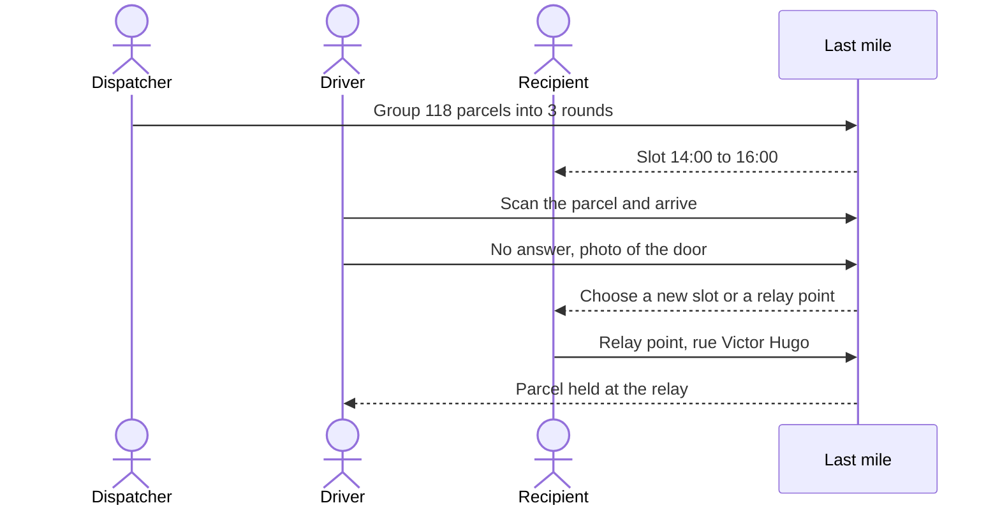

🏠 [Specs](../../../../README.md) › 🏷️ [Sectors](../../../README.md) ›
🚛 [SC07 Transport and logistics](../../README.md) › 📝 [Use cases](../README.md) ›
📝 [Use cases: FL-SC07-07 Passengers, removals, courier and freight](README.md) › 📝 UC-SC07-23 Run last-mile rounds

# 📝 UC-SC07-23 Run last-mile rounds

**Status:** ✅ specified

## Summary

A courier company plans rounds of parcels to homes and businesses. Each parcel has a delivery slot and a proof of
delivery (signature, photo or code). When a delivery fails the customer is offered a new slot or a relay point, and the
parcel is never left without a decision.

## Personas

- [U29 Dispatcher](../../../../01-users/personas/u29-dispatcher.md)
- [U30 Driver](../../../../01-users/personas/u30-driver.md)

## Goal

Every parcel is delivered in its slot or has a next step the customer chose, with a proof for each delivery, and the
driver's day is a short, ordered round.

## Trigger

Parcels arrive at the depot, a round is planned, or a delivery fails.

## Frequency

Hundreds of parcels a day per depot, each driver doing 60 to 150 stops.

## Preconditions

- The parcels are received with their recipient and address ([E-SC07-20 Parcel](../../data/e-sc07-20-parcel.md)).
- The vans and drivers are available ([E-SC07-03 Fleet vehicle](../../data/e-sc07-03-fleet-vehicle.md),
  [E-SC07-04 Driver document](../../data/e-sc07-04-driver-document.md)).
- The relay points of the area are in the settings.

## Postconditions

- **Succeeded:** each parcel is saved ([E-SC07-20 Parcel](../../data/e-sc07-20-parcel.md)) as Delivered with its proof
  ([E-SC07-16 Proof of delivery](../../data/e-sc07-16-proof-of-delivery.md)), or with a new slot or relay point chosen
  by the recipient.
- **Failed:** a failed parcel is held at the depot with its reason and the recipient is told the next step.

## Main flow

1. The dispatcher opens the last-mile screen
   ([S-SC07-23](../../screens/07-passengers-removals-courier-and-freight/s-sc07-23-last-mile.md)) and sees the day's
   parcels by area.
2. simple-ERP groups them in rounds by area and slot, orders the stops and sends each to a driver
   ([UC-SC07-02](../01-orders-and-planning/uc-sc07-02-plan-trips-and-optimise-routes.md)).
3. The recipient receives a message with the slot and a link to follow the van or change the slot.
4. The driver delivers on the phone: scan the parcel, collect the proof
   ([UC-SC07-07](../03-on-the-road/uc-sc07-07-collect-proofs-of-delivery-and-report-incidents.md)).
5. If nobody answers, the driver marks the delivery Failed with a reason and a photo of the door.
6. The recipient is offered a new slot or a relay point
   ([BR-SC07-18](../../business-rules/br-sc07-18-a-failed-delivery-gets-a-new-slot-or-a-relay-point.md)) and the parcel
   follows.

## Alternative flows

- 2a. A parcel must be delivered to the recipient in person (age or identity check): the driver scans the document and
  the proof says so.
- 5a. A neighbour accepts the parcel: the recipient has agreed in advance and the neighbour's name is the proof.
- 6a. The recipient picks the relay point: the parcel is Held there and a code is sent.

## Error flows

- 5e. No answer after the second attempt: the parcel goes to the relay point proposed by default and the recipient is
  told.
- 4e. The scanned parcel is not in the driver's round: the driver is warned before leaving.
- 6e. A parcel stays at the depot or the relay point beyond the holding time: it is returned to the sender and the
  sender is told.
- Any step: a service does not answer; the call is retried first
  ([BR-F3-32](../../../../02-functional/f03-assistant/business-rules/br-f03-32-retry-before-an-error.md)), then the
  message follows the error pattern ([D122](../../../../06-decisions/ux/d122-error-message-standard.md)) and what the
  user typed stays on the screen.

## Business rules

- [BR-SC07-18](../../business-rules/br-sc07-18-a-failed-delivery-gets-a-new-slot-or-a-relay-point.md)
- [BR-SC07-06](../../business-rules/br-sc07-06-proof-of-delivery-closes-the-stop.md)

## Entities

- [E-SC07-20 Parcel](../../data/e-sc07-20-parcel.md): created, changed, delivered
- [E-SC07-16 Proof of delivery](../../data/e-sc07-16-proof-of-delivery.md): created, the proof of each delivery
- [E-SC07-06 Stop](../../data/e-sc07-06-stop.md): created, the stop of the round
- [E-SC07-02 Trip](../../data/e-sc07-02-trip.md): read, the round as a trip

## Permissions

Dispatcher plans rounds and changes parcels; driver scans, delivers and records proofs. The recipient sees
only their parcel and its slot, never the others on the round.

## Notifications

The recipient, by SMS and email: the slot, the van approaching, a failed delivery and the choice of a new slot or a
relay point.

## Audit events

Each parcel scanned, assigned, delivered, failed or held, each proof, each slot or relay choice, who and when.

## AI involvement

No AI step of its own. The AI assistant may open the screen and prefill it from the user's words; the user checks and
confirms
[BR-F3-07](../../../../02-functional/f03-assistant/business-rules/br-f03-07-no-deletes-no-irreversible-acts.md).

## API, MCP and A2A exposure

T5 operations of the capability for the personas above: create, read, update and list. The MCP tool of the
capability may read and propose, never confirm alone. No A2A skill.

## Screens

- [S-SC07-23](../../screens/07-passengers-removals-courier-and-freight/s-sc07-23-last-mile.md)

## Flowchart

See
[FL-SC07-07 Passengers, removals, courier and freight](../../flows/fl-sc07-07-passengers-removals-courier-and-freight.md#flowchart).

## Sequence diagram

## Acceptance criteria

1. **Given** a parcel with a slot of 14:00 to 16:00 **when** the driver delivers at 15:10 with a signature **then** the
   parcel is Delivered with its proof.
2. **Given** a first failed attempt **when** the driver marks it Failed **then** the recipient receives the choice of a
   new slot or a relay point.
3. **Given** a second failed attempt and no choice from the recipient **when** the day ends **then** the parcel goes to
   the default relay point and the recipient is told.
4. **Given** a parcel left at the relay point for the holding time **when** the delay ends **then** it is returned to
   the sender.

## Non-functional notes

The screen answers within 2 seconds for 10,000 records; every change is audited.

## Regulatory references

A parcel bought by a consumer online is delivered within the date the seller stated or at most thirty days
after the order. The proof of delivery (signature, photo or code) is personal data kept for the time needed to settle a
claim. Real-time location of the van is shown to the recipient only on the day. The France-pack rule is written later.
Related: [CR-FR-066](../../../../10-country-packs/france/consumer/cr-fr-066-delivery-within-30-days.md),
[CR-FR-052](../../../../10-country-packs/france/data-protection/cr-fr-052-storage-limitation.md),
[CR-FR-054](../../../../10-country-packs/france/data-protection/cr-fr-054-location-with-consent.md).

## Related use cases

- [UC-SC07-22 Quote and run house removals](uc-sc07-22-quote-and-run-house-removals.md)
- [UC-SC07-24 Forward freight and clear customs](uc-sc07-24-forward-freight-and-clear-customs.md)
- [UC-SC07-02](../01-orders-and-planning/uc-sc07-02-plan-trips-and-optimise-routes.md)
- [UC-SC07-07](../03-on-the-road/uc-sc07-07-collect-proofs-of-delivery-and-report-incidents.md)
- [UC-F7-06](../../../../02-functional/f07-purchasing-and-stock/use-cases/04-pick-pack-and-ship/uc-f07-06-pick-pack-and-ship.md)

## Open questions

None.

---

⬅️ [UC-SC07-22 Quote and run house removals](uc-sc07-22-quote-and-run-house-removals.md) · ⬆️ [Up](README.md) ·
➡️ [UC-SC07-24 Forward freight and clear customs](uc-sc07-24-forward-freight-and-clear-customs.md)
