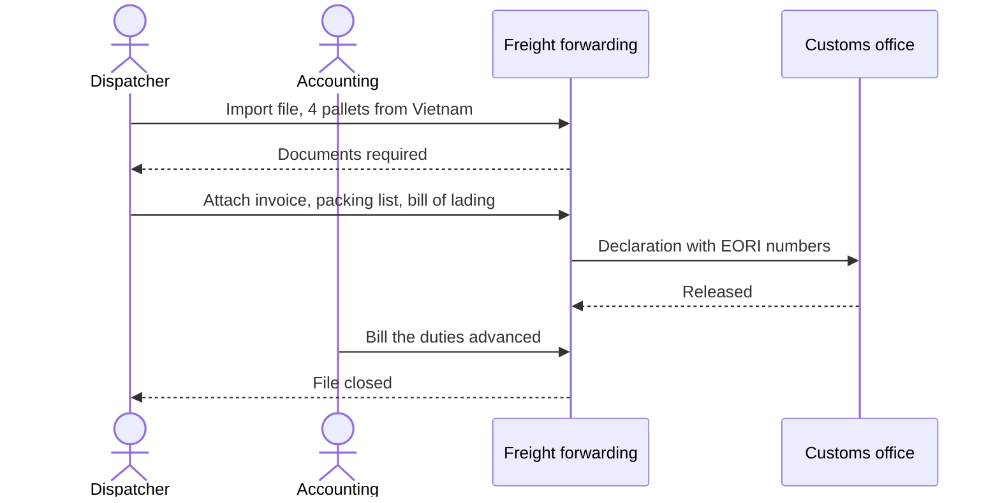

🏠 [Specs](../../../../README.md) › 🏷️ [Sectors](../../../README.md) ›
🚛 [SC07 Transport and logistics](../../README.md) › 📝 [Use cases](../README.md) ›
📝 [Use cases: FL-SC07-07 Passengers, removals, courier and freight](README.md) ›
📝 UC-SC07-24 Forward freight and clear customs

# 📝 UC-SC07-24 Forward freight and clear customs

**Status:** ✅ specified

## Summary

A freight forwarder organises a shipment for a customer from one country to another, books the carriers, prepares the
customs declaration with the documents of the sale and the transport, pays or defers the duties and VAT, and bills the
customer with the costs it advanced. Every customs entry carries the EORI number of the parties.

## Personas

- [U29 Dispatcher](../../../../01-users/personas/u29-dispatcher.md)
- [U05 Accounting](../../../../01-users/personas/u05-accounting.md)

## Goal

Every shipment is cleared with a complete file, the right party's EORI number and the duties and VAT known before the
goods move, and the customer is billed what was paid.

## Trigger

A customer asks for an import or an export, a document is received, or customs asks a question.

## Frequency

Dozens of files a week for a forwarder, each with 5 to 15 documents.

## Preconditions

- The customer is a record with its EORI number
  ([E-F6-01](../../../../02-functional/f06-customers-and-sales/data/e-f06-01-customer-record.md),
  [E-F6-24](../../../../02-functional/f06-customers-and-sales/data/e-f06-24-company-identifier.md)).
- The carriers and their rates are known ([E-SC07-12 Charter](../../data/e-sc07-12-charter.md)).
- The tariff and the duty rates of the country pack are loaded.

## Postconditions

- **Succeeded:** the file is saved ([E-SC07-21 Shipment file](../../data/e-sc07-21-shipment-file.md)) with its
  documents, declaration, duties and carrier legs, and the customer's invoice shows the costs advanced.
- **Failed:** the declaration is not lodged, the goods do not leave or enter and the missing document or number is
  named.

## Main flow

1. The dispatcher opens the forwarding screen
   ([S-SC07-24](../../screens/07-passengers-removals-courier-and-freight/s-sc07-24-freight-forwarding.md)) and creates a
   file for an import or an export with the parties, the goods, the incoterm and the places.
2. SimpleERP lists the documents required: commercial invoice, packing list, transport document, certificate of origin
   when needed.
3. The dispatcher attaches the documents and the carrier legs are booked
   ([UC-SC07-12](../01-orders-and-planning/uc-sc07-12-subcontract-to-other-carriers.md)).
4. SimpleERP prepares the customs declaration with the tariff code of each line and the EORI number of the declarant
   and of the consignor or consignee
   ([BR-SC07-19](../../business-rules/br-sc07-19-customs-entries-carry-the-eori-number.md)).
5. Accounting checks the duties and the VAT and the dispatcher lodges the declaration.
6. When the goods are cleared and delivered, accounting bills the customer with the carriage, the duties advanced and
   the forwarder's fee
   [UC-F6-06](../../../../02-functional/f06-customers-and-sales/use-cases/03-invoice-and-get-paid/uc-f06-06-invoice-deposits-progress-and-final.md).

## Alternative flows

- 4a. The goods go to another EU country: no customs duty applies and the file holds the VAT and the trade statistics
  instead.
- 5a. The forwarder defers the VAT on imports on the monthly return when the customer's authorisation allows it: the VAT
  is not advanced.
- 3a. The goods are in transit under a customs procedure: the file follows the movement to its destination office.

## Error flows

- 4e. An EORI number is missing for a party outside the EU or for the declarant: the declaration is refused until it is
  entered.
- 4f. The tariff code of a line is not in the country pack's tariff: the line stays open for a code.
- 5e. Customs asks for a document the file lacks: the file returns to Documents and the customer is asked.
- Any step: a service does not answer; the call is retried first
  ([BR-F3-32](../../../../02-functional/f03-assistant/business-rules/br-f03-32-retry-before-an-error.md)), then the
  message follows the error pattern ([D122](../../../../06-decisions/ux/d122-error-message-standard.md)) and what the
  user typed stays on the screen.

## Business rules

- [BR-SC07-19](../../business-rules/br-sc07-19-customs-entries-carry-the-eori-number.md)
- [BR-SC07-04](../../business-rules/br-sc07-04-documents-on-board-complete.md)

## Entities

- [E-SC07-21 Shipment file](../../data/e-sc07-21-shipment-file.md): created, changed, cleared
- [E-SC07-12 Charter](../../data/e-sc07-12-charter.md): read, the carriers of each leg
- [E-SC07-05 Consignment note](../../data/e-sc07-05-consignment-note.md): created, the transport document of each leg
- [E-F6-24](../../../../02-functional/f06-customers-and-sales/data/e-f06-24-company-identifier.md): read, the customer's
  identifiers including the EORI number

## Permissions

Dispatcher creates and changes files and lodges declarations; accounting checks duties and bills. The
customer reads the status and the documents of their own files.

## Notifications

The customer, by email: the file is cleared or customs asks for a document. The dispatcher, in the app: a document is
missing three days before the shipment.

## Audit events

Each file created, document added, code chosen, declaration lodged, duty paid and release, with who, when and the
customs reference.

## AI involvement

No AI step of its own. The AI assistant may open the screen and prefill it from the user's words; the user checks and
confirms
[BR-F3-07](../../../../02-functional/f03-assistant/business-rules/br-f03-07-no-deletes-no-irreversible-acts.md).

## API, MCP and A2A exposure

T5 operations of the capability for the personas above: create, read, update and list. The MCP tool of the
capability may read and propose, never confirm alone. No A2A skill.

## Screens

- [S-SC07-24](../../screens/07-passengers-removals-courier-and-freight/s-sc07-24-freight-forwarding.md)

## Flowchart

See
[FL-SC07-07 Passengers, removals, courier and freight](../../flows/fl-sc07-07-passengers-removals-courier-and-freight.md#flowchart).

## Sequence diagram

## Acceptance criteria

1. **Given** an import file for a consignee with no EORI number **when** the dispatcher prepares the declaration
   **then** it is refused and the number is asked for.
2. **Given** a sale to another EU country **when** the file is created **then** no customs duty is computed and the VAT
   and statistics lines are proposed.
3. **Given** a file with duties of 1,240.00 EUR advanced **when** the goods are released **then** the customer's invoice
   shows the duties advanced and the fee.
4. **Given** a line whose tariff code is not in the tariff **when** the dispatcher saves it **then** the line stays open
   for a code.

## Non-functional notes

The screen answers within 2 seconds for 10,000 records; every change is audited.

## Regulatory references

Operators who import or export goods outside the EU use an EORI number, which every customs declaration
carries for the declarant and the parties it names. The duty depends on the tariff code, the origin and the value. VAT
on imports is paid at customs or, when authorised, declared on the monthly return. Trade between EU countries is
reported in statistics. The France-pack rules are [CR-FR-172 EORI number and import declarations](../../../../10-country-packs/france/trade/cr-fr-172-eori-and-imports.md) and [CR-FR-173 EU trade statistics on goods](../../../../10-country-packs/france/trade/cr-fr-173-eu-trade-statistics.md). Related:
[CR-FR-172](../../../../10-country-packs/france/trade/cr-fr-172-eori-and-imports.md),
[CR-FR-173](../../../../10-country-packs/france/trade/cr-fr-173-eu-trade-statistics.md),
[CR-FR-071](../../../../10-country-packs/france/tax-and-vat/cr-fr-071-distance-sales-vat-oss.md).

## Related use cases

- [UC-SC07-23 Run last-mile rounds](uc-sc07-23-run-last-mile-rounds.md)
- [UC-SC07-12](../01-orders-and-planning/uc-sc07-12-subcontract-to-other-carriers.md)
- [UC-SC07-19](../04-compliance/uc-sc07-19-follow-cabotage-and-international-trips.md)
- [UC-F8-07](../../../../02-functional/f08-accounting/use-cases/04-tax-assets-and-analytics/uc-f08-07-manage-vat-and-file-returns.md)

## Open questions

None.

---

⬅️ [UC-SC07-23 Run last-mile rounds](uc-sc07-23-run-last-mile-rounds.md) · ⬆️ [Up](README.md)
