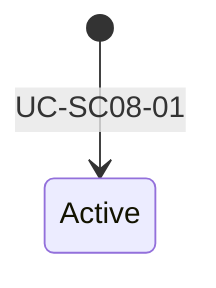

🏠 [Specs](../../../README.md) › 🏷️ [Sectors](../../README.md) › 🤲 [SC08 Non-profit association](../README.md) ›
🗃️ [Data](README.md) › 🗃️ E-SC08-01 Member

# 🗃️ E-SC08-01 Member

**Status:** 🔄 waiting for the owner

## Purpose

A person or body member of the association.

## Fields

| Name | Type | Required | Validation | Default | Example | Personal data | Custom fields |
|---|---|---|---|---|---|---|---|
| contact | contact | yes | - | - | J. Martin | yes | no |
| membership period, kind | dates, kind | yes | BR-SC08-04 | year | 2026, individual | no | yes |
| consents | list | no | BR-SC08-13 | - | newsletter | yes | no |

## Relations

(Proposed) As its use cases.

## Lifecycle

## Indexes and search

(Proposed) By number, date, partner.

## Retention

While a member, then deleted:
[CR-FR-052 Personal data kept no longer than needed](../../../10-country-packs/france/data-protection/cr-fr-052-storage-limitation.md).

## Audit

Every change.

## Import and export

(Proposed) CSV, FEC where relevant.

## Used by

- [UC-SC08-01](../use-cases/01-members-and-governance/uc-sc08-01-manage-members-and-dues.md)
- [UC-SC08-17](../use-cases/06-accounts-and-data/uc-sc08-17-communicate-with-members.md)
- [UC-SC08-18](../use-cases/06-accounts-and-data/uc-sc08-18-handle-members-data-protection-rights.md)
- [UC-SC08-19](../use-cases/06-accounts-and-data/uc-sc08-19-follow-the-association-s-dashboard.md)

## Open questions

None.

---

⬆️ [Up](README.md) · ➡️ [E-SC08-02 Dues payment](e-sc08-02-dues-payment.md)
