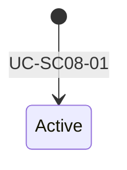

🏠 [Specs](../../../README.md) › 🏷️ [Sectors](../../README.md) › 🤲 [SC08 Non-profit association](../README.md) ›
🗃️ [Data](README.md) › 🗃️ E-SC08-02 Dues payment

# 🗃️ E-SC08-02 Dues payment

**Status:** ✅ specified

## Purpose

Dues for a period.

## Fields

| Name | Type | Required | Validation | Default | Example | Personal data | Custom fields |
|---|---|---|---|---|---|---|---|
| member, period | records | yes | - | - | J. Martin, 2026 | yes | no |
| amount, method | amount, method | yes | - | - | 30.00, card | no | no |

## Relations

As its use cases.

## Lifecycle

## Indexes and search

By number, date, partner.

## Retention

As an accounting record:
[CR-FR-002 Accounting records kept 10 years](../../../10-country-packs/france/accounting/cr-fr-002-accounting-records-kept-ten-years.md).

## Audit

Every change.

## Import and export

CSV, FEC where relevant.

## Used by

- [UC-SC08-01](../use-cases/01-members-and-governance/uc-sc08-01-manage-members-and-dues.md)

## Open questions

None.

---

⬅️ [E-SC08-01 Member](e-sc08-01-member.md) · ⬆️ [Up](README.md) ·
➡️ [E-SC08-03 Assembly or board meeting](e-sc08-03-assembly-or-board-meeting.md)
