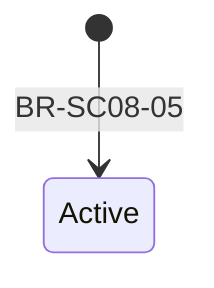

🏠 [Specs](../../../README.md) › 🏷️ [Sectors](../../README.md) › 🤲 [SC08 Non-profit association](../README.md) ›
🗃️ [Data](README.md) › 🗃️ E-SC08-03 Assembly or board meeting

# 🗃️ E-SC08-03 Assembly or board meeting

**Status:** ✅ specified

## Purpose

A meeting and its decisions.

## Fields

| Name | Type | Required | Validation | Default | Example | Personal data | Custom fields |
|---|---|---|---|---|---|---|---|
| kind, date | records | yes | BR-SC08-05 | - | general assembly, 20 Mar | no | no |
| attendance, proxies, votes | lists | yes | - | - | 64 + 18 | yes | no |
| minutes | file | no | - | - | minutes.pdf | no | no |

## Relations

As its use cases.

## Lifecycle

## Indexes and search

By number, date, partner.

## Retention

Kept for the period of its kind of record in the country pack (D293), or else its kind's default in the
[retention schedule](../../../05-non-functional/data-retention.md).

## Audit

Every change.

## Import and export

CSV, FEC where relevant.

## Used by

- [UC-SC08-02](../use-cases/01-members-and-governance/uc-sc08-02-run-the-general-assembly.md)
- [UC-SC08-03](../use-cases/01-members-and-governance/uc-sc08-03-run-the-board-and-its-decisions.md)

## Open questions

None.

---

⬅️ [E-SC08-02 Dues payment](e-sc08-02-dues-payment.md) · ⬆️ [Up](README.md) · ➡️ [E-SC08-04 Gift](e-sc08-04-gift.md)
