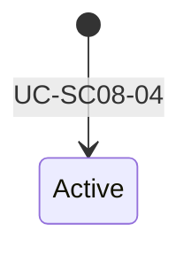

🏠 [Specs](../../../README.md) › 🏷️ [Sectors](../../README.md) › 🤲 [SC08 Non-profit association](../README.md) ›
🗃️ [Data](README.md) › 🗃️ E-SC08-04 Gift

# 🗃️ E-SC08-04 Gift

**Status:** ✅ specified

## Purpose

A donation.

## Fields

| Name | Type | Required | Validation | Default | Example | Personal data | Custom fields |
|---|---|---|---|---|---|---|---|
| donor, date, amount | records | yes | - | - | J. Martin, 12 Nov, 100.00 | yes | no |
| method, campaign, purpose | records | no | BR-SC08-07 | - | card, winter, school | no | no |

## Relations

As its use cases.

## Lifecycle

## Indexes and search

By number, date, partner.

## Retention

As an accounting record:
[CR-FR-002 Accounting records kept 10 years](../../../10-country-packs/france/accounting/cr-fr-002-accounting-records-kept-ten-years.md).

## Audit

Every change.

## Import and export

CSV, FEC where relevant.

## Used by

- [UC-SC08-04](../use-cases/02-donations-and-receipts/uc-sc08-04-collect-donations-online-and-offline.md)
- [UC-SC08-07](../use-cases/02-donations-and-receipts/uc-sc08-07-manage-regular-donors.md)
- [UC-SC08-19](../use-cases/06-accounts-and-data/uc-sc08-19-follow-the-association-s-dashboard.md)
- [UC-SC08-20](../use-cases/02-donations-and-receipts/uc-sc08-20-ask-the-assistant-about-the-association.md)

## Open questions

None.

---

⬅️ [E-SC08-03 Assembly or board meeting](e-sc08-03-assembly-or-board-meeting.md) · ⬆️ [Up](README.md) ·
➡️ [E-SC08-05 Fundraising campaign](e-sc08-05-fundraising-campaign.md)
