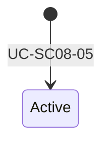

🏠 [Specs](../../../README.md) › 🏷️ [Sectors](../../README.md) › 🤲 [SC08 Non-profit association](../README.md) ›
🗃️ [Data](README.md) › 🗃️ E-SC08-05 Fundraising campaign

# 🗃️ E-SC08-05 Fundraising campaign

**Status:** 🔄 waiting for the owner

## Purpose

A fundraising campaign.

## Fields

| Name | Type | Required | Validation | Default | Example | Personal data | Custom fields |
|---|---|---|---|---|---|---|---|
| name, dates | text, dates | yes | - | - | Winter 2026 | no | no |
| target, raised | amounts | no | - | - | 20 000, 12 400 | no | no |

## Relations

(Proposed) As its use cases.

## Lifecycle

## Indexes and search

(Proposed) By number, date, partner.

## Retention

Kept for the period of its kind of record in the country pack (D293), or else its kind's default in the
[retention schedule](../../../05-non-functional/data-retention.md).

## Audit

Every change.

## Import and export

(Proposed) CSV, FEC where relevant.

## Used by

- [UC-SC08-05](../use-cases/02-donations-and-receipts/uc-sc08-05-run-fundraising-campaigns.md)

## Open questions

None.

---

⬅️ [E-SC08-04 Gift](e-sc08-04-gift.md) · ⬆️ [Up](README.md) · ➡️ [E-SC08-06 Tax receipt](e-sc08-06-tax-receipt.md)
