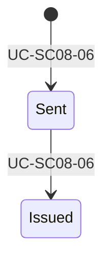

🏠 [Specs](../../../README.md) › 🏷️ [Sectors](../../README.md) › 🤲 [SC08 Non-profit association](../README.md) ›
🗃️ [Data](README.md) › 🗃️ E-SC08-06 Tax receipt

# 🗃️ E-SC08-06 Tax receipt

**Status:** 🔄 waiting for the owner

## Purpose

A receipt for a gift.

## Fields

| Name | Type | Required | Validation | Default | Example | Personal data | Custom fields |
|---|---|---|---|---|---|---|---|
| number, donor, year | records | yes | BR-SC08-02 | auto | R-2026-0418 | yes | no |
| amount, form | amount, kind | yes | - | - | 100.00, individual | no | no |

## Relations

(Proposed) As its use cases.

## Lifecycle

## Indexes and search

(Proposed) By number, date, partner.

## Retention

As an accounting record:
[CR-FR-002 Accounting records kept 10 years](../../../10-country-packs/france/accounting/cr-fr-002-accounting-records-kept-ten-years.md).

## Audit

Every change.

## Import and export

(Proposed) CSV, FEC where relevant.

## Used by

- [UC-SC08-06](../use-cases/02-donations-and-receipts/uc-sc08-06-issue-tax-receipts-for-gifts.md)

## Open questions

None.

---

⬅️ [E-SC08-05 Fundraising campaign](e-sc08-05-fundraising-campaign.md) · ⬆️ [Up](README.md) ·
➡️ [E-SC08-07 Debit mandate](e-sc08-07-debit-mandate.md)
