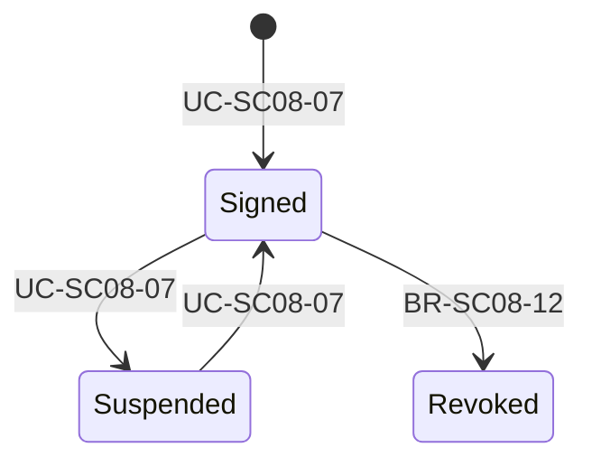

🏠 [Specs](../../../README.md) › 🏷️ [Sectors](../../README.md) › 🤲 [SC08 Non-profit association](../README.md) ›
🗃️ [Data](README.md) › 🗃️ E-SC08-07 Debit mandate

# 🗃️ E-SC08-07 Debit mandate

**Status:** ✅ specified

## Purpose

A regular gift mandate.

## Fields

| Name | Type | Required | Validation | Default | Example | Personal data | Custom fields |
|---|---|---|---|---|---|---|---|
| donor, reference | records | yes | BR-SC08-12 | - | J. Martin, M-77 | yes | no |
| amount, frequency | amount, monthly | yes | - | - | 15.00 | no | no |

## Relations

As its use cases.

## Lifecycle

## Indexes and search

By number, date, partner.

## Retention

Kept for the period of its kind of record in the country pack (D293), or else its kind's default in the
[retention schedule](../../../05-non-functional/data-retention.md).

## Audit

Every change.

## Import and export

CSV, FEC where relevant.

## Used by

- [UC-SC08-07](../use-cases/02-donations-and-receipts/uc-sc08-07-manage-regular-donors.md)

## Open questions

None.

---

⬅️ [E-SC08-06 Tax receipt](e-sc08-06-tax-receipt.md) · ⬆️ [Up](README.md) · ➡️ [E-SC08-08 Grant](e-sc08-08-grant.md)
