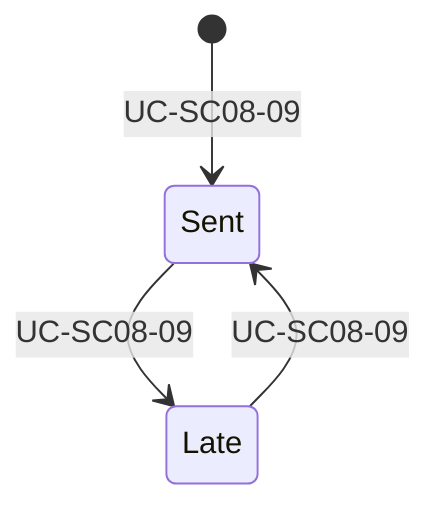

🏠 [Specs](../../../README.md) › 🏷️ [Sectors](../../README.md) › 🤲 [SC08 Non-profit association](../README.md) ›
🗃️ [Data](README.md) › 🗃️ E-SC08-09 Grant report

# 🗃️ E-SC08-09 Grant report

**Status:** 🔄 waiting for the owner

## Purpose

A report to a funder.

## Fields

| Name | Type | Required | Validation | Default | Example | Personal data | Custom fields |
|---|---|---|---|---|---|---|---|
| grant, period | records | yes | - | - | Town grant, 2026 | no | no |
| spent, state | amount, state | yes | - | - | 23 100, sent | no | no |

## Relations

(Proposed) As its use cases.

## Lifecycle

## Indexes and search

(Proposed) By number, date, partner.

## Retention

As an accounting record:
[CR-FR-002 Accounting records kept 10 years](../../../10-country-packs/france/accounting/cr-fr-002-accounting-records-kept-ten-years.md).

## Audit

Every change.

## Import and export

(Proposed) CSV, FEC where relevant.

## Used by

- [UC-SC08-09](../use-cases/03-grants/uc-sc08-09-report-to-funders-on-grants.md)
- [UC-SC08-14](../use-cases/06-accounts-and-data/uc-sc08-14-keep-association-accounts.md)
- [UC-SC08-15](../use-cases/06-accounts-and-data/uc-sc08-15-publish-the-yearly-accounts-above-the-thresholds.md)

## Open questions

None.

---

⬅️ [E-SC08-08 Grant](e-sc08-08-grant.md) · ⬆️ [Up](README.md) · ➡️ [E-SC08-10 Mission](e-sc08-10-mission.md)
