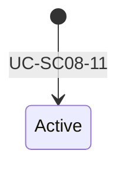

🏠 [Specs](../../../README.md) › 🏷️ [Sectors](../../README.md) › 🤲 [SC08 Non-profit association](../README.md) ›
🗃️ [Data](README.md) › 🗃️ E-SC08-11 Volunteer hours

# 🗃️ E-SC08-11 Volunteer hours

**Status:** 🔄 waiting for the owner

## Purpose

Time given.

## Fields

| Name | Type | Required | Validation | Default | Example | Personal data | Custom fields |
|---|---|---|---|---|---|---|---|
| volunteer, mission, hours | records | yes | BR-SC08-10 | - | P. L., food drive, 4 | yes | no |
| value | amount | no | - | - | 48.00 | no | no |

## Relations

(Proposed) As its use cases.

## Lifecycle

## Indexes and search

(Proposed) By number, date, partner.

## Retention

Kept for the period of its kind of record in the country pack (D293), or else its kind's default in the
[retention schedule](../../../05-non-functional/data-retention.md).

## Audit

Every change.

## Import and export

(Proposed) CSV, FEC where relevant.

## Used by

- [UC-SC08-11](../use-cases/04-volunteers/uc-sc08-11-record-and-value-volunteer-time.md)

## Open questions

None.

---

⬅️ [E-SC08-10 Mission](e-sc08-10-mission.md) · ⬆️ [Up](README.md) ·
➡️ [E-SC08-12 Association event](e-sc08-12-association-event.md)
