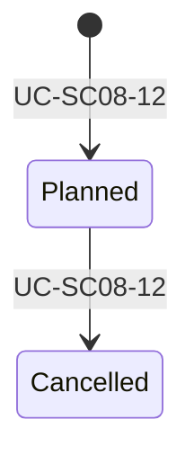

🏠 [Specs](../../../README.md) › 🏷️ [Sectors](../../README.md) › 🤲 [SC08 Non-profit association](../README.md) ›
🗃️ [Data](README.md) › 🗃️ E-SC08-12 Association event

# 🗃️ E-SC08-12 Association event

**Status:** ✅ specified

## Purpose

An association event; its sessions, ticket types and tickets are the shared ticketing model,
[E-F5-07 Registration event](../../../02-functional/f05-social-media/data/e-f05-07-registration-event.md),
[E-F5-12 Event ticket](../../../02-functional/f05-social-media/data/e-f05-12-event-ticket.md).

## Fields

| Name | Type | Required | Validation | Default | Example | Personal data | Custom fields |
|---|---|---|---|---|---|---|---|
| name, date, places | records | yes | - | - | Gala, 12 Dec, 200 | no | no |
| tickets | list | no | - | - | 164 | yes | no |

## Relations

As its use cases.

## Lifecycle

## Indexes and search

By number, date, partner.

## Retention

Kept for the period of its kind of record in the country pack (D293), or else its kind's default in the
[retention schedule](../../../05-non-functional/data-retention.md).

## Audit

Every change.

## Import and export

CSV, FEC where relevant.

## Used by

- [UC-SC08-12](../use-cases/05-events/uc-sc08-12-run-events-and-ticketing.md)

## Open questions

None.

---

⬅️ [E-SC08-11 Volunteer hours](e-sc08-11-volunteer-hours.md) · ⬆️ [Up](README.md) ·
➡️ [E-SC08-13 Temporary bar](e-sc08-13-temporary-bar.md)
