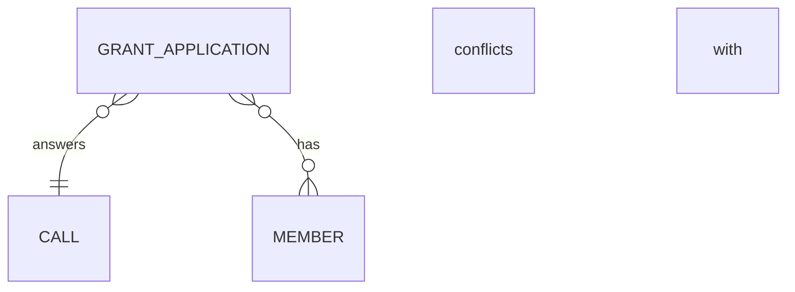
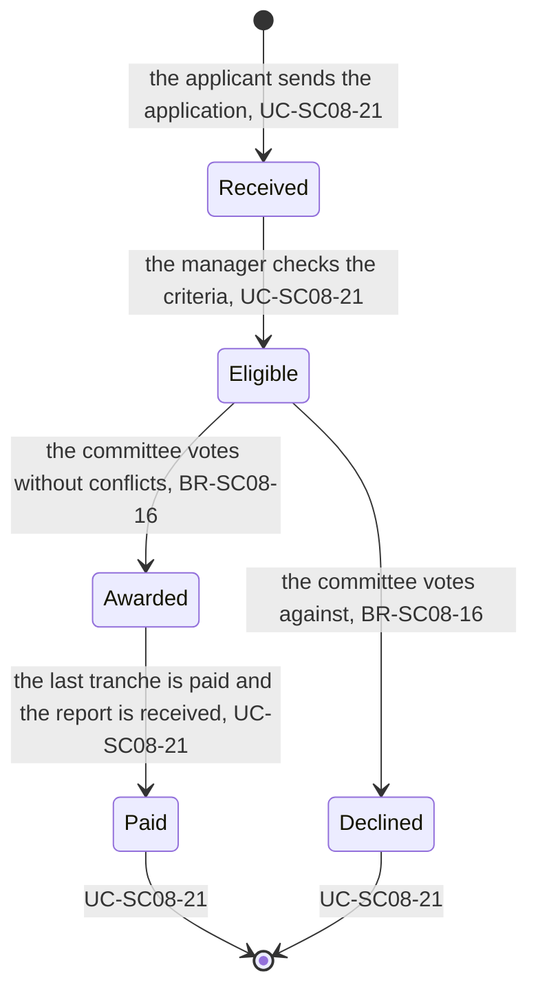

🏠 [Specs](../../../README.md) › 🏷️ [Sectors](../../README.md) › 🤲 [SC08 Non-profit association](../README.md) ›
🗃️ [Data](README.md) › 🗃️ E-SC08-16 Grant application

# 🗃️ E-SC08-16 Grant application

**Status:** ✅ specified

## Purpose

One application to a call of the foundation, with its score, the conflicts, the committee's decision and the grant it
becomes ([D552](../../../06-decisions/sectors/d552-benchmark-gaps-sc08-non-profit.md)). It is the foundation's side of a
grant; the grant a company receives is a grant of its own accounts
([E-F8-18 Grant](../../../02-functional/f08-accounting/data/e-f08-18-grant.md)).

## Fields

| Name | Type | Required | Validation | Default | Example | Personal data | Custom fields |
|---|---|---|---|---|---|---|---|
| call | text | yes | a call of the foundation | - | Youth projects 2026 | no | no |
| applicant | customer (E-F6-01) | yes | an organisation | - | Arc-en-Ciel | no | no |
| project | text | yes | a description | - | Summer camps | no | no |
| amount asked | amount in EUR | yes | above 0 | - | 30,000.00 | no | no |
| score | number | no | 0 to 10 | - | 8.4 | no | no |
| conflicts | list of members | no | committee members | none | 2 members | no | no |
| decision | awarded, declined | no | one of the two | - | awarded | no | no |
| amount awarded | amount in EUR | no | up to the amount asked | - | 30,000.00 | no | no |
| tranches | list of dates and amounts | no | adding to the award | - | 2 x 15,000.00 | no | no |
| report due | date | no | after the last tranche date | - | 2027-06-30 | no | no |
| state | Received, Eligible, Awarded, Declined, Paid | yes | the lifecycle below | Received | Eligible | no | no |
| owner | user | yes | a user of the company | the creator | Claire P. | yes | no |

## Relations

- [E-F6-01](../../../02-functional/f06-customers-and-sales/data/e-f06-01-customer-record.md)
- [E-SC08-01 Member](e-sc08-01-member.md)
- [E-SC08-03 Assembly or board meeting](e-sc08-03-assembly-or-board-meeting.md)
- [E-F8-19 Dedicated fund](../../../02-functional/f08-accounting/data/e-f08-19-dedicated-fund.md)

## Lifecycle

## Indexes and search

By call, applicant, state, score and decision.

## Retention

Kept ten years with the agreements and the accounting records
([CR-FR-002](../../../10-country-packs/france/accounting/cr-fr-002-accounting-records-kept-ten-years.md)), and declined
applications three years.

## Audit

Every score, declared interest, vote with the members counted, decision and payment, with who and when.

## Import and export

CSV import of applications from the form and export of the decisions for the minutes.

## Used by

- [UC-SC08-21](../use-cases/07-foundations-integration-and-federations/uc-sc08-21-give-grants-as-a-foundation.md)
- [UC-SC08-03](../use-cases/01-members-and-governance/uc-sc08-03-run-the-board-and-its-decisions.md)

## Open questions

None.

---

⬅️ [E-SC08-15 Gift in kind](e-sc08-15-gift-in-kind.md) · ⬆️ [Up](README.md) ·
➡️ [E-SC08-17 Integration pathway](e-sc08-17-integration-pathway.md)
