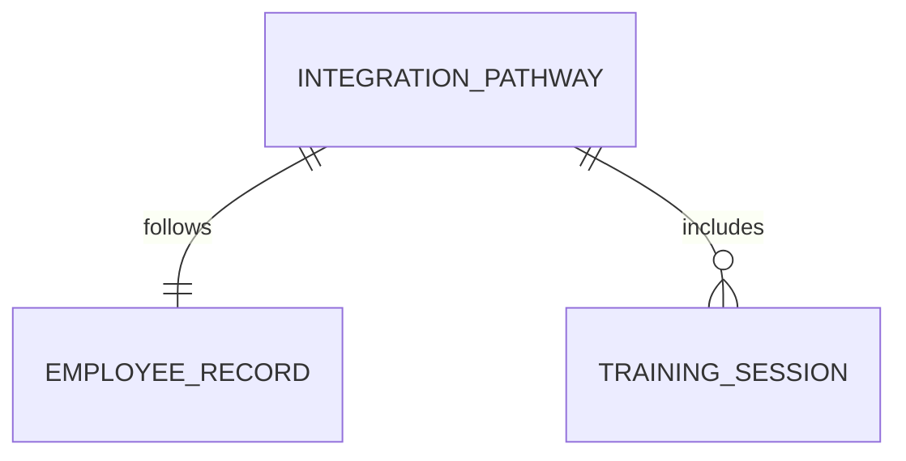
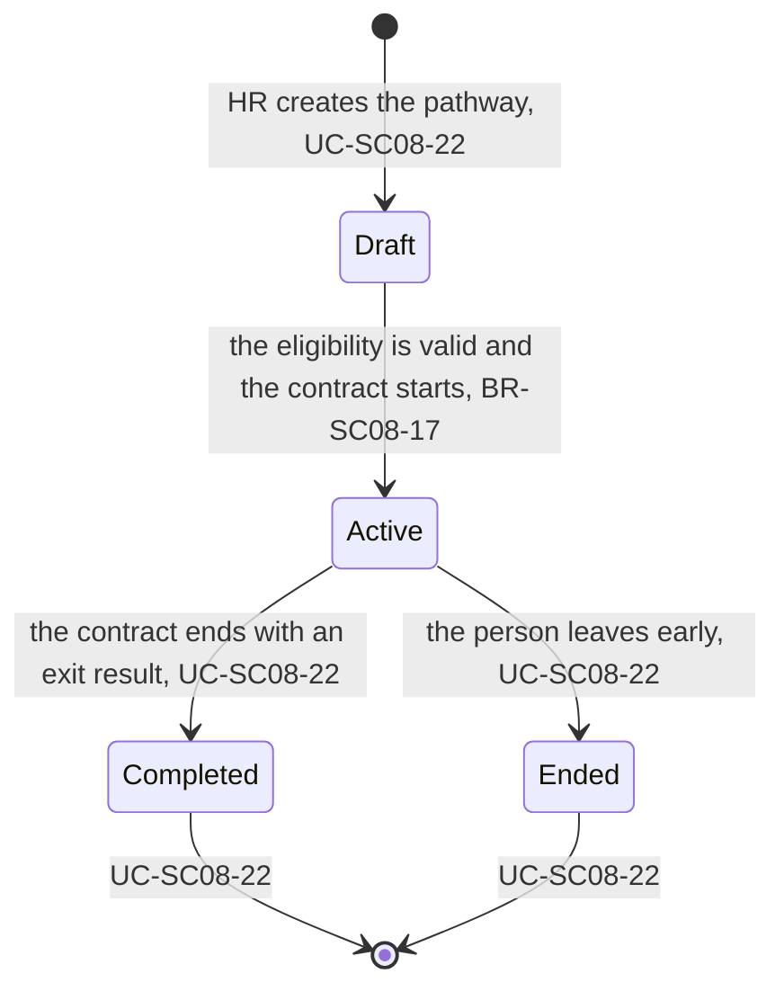

🏠 [Specs](../../../README.md) › 🏷️ [Sectors](../../README.md) › 🤲 [SC08 Non-profit association](../README.md) ›
🗃️ [Data](README.md) › 🗃️ E-SC08-17 Integration pathway

# 🗃️ E-SC08-17 Integration pathway

**Status:** ✅ specified

## Purpose

The pathway of one person in a work-integration enterprise: eligibility, steps, hours, aid and exit
([D552](../../../06-decisions/sectors/d552-benchmark-gaps-sc08-non-profit.md)). It adds the integration side to the
employee record ([E-F9-01](../../../02-functional/f09-hr-and-projects/data/e-f09-01-employee-record.md)) and contract
([E-F9-02 Contract](../../../02-functional/f09-hr-and-projects/data/e-f09-02-contract.md)), which stay the source of the
employment.

## Fields

| Name | Type | Required | Validation | Default | Example | Personal data | Custom fields |
|---|---|---|---|---|---|---|---|
| person | employee (E-F9-01) | yes | an employee of the structure | - | Ms Diallo | yes | no |
| eligible from | date | yes | not after the contract start | - | 2025-05-01 | no | no |
| eligible to | date | yes | after eligible from | - | 2027-05-01 | no | no |
| steps | list with dates | no | steps of the pathway | none | support, training | no | no |
| hours | number per month | no | 0 or more | 0 | 104 | no | no |
| aid | share of a position | no | 0 to 1 | computed | 0.69 | no | no |
| exit | job, training, other | no | required to complete | - | job | no | no |
| exit date | date | no | after the start | - | 2027-01-15 | no | no |
| notes | text | no | restricted | - | - | yes | no |
| state | Draft, Active, Completed, Ended | yes | the lifecycle below | Draft | Active | no | no |
| owner | user | yes | a user of the company | the creator | Claire P. | yes | no |

## Relations

- [E-F9-01](../../../02-functional/f09-hr-and-projects/data/e-f09-01-employee-record.md)
- [E-F9-02 Contract](../../../02-functional/f09-hr-and-projects/data/e-f09-02-contract.md)
- [E-F9-22](../../../02-functional/f09-hr-and-projects/data/e-f09-22-training-session.md)

## Lifecycle

## Indexes and search

By person, state, eligibility end date and exit result.

## Retention

Kept five years after the end for the paying body's checks, the social notes erased earlier on request.

## Audit

Every eligibility, step, claim and exit, and each reading of the notes, with who and when.

## Import and export

Export of the monthly claim and the yearly results of exits for the paying body.

## Used by

- [UC-SC08-22](../use-cases/07-foundations-integration-and-federations/uc-sc08-22-run-a-work-integration-enterprise.md)
- [UC-SC08-10](../use-cases/04-volunteers/uc-sc08-10-recruit-and-register-volunteers-for-missions.md)

## Open questions

None.

---

⬅️ [E-SC08-16 Grant application](e-sc08-16-grant-application.md) · ⬆️ [Up](README.md) ·
➡️ [E-SC08-18 Member organisation](e-sc08-18-member-organisation.md)
