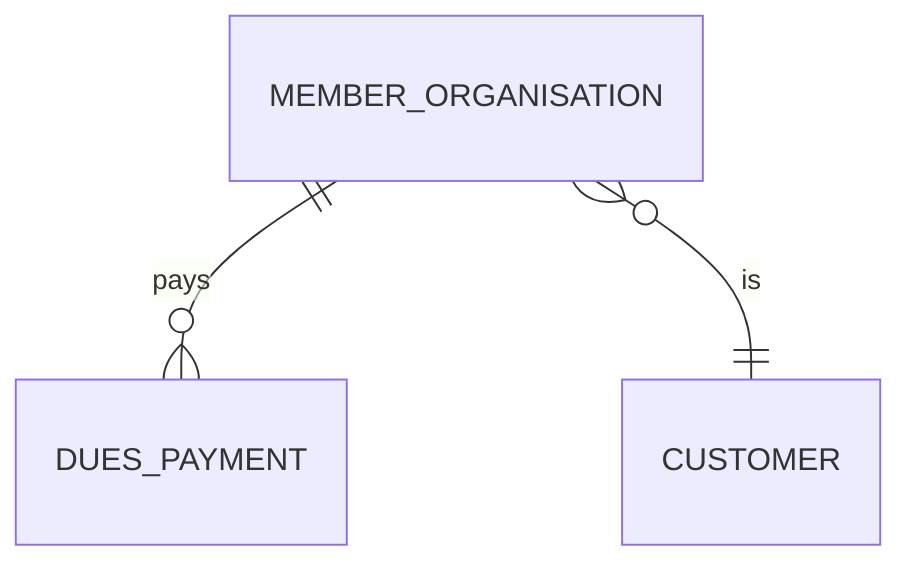
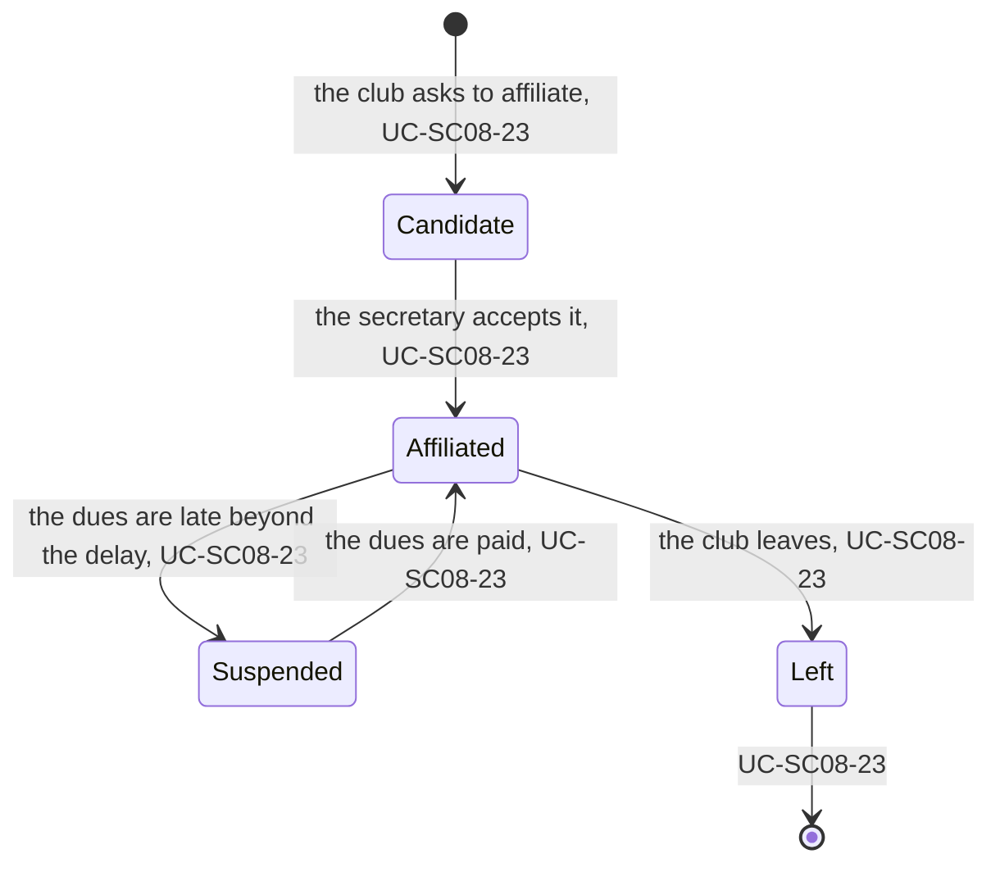

🏠 [Specs](../../../README.md) › 🏷️ [Sectors](../../README.md) › 🤲 [SC08 Non-profit association](../README.md) ›
🗃️ [Data](README.md) › 🗃️ E-SC08-18 Member organisation

# 🗃️ E-SC08-18 Member organisation

**Status:** ✅ specified

## Purpose

One club or association that is a member of the federation, with its headcount, dues and votes
([D552](../../../06-decisions/sectors/d552-benchmark-gaps-sc08-non-profit.md)). It is not an individual member
([E-SC08-01 Member](e-sc08-01-member.md)): it is an organisation that pays dues for its own members.

## Fields

| Name | Type | Required | Validation | Default | Example | Personal data | Custom fields |
|---|---|---|---|---|---|---|---|
| club | customer (E-F6-01) | yes | an organisation | - | Judo Club Part-Dieu | no | no |
| region | text | yes | a region of the federation | - | Rhône | no | no |
| discipline | text | yes | a discipline of the federation | - | Judo | no | no |
| licensed members | number | yes | 0 or more | 0 | 142 | no | no |
| dues | amount in EUR | yes | from the scale | computed | 1,123.00 | no | no |
| dues paid | amount in EUR | yes | 0 to the dues | 0 | 1,123.00 | no | no |
| votes | number | yes | from the headcount | computed | 7 | no | no |
| affiliated on | date | no | not in the future | - | 2019-09-01 | no | no |
| representative | text | yes | a person of the club | - | Ms Perrin | yes | no |
| state | Candidate, Affiliated, Suspended, Left | yes | the lifecycle below | Candidate | Affiliated | no | no |
| owner | user | yes | a user of the company | the creator | Claire P. | yes | no |

## Relations

- [E-F6-01](../../../02-functional/f06-customers-and-sales/data/e-f06-01-customer-record.md)
- [E-SC08-01 Member](e-sc08-01-member.md)
- [E-SC08-02 Dues payment](e-sc08-02-dues-payment.md)
- [E-SC08-03 Assembly or board meeting](e-sc08-03-assembly-or-board-meeting.md)

## Lifecycle

## Indexes and search

By club, region, discipline, state and season.

## Retention

Kept ten years after the club leaves, with the dues and the accounting records
([CR-FR-002](../../../10-country-packs/france/accounting/cr-fr-002-accounting-records-kept-ten-years.md)).

## Audit

Every affiliation, declaration, dues computation, payment, suspension and leaving, with who, when and the old and new
value.

## Import and export

CSV import of a club's list of members and export of the clubs with their dues.

## Used by

- [UC-SC08-23](../use-cases/07-foundations-integration-and-federations/uc-sc08-23-run-a-federation-of-member-clubs.md)
- [UC-SC08-01](../use-cases/01-members-and-governance/uc-sc08-01-manage-members-and-dues.md)

## Open questions

None.

---

⬅️ [E-SC08-17 Integration pathway](e-sc08-17-integration-pathway.md) · ⬆️ [Up](README.md) ·
➡️ [E-SC08-19 Fundraising page](e-sc08-19-fundraising-page.md)
