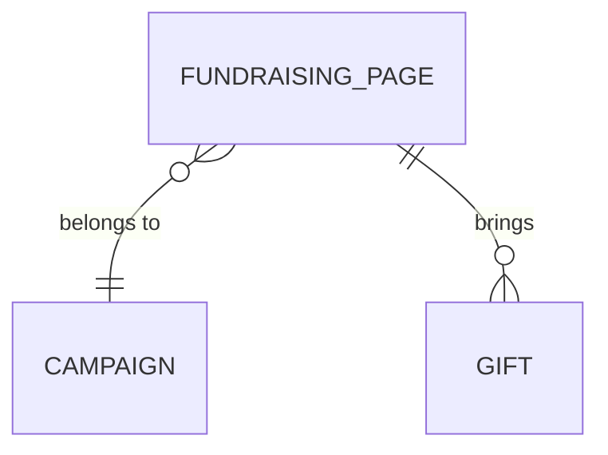
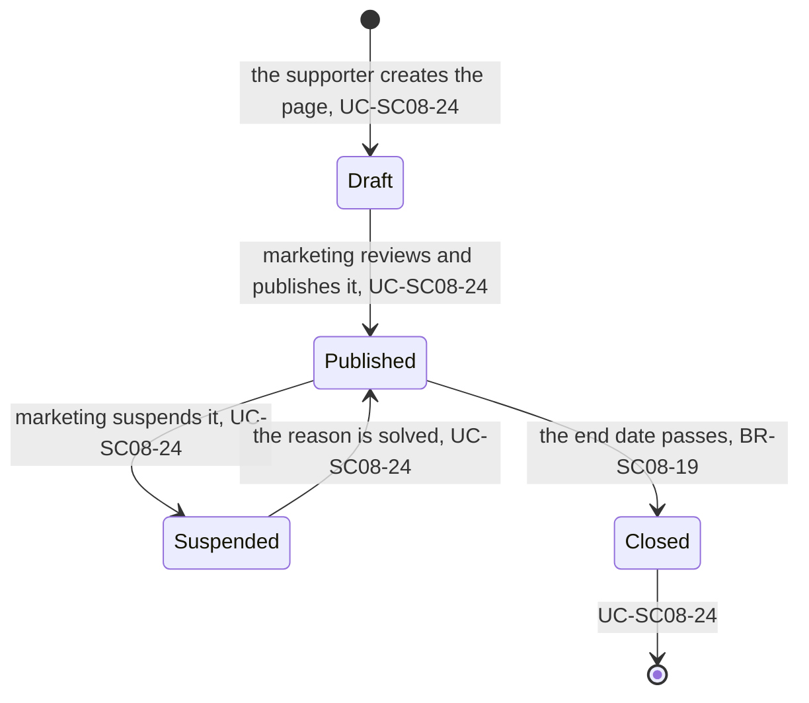

🏠 [Specs](../../../README.md) › 🏷️ [Sectors](../../README.md) › 🤲 [SC08 Non-profit association](../README.md) ›
🗃️ [Data](README.md) › 🗃️ E-SC08-19 Fundraising page

# 🗃️ E-SC08-19 Fundraising page

**Status:** ✅ specified

## Purpose

A supporter's fundraising page attached to a campaign, with its goal, its link and its totals
([D552](../../../06-decisions/sectors/d552-benchmark-gaps-sc08-non-profit.md)). It is not a campaign
([E-SC08-05 Fundraising campaign](e-sc08-05-fundraising-campaign.md)): it is one supporter's share of it, and the gifts
it brings are the association's gifts ([E-SC08-04 Gift](e-sc08-04-gift.md)).

## Fields

| Name | Type | Required | Validation | Default | Example | Personal data | Custom fields |
|---|---|---|---|---|---|---|---|
| title | text | yes | within the page rules | - | Marathon for Arc | no | no |
| owner | customer (E-F6-01) | yes | a supporter | - | Julie M. | yes | no |
| campaign | campaign (E-SC08-05) | yes | an open campaign | - | Run for Health 2026 | no | no |
| goal | amount in EUR | yes | above 0 | - | 2,000.00 | no | no |
| raised | amount in EUR | yes | sum of the gifts | 0 | 1,350.00 | no | no |
| donors | number | yes | 0 or more | 0 | 31 | no | no |
| link | text | yes | unique address | generated | arc.example/marathon | no | no |
| end date | date | no | after the publication | campaign end | 2026-12-31 | no | no |
| story | text | no | within the page rules | - | Running 42 km for Arc-en-Ciel | no | no |
| state | Draft, Published, Suspended, Closed | yes | the lifecycle below | Draft | Published | no | no |
| owner | user | yes | a user of the company | the creator | Claire P. | yes | no |

## Relations

- [E-SC08-05 Fundraising campaign](e-sc08-05-fundraising-campaign.md)
- [E-SC08-04 Gift](e-sc08-04-gift.md)
- [E-SC08-06 Tax receipt](e-sc08-06-tax-receipt.md)
- [E-F6-01](../../../02-functional/f06-customers-and-sales/data/e-f06-01-customer-record.md)

## Lifecycle

## Indexes and search

By campaign, owner, state and raised amount.

## Retention

Kept with the campaign and its gifts for ten years
([CR-FR-002](../../../10-country-packs/france/accounting/cr-fr-002-accounting-records-kept-ten-years.md)), the owner's
personal data erased on request.

## Audit

Every review, publication, suspension, gift and receipt, with who and when.

## Import and export

Export of the pages of a campaign with their totals as CSV.

## Used by

- [UC-SC08-24](../use-cases/07-foundations-integration-and-federations/uc-sc08-24-let-supporters-fundraise-for-us.md)
- [UC-SC08-05](../use-cases/02-donations-and-receipts/uc-sc08-05-run-fundraising-campaigns.md)

## Open questions

None.

---

⬅️ [E-SC08-18 Member organisation](e-sc08-18-member-organisation.md) · ⬆️ [Up](README.md)
