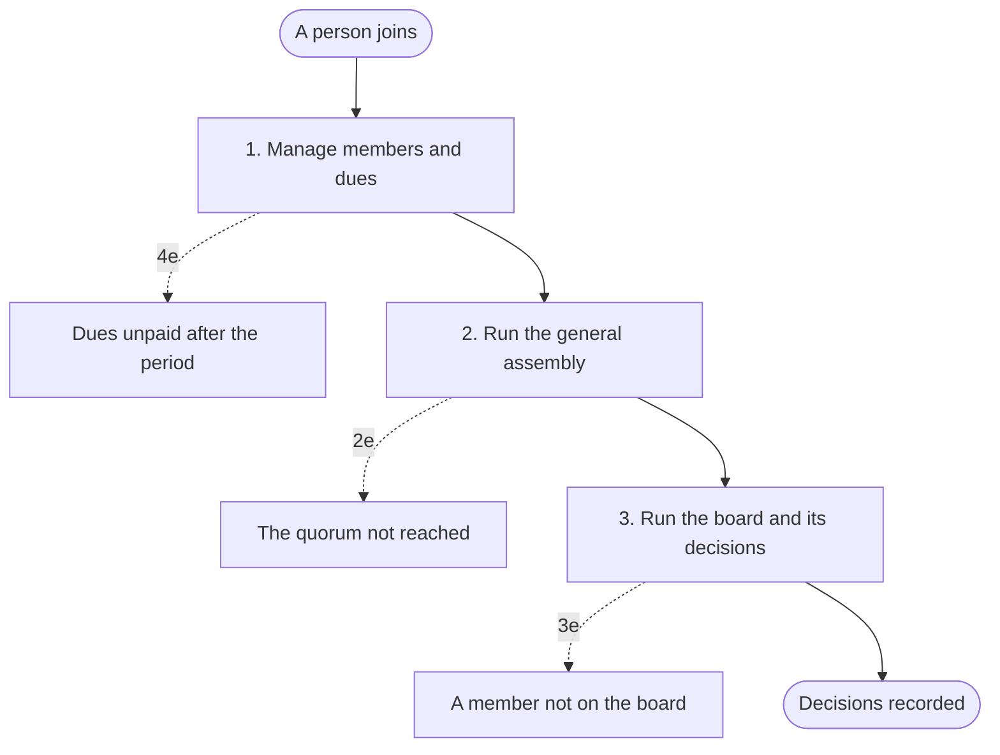

🏠 [Specs](../../../README.md) › 🏷️ [Sectors](../../README.md) › 🤲 [SC08 Non-profit association](../README.md) ›
🔀 [Flows](README.md) › 🔀 FL-SC08-01 Members and governance

# 🔀 FL-SC08-01 Members and governance

**Status:** ✅ specified

## Summary

Members, the assembly and the board. It covers
[UC-SC08-01 Manage members and dues](../use-cases/01-members-and-governance/uc-sc08-01-manage-members-and-dues.md),
[UC-SC08-02 Run the general assembly](../use-cases/01-members-and-governance/uc-sc08-02-run-the-general-assembly.md),
[UC-SC08-03 Run the board and its decisions](../use-cases/01-members-and-governance/uc-sc08-03-run-the-board-and-its-decisions.md).

## Personas

- [U09 Customer](../../../01-users/personas/u09-customer.md)
- [U13 Owner](../../../01-users/personas/u13-owner.md)
- [U31 Treasurer](../../../01-users/personas/u31-treasurer.md)

## Flowchart

## Sequence diagram

See each use case.

## Steps

| Step | Persona | Screen | Use case | What happens |
|---|---|---|---|---|
| 1 | U31, U09 | [S-SC08-01](../screens/01-members-and-governance/s-sc08-01-members.md) | [UC-SC08-01](../use-cases/01-members-and-governance/uc-sc08-01-manage-members-and-dues.md) | People join the association, pay their dues online or to the treasurer, and renew each period, membership and voting rights follow paid dues |
| 2 | U13, U31 | [S-SC08-02](../screens/01-members-and-governance/s-sc08-02-general-assembly.md) | [UC-SC08-02](../use-cases/01-members-and-governance/uc-sc08-02-run-the-general-assembly.md) | The board sends the notice, records attendance and proxies, runs the votes and writes the minutes, following the statutes entered as settings |
| 3 | U13, U31 | [S-SC08-03](../screens/01-members-and-governance/s-sc08-03-board.md) | [UC-SC08-03](../use-cases/01-members-and-governance/uc-sc08-03-run-the-board-and-its-decisions.md) | The board meets, decides and records its decisions, only board members vote |

### Entities and screens

| Entity | States in this flow | Shown at step and screen | Aggregated view |
|---|---|---|---|
| [E-SC08-01 Member](../data/e-sc08-01-member.md) | Active | 1 [S-SC08-01](../screens/01-members-and-governance/s-sc08-01-members.md) | Members |
| [E-SC08-02 Dues payment](../data/e-sc08-02-dues-payment.md) | Active | 1 [S-SC08-01](../screens/01-members-and-governance/s-sc08-01-members.md) | Dues payments |
| [E-SC08-03 Assembly or board meeting](../data/e-sc08-03-assembly-or-board-meeting.md) | Active | 2 [S-SC08-02](../screens/01-members-and-governance/s-sc08-02-general-assembly.md); 3 [S-SC08-03](../screens/01-members-and-governance/s-sc08-03-board.md) | Assembly or board meetings |
| [E-F15-07 Corporate decision](../../../02-functional/f15-legal-assistant/data/e-f15-07-corporate-decision.md) | Prepared, Held, Registered | Shown elsewhere: [S-F15-09 Company records](../../../02-functional/f15-legal-assistant/screens/05-duties-and-records/s-f15-09-company-records.md) | Corporate decisions |

## Errors

- [UC-SC08-01](../use-cases/01-members-and-governance/uc-sc08-01-manage-members-and-dues.md) 4e. Dues unpaid after the
  period: a reminder is sent and voting rights stop.
- [UC-SC08-01](../use-cases/01-members-and-governance/uc-sc08-01-manage-members-and-dues.md) 2e. A payment refused:
  membership waits.
- [UC-SC08-02](../use-cases/01-members-and-governance/uc-sc08-02-run-the-general-assembly.md) 2e. The quorum not
  reached: a second assembly is called as the statutes say.
- [UC-SC08-02](../use-cases/01-members-and-governance/uc-sc08-02-run-the-general-assembly.md) 3e. A proxy over the
  limit: it is refused.
- [UC-SC08-03](../use-cases/01-members-and-governance/uc-sc08-03-run-the-board-and-its-decisions.md) 3e. A member not on
  the board: cannot vote.
- [UC-SC08-03](../use-cases/01-members-and-governance/uc-sc08-03-run-the-board-and-its-decisions.md) 2e. The quorum not
  reached: the decision is postponed.

## Images

Every step and error, for each persona taking part, in light and dark mode (D120). Steps are numbered as in the Steps
table; E rows are the error cases.

| Step | Persona | Device | Light | Dark |
|---|---|---|---|---|
| 1 | U31 | desktop | [light](../images/01-members-and-governance/u31-treasurer/1-members-desktop-light.png) | [dark](../images/01-members-and-governance/u31-treasurer/1-members-desktop-dark.png) |
| 1 | U31 | phone | [light](../images/01-members-and-governance/u31-treasurer/1-members-phone-light.png) | [dark](../images/01-members-and-governance/u31-treasurer/1-members-phone-dark.png) |
| 1 | U09 | phone | [light](../images/01-members-and-governance/u09-customer/1-members-phone-light.png) | [dark](../images/01-members-and-governance/u09-customer/1-members-phone-dark.png) |
| 2 | U13 | desktop | [light](../images/01-members-and-governance/u13-owner/2-assembly-desktop-light.png) | [dark](../images/01-members-and-governance/u13-owner/2-assembly-desktop-dark.png) |
| 2 | U13 | phone | [light](../images/01-members-and-governance/u13-owner/2-assembly-phone-light.png) | [dark](../images/01-members-and-governance/u13-owner/2-assembly-phone-dark.png) |
| 2 | U31 | desktop | [light](../images/01-members-and-governance/u31-treasurer/2-assembly-desktop-light.png) | [dark](../images/01-members-and-governance/u31-treasurer/2-assembly-desktop-dark.png) |
| 2 | U31 | phone | [light](../images/01-members-and-governance/u31-treasurer/2-assembly-phone-light.png) | [dark](../images/01-members-and-governance/u31-treasurer/2-assembly-phone-dark.png) |
| 3 | U13 | desktop | [light](../images/01-members-and-governance/u13-owner/3-board-desktop-light.png) | [dark](../images/01-members-and-governance/u13-owner/3-board-desktop-dark.png) |
| 3 | U13 | phone | [light](../images/01-members-and-governance/u13-owner/3-board-phone-light.png) | [dark](../images/01-members-and-governance/u13-owner/3-board-phone-dark.png) |
| 3 | U31 | desktop | [light](../images/01-members-and-governance/u31-treasurer/3-board-desktop-light.png) | [dark](../images/01-members-and-governance/u31-treasurer/3-board-desktop-dark.png) |
| 3 | U31 | phone | [light](../images/01-members-and-governance/u31-treasurer/3-board-phone-light.png) | [dark](../images/01-members-and-governance/u31-treasurer/3-board-phone-dark.png) |
| E1 | U13 | desktop | [light](../images/01-members-and-governance/u13-owner/e1-no-quorum-desktop-light.png) | [dark](../images/01-members-and-governance/u13-owner/e1-no-quorum-desktop-dark.png) |
| E1 | U13 | phone | [light](../images/01-members-and-governance/u13-owner/e1-no-quorum-phone-light.png) | [dark](../images/01-members-and-governance/u13-owner/e1-no-quorum-phone-dark.png) |

## Open questions

None.

---

⬆️ [Up](README.md) · ➡️ [FL-SC08-02 Donations and receipts](fl-sc08-02-donations-and-receipts.md)
