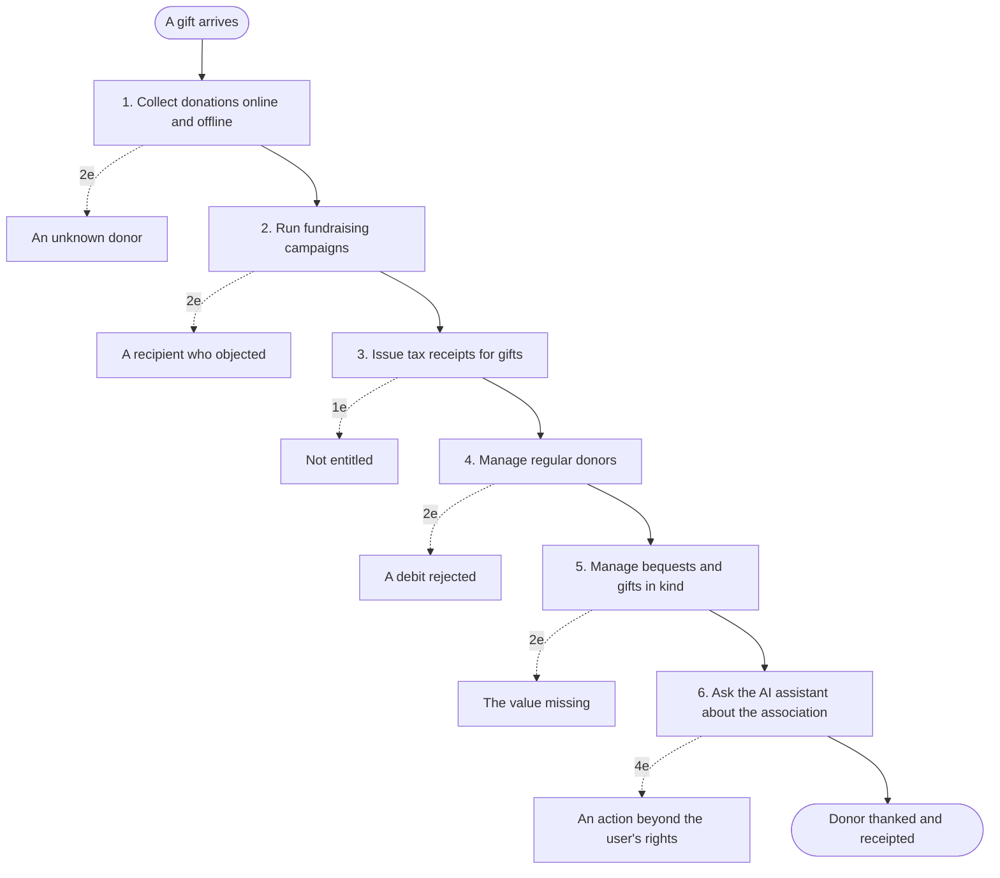

🏠 [Specs](../../../README.md) › 🏷️ [Sectors](../../README.md) › 🤲 [SC08 Non-profit association](../README.md) ›
🔀 [Flows](README.md) › 🔀 FL-SC08-02 Donations and receipts

# 🔀 FL-SC08-02 Donations and receipts

**Status:** ✅ specified

## Summary

Gifts, campaigns, receipts, regular donors, bequests and the AI assistant. It covers
[UC-SC08-04 Collect donations online and offline](../use-cases/02-donations-and-receipts/uc-sc08-04-collect-donations-online-and-offline.md),
[UC-SC08-05 Run fundraising campaigns](../use-cases/02-donations-and-receipts/uc-sc08-05-run-fundraising-campaigns.md),
[UC-SC08-06 Issue tax receipts for gifts](../use-cases/02-donations-and-receipts/uc-sc08-06-issue-tax-receipts-for-gifts.md),
[UC-SC08-07 Manage regular donors](../use-cases/02-donations-and-receipts/uc-sc08-07-manage-regular-donors.md),
[UC-SC08-16 Manage bequests and gifts in kind](../use-cases/02-donations-and-receipts/uc-sc08-16-manage-bequests-and-gifts-in-kind.md),
[UC-SC08-20 Ask the AI assistant about the association](../use-cases/02-donations-and-receipts/uc-sc08-20-ask-the-assistant-about-the-association.md).

## Personas

- [U09 Customer](../../../01-users/personas/u09-customer.md)
- [U12 Marketing and communication](../../../01-users/personas/u12-marketing.md)
- [U13 Owner](../../../01-users/personas/u13-owner.md)
- [U31 Treasurer](../../../01-users/personas/u31-treasurer.md)

## Flowchart

## Sequence diagram

See each use case.

## Steps

| Step | Persona | Screen | Use case | What happens |
|---|---|---|---|---|
| 1 | U31, U09 | [S-SC08-04](../screens/02-donations-and-receipts/s-sc08-04-donations.md) | [UC-SC08-04](../use-cases/02-donations-and-receipts/uc-sc08-04-collect-donations-online-and-offline.md) | The treasurer receives gifts by card, transfer, cheque or platforms, matches each to its donor, and thanks them |
| 2 | U12, U31 | [S-SC08-05](../screens/02-donations-and-receipts/s-sc08-05-campaigns.md) | [UC-SC08-05](../use-cases/02-donations-and-receipts/uc-sc08-05-run-fundraising-campaigns.md) | Marketing plans a campaign, sends appeals to donors who agreed, and follows gifts against the target |
| 3 | U31 | [S-SC08-06](../screens/02-donations-and-receipts/s-sc08-06-tax-receipts.md) | [UC-SC08-06](../use-cases/02-donations-and-receipts/uc-sc08-06-issue-tax-receipts-for-gifts.md) | The treasurer generates tax receipts per gift or yearly, on the official model, checks and sends them, and declares them after the year end |
| 4 | U31, U09 | [S-SC08-07](../screens/02-donations-and-receipts/s-sc08-07-regular-gifts.md) | [UC-SC08-07](../use-cases/02-donations-and-receipts/uc-sc08-07-manage-regular-donors.md) | A donor signs a direct debit mandate, the treasurer collects the gift monthly and sends one receipt a year |
| 5 | U31, U13 | [S-SC08-16](../screens/02-donations-and-receipts/s-sc08-16-bequests.md) | [UC-SC08-16](../use-cases/02-donations-and-receipts/uc-sc08-16-manage-bequests-and-gifts-in-kind.md) | The treasurer records bequests and gifts in kind with their value, the board accepts them when the statutes require |
| 6 | U31, U13 | [S-SC08-20](../screens/02-donations-and-receipts/s-sc08-20-association-assistant.md) | [UC-SC08-20](../use-cases/02-donations-and-receipts/uc-sc08-20-ask-the-assistant-about-the-association.md) | The treasurer or the president asks the AI assistant about gifts, reports due or members to renew, within their role's rights |

### Entities and screens

| Entity | States in this flow | Shown at step and screen | Aggregated view |
|---|---|---|---|
| [E-SC08-04 Gift](../data/e-sc08-04-gift.md) | Active | 1 [S-SC08-04](../screens/02-donations-and-receipts/s-sc08-04-donations.md); 4 [S-SC08-07](../screens/02-donations-and-receipts/s-sc08-07-regular-gifts.md); 6 [S-SC08-20](../screens/02-donations-and-receipts/s-sc08-20-association-assistant.md) | Gifts |
| [E-SC08-05 Fundraising campaign](../data/e-sc08-05-fundraising-campaign.md) | Active | 2 [S-SC08-05](../screens/02-donations-and-receipts/s-sc08-05-campaigns.md) | Fundraising campaigns |
| [E-SC08-06 Tax receipt](../data/e-sc08-06-tax-receipt.md) | Sent, Issued | 3 [S-SC08-06](../screens/02-donations-and-receipts/s-sc08-06-tax-receipts.md) | Tax receipts |
| [E-SC08-07 Debit mandate](../data/e-sc08-07-debit-mandate.md) | Signed, Suspended, Revoked | 4 [S-SC08-07](../screens/02-donations-and-receipts/s-sc08-07-regular-gifts.md) | Debit mandates |
| [E-SC08-15 Gift in kind](../data/e-sc08-15-gift-in-kind.md) | Active | 5 [S-SC08-16](../screens/02-donations-and-receipts/s-sc08-16-bequests.md) | Gift in kinds |
| [E-F1-01 Company](../../../02-functional/f01-administration/data/e-f01-01-company.md) | In setup, Active | Shown elsewhere: [S-F1-10 Client companies](../../../02-functional/f01-administration/screens/08-provider-and-client-companies/s-f01-10-client-companies.md) | Companies |
| [E-F3-04 Assistant change batch](../../../02-functional/f03-assistant/data/e-f03-04-assistant-change-batch.md) | Proposed, Cancelled, Done, Partly done, Undone | Shown elsewhere: [S-F3-01 Assistant panel](../../../02-functional/f03-assistant/screens/01-ask-the-assistant/s-f03-01-assistant-panel.md) | Assistant change batches |
| [E-F1-03 User](../../../02-functional/f01-administration/data/e-f01-03-user.md) | Invited, Active, Deactivated | Shown elsewhere: [S-F1-03 Users](../../../02-functional/f01-administration/screens/03-user-lifecycle/s-f01-03-users.md) | Users |
| [E-F1-06 Role](../../../02-functional/f01-administration/data/e-f01-06-role.md) | Active | Shown elsewhere: [S-F1-06 Role editor](../../../02-functional/f01-administration/screens/04-edit-a-role/s-f01-06-role-editor.md) | Roles |

## Errors

- [UC-SC08-04](../use-cases/02-donations-and-receipts/uc-sc08-04-collect-donations-online-and-offline.md) 2e. An unknown
  donor: a donor record is created.
- [UC-SC08-04](../use-cases/02-donations-and-receipts/uc-sc08-04-collect-donations-online-and-offline.md) 2f. A
  duplicate donor: the treasurer merges.
- [UC-SC08-05](../use-cases/02-donations-and-receipts/uc-sc08-05-run-fundraising-campaigns.md) 2e. A recipient who
  objected: they are skipped.
- [UC-SC08-05](../use-cases/02-donations-and-receipts/uc-sc08-05-run-fundraising-campaigns.md) 4e. The target missed:
  the shortfall is shown.
- [UC-SC08-06](../use-cases/02-donations-and-receipts/uc-sc08-06-issue-tax-receipts-for-gifts.md) 1e. Not entitled:
  receipts are disabled.
- [UC-SC08-06](../use-cases/02-donations-and-receipts/uc-sc08-06-issue-tax-receipts-for-gifts.md) 4e. The declaration
  date near: the treasurer is reminded.
- [UC-SC08-07](../use-cases/02-donations-and-receipts/uc-sc08-07-manage-regular-donors.md) 2e. A debit rejected: the
  donor is told.
- [UC-SC08-07](../use-cases/02-donations-and-receipts/uc-sc08-07-manage-regular-donors.md) 1e. A mandate without
  signature: it is refused.
- [UC-SC08-16](../use-cases/02-donations-and-receipts/uc-sc08-16-manage-bequests-and-gifts-in-kind.md) 2e. The value
  missing: it is asked.
- [UC-SC08-16](../use-cases/02-donations-and-receipts/uc-sc08-16-manage-bequests-and-gifts-in-kind.md) 3e. The board
  refuses: the gift is closed as refused.
- [UC-SC08-20](../use-cases/02-donations-and-receipts/uc-sc08-20-ask-the-assistant-about-the-association.md) 4e. An
  action beyond the user's rights: the AI assistant refuses and says which role can do it.
- [UC-SC08-20](../use-cases/02-donations-and-receipts/uc-sc08-20-ask-the-assistant-about-the-association.md) 2e. No data
  to answer: the AI assistant says so and does not guess.

## Images

Every step and error, for each persona taking part, in light and dark mode (D120). Steps are numbered as in the Steps
table; E rows are the error cases.

| Step | Persona | Device | Light | Dark |
|---|---|---|---|---|
| 1 | U31 | desktop | [light](../images/02-donations-and-receipts/u31-treasurer/1-gifts-desktop-light.png) | [dark](../images/02-donations-and-receipts/u31-treasurer/1-gifts-desktop-dark.png) |
| 1 | U31 | phone | [light](../images/02-donations-and-receipts/u31-treasurer/1-gifts-phone-light.png) | [dark](../images/02-donations-and-receipts/u31-treasurer/1-gifts-phone-dark.png) |
| 1 | U09 | phone | [light](../images/02-donations-and-receipts/u09-customer/1-gifts-phone-light.png) | [dark](../images/02-donations-and-receipts/u09-customer/1-gifts-phone-dark.png) |
| 2 | U12 | desktop | [light](../images/02-donations-and-receipts/u12-marketing/2-campaign-desktop-light.png) | [dark](../images/02-donations-and-receipts/u12-marketing/2-campaign-desktop-dark.png) |
| 2 | U12 | phone | [light](../images/02-donations-and-receipts/u12-marketing/2-campaign-phone-light.png) | [dark](../images/02-donations-and-receipts/u12-marketing/2-campaign-phone-dark.png) |
| 2 | U31 | desktop | [light](../images/02-donations-and-receipts/u31-treasurer/2-campaign-desktop-light.png) | [dark](../images/02-donations-and-receipts/u31-treasurer/2-campaign-desktop-dark.png) |
| 2 | U31 | phone | [light](../images/02-donations-and-receipts/u31-treasurer/2-campaign-phone-light.png) | [dark](../images/02-donations-and-receipts/u31-treasurer/2-campaign-phone-dark.png) |
| 3 | U31 | desktop | [light](../images/02-donations-and-receipts/u31-treasurer/3-receipts-desktop-light.png) | [dark](../images/02-donations-and-receipts/u31-treasurer/3-receipts-desktop-dark.png) |
| 3 | U31 | phone | [light](../images/02-donations-and-receipts/u31-treasurer/3-receipts-phone-light.png) | [dark](../images/02-donations-and-receipts/u31-treasurer/3-receipts-phone-dark.png) |
| 4 | U09 | phone | [light](../images/02-donations-and-receipts/u09-customer/4-regular-gifts-phone-light.png) | [dark](../images/02-donations-and-receipts/u09-customer/4-regular-gifts-phone-dark.png) |
| 4 | U31 | desktop | [light](../images/02-donations-and-receipts/u31-treasurer/4-regular-gifts-desktop-light.png) | [dark](../images/02-donations-and-receipts/u31-treasurer/4-regular-gifts-desktop-dark.png) |
| 4 | U31 | phone | [light](../images/02-donations-and-receipts/u31-treasurer/4-regular-gifts-phone-light.png) | [dark](../images/02-donations-and-receipts/u31-treasurer/4-regular-gifts-phone-dark.png) |
| 5 | U31 | desktop | [light](../images/02-donations-and-receipts/u31-treasurer/5-bequest-desktop-light.png) | [dark](../images/02-donations-and-receipts/u31-treasurer/5-bequest-desktop-dark.png) |
| 5 | U31 | phone | [light](../images/02-donations-and-receipts/u31-treasurer/5-bequest-phone-light.png) | [dark](../images/02-donations-and-receipts/u31-treasurer/5-bequest-phone-dark.png) |
| 5 | U13 | desktop | [light](../images/02-donations-and-receipts/u13-owner/5-bequest-desktop-light.png) | [dark](../images/02-donations-and-receipts/u13-owner/5-bequest-desktop-dark.png) |
| 5 | U13 | phone | [light](../images/02-donations-and-receipts/u13-owner/5-bequest-phone-light.png) | [dark](../images/02-donations-and-receipts/u13-owner/5-bequest-phone-dark.png) |
| 6 | U31 | desktop | [light](../images/02-donations-and-receipts/u31-treasurer/6-assistant-desktop-light.png) | [dark](../images/02-donations-and-receipts/u31-treasurer/6-assistant-desktop-dark.png) |
| 6 | U31 | phone | [light](../images/02-donations-and-receipts/u31-treasurer/6-assistant-phone-light.png) | [dark](../images/02-donations-and-receipts/u31-treasurer/6-assistant-phone-dark.png) |
| 6 | U13 | desktop | [light](../images/02-donations-and-receipts/u13-owner/6-assistant-desktop-light.png) | [dark](../images/02-donations-and-receipts/u13-owner/6-assistant-desktop-dark.png) |
| 6 | U13 | phone | [light](../images/02-donations-and-receipts/u13-owner/6-assistant-phone-light.png) | [dark](../images/02-donations-and-receipts/u13-owner/6-assistant-phone-dark.png) |
| E1 | U31 | desktop | [light](../images/02-donations-and-receipts/u31-treasurer/e1-not-entitled-desktop-light.png) | [dark](../images/02-donations-and-receipts/u31-treasurer/e1-not-entitled-desktop-dark.png) |
| E1 | U31 | phone | [light](../images/02-donations-and-receipts/u31-treasurer/e1-not-entitled-phone-light.png) | [dark](../images/02-donations-and-receipts/u31-treasurer/e1-not-entitled-phone-dark.png) |

## Open questions

None.

---

⬅️ [FL-SC08-01 Members and governance](fl-sc08-01-members-and-governance.md) · ⬆️ [Up](README.md) ·
➡️ [FL-SC08-03 Grants](fl-sc08-03-grants.md)
