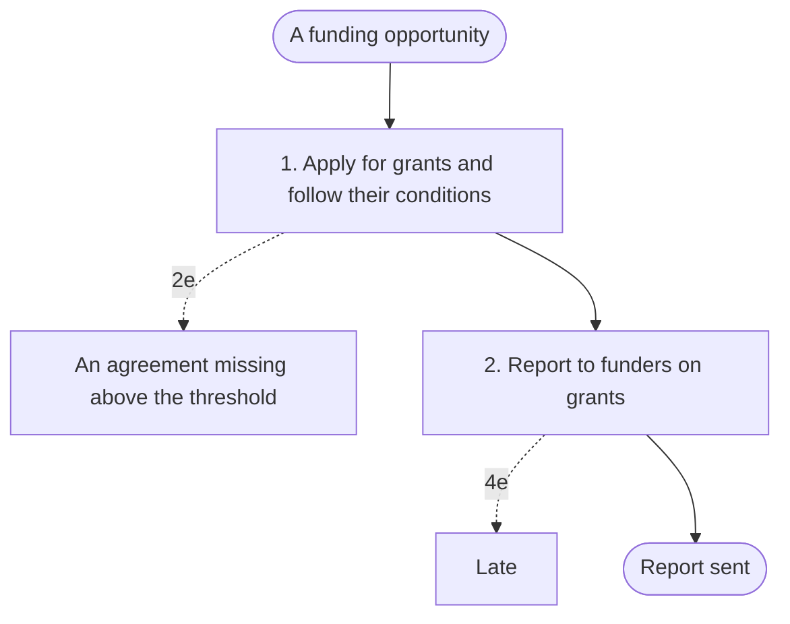

🏠 [Specs](../../../README.md) › 🏷️ [Sectors](../../README.md) › 🤲 [SC08 Non-profit association](../README.md) ›
🔀 [Flows](README.md) › 🔀 FL-SC08-03 Grants

# 🔀 FL-SC08-03 Grants

**Status:** ✅ specified

## Summary

Grants on the shared grant accounting, and reports to funders. It covers
[UC-SC08-08 Apply for grants and follow their conditions](../use-cases/03-grants/uc-sc08-08-apply-for-grants-and-follow-their-conditions.md),
[UC-SC08-09 Report to funders on grants](../use-cases/03-grants/uc-sc08-09-report-to-funders-on-grants.md).

## Personas

- [U13 Owner](../../../01-users/personas/u13-owner.md)
- [U31 Treasurer](../../../01-users/personas/u31-treasurer.md)

## Flowchart

## Sequence diagram

See each use case.

## Steps

| Step | Persona | Screen | Use case | What happens |
|---|---|---|---|---|
| 1 | U31, U13 | [S-SC08-08](../screens/03-grants/s-sc08-08-grants.md) | [UC-SC08-08](../use-cases/03-grants/uc-sc08-08-apply-for-grants-and-follow-their-conditions.md) | The treasurer applies for grants, records the signed agreement and its conditions with the shared grant accounting, and tracks spending to the purpose |
| 2 | U31, U13 | [S-SC08-09](../screens/03-grants/s-sc08-09-grant-reports.md) | [UC-SC08-09](../use-cases/03-grants/uc-sc08-09-report-to-funders-on-grants.md) | The treasurer gathers spending per grant, fills the financial report and sends it to the funder on time |

### Entities and screens

| Entity | States in this flow | Shown at step and screen | Aggregated view |
|---|---|---|---|
| [E-SC12-05 Training funding](../../sc12-education-and-training/data/e-sc12-05-training-funding.md) | Requested, Granted, Refused | Shown elsewhere: [S-SC12-04 Funding](../../sc12-education-and-training/screens/02-enrol-and-fund/s-sc12-04-funding.md) | Training fundings |
| [E-F8-18 Grant](../../../02-functional/f08-accounting/data/e-f08-18-grant.md) | Granted, Received, Closed | 1 [S-SC08-08](../screens/03-grants/s-sc08-08-grants.md); 2 [S-SC08-09](../screens/03-grants/s-sc08-09-grant-reports.md) | Grants |
| [E-SC08-09 Grant report](../data/e-sc08-09-grant-report.md) | Sent, Late | 2 [S-SC08-09](../screens/03-grants/s-sc08-09-grant-reports.md) | Grant reports |

## Errors

- [UC-SC08-08](../use-cases/03-grants/uc-sc08-08-apply-for-grants-and-follow-their-conditions.md) 2e. An agreement
  missing above the threshold: the grant is flagged.
- [UC-SC08-08](../use-cases/03-grants/uc-sc08-08-apply-for-grants-and-follow-their-conditions.md) 4e. Spending over the
  grant: the treasurer is warned.
- [UC-SC08-09](../use-cases/03-grants/uc-sc08-09-report-to-funders-on-grants.md) 4e. Late: the treasurer is reminded.
- [UC-SC08-09](../use-cases/03-grants/uc-sc08-09-report-to-funders-on-grants.md) 1e. Untagged spending: it is listed for
  tagging.

## Images

Every step and error, for each persona taking part, in light and dark mode (D120). Steps are numbered as in the Steps
table; E rows are the error cases.

| Step | Persona | Device | Light | Dark |
|---|---|---|---|---|
| 1 | U31 | desktop | [light](../images/03-grants/u31-treasurer/1-grant-desktop-light.png) | [dark](../images/03-grants/u31-treasurer/1-grant-desktop-dark.png) |
| 1 | U31 | phone | [light](../images/03-grants/u31-treasurer/1-grant-phone-light.png) | [dark](../images/03-grants/u31-treasurer/1-grant-phone-dark.png) |
| 1 | U13 | desktop | [light](../images/03-grants/u13-owner/1-grant-desktop-light.png) | [dark](../images/03-grants/u13-owner/1-grant-desktop-dark.png) |
| 1 | U13 | phone | [light](../images/03-grants/u13-owner/1-grant-phone-light.png) | [dark](../images/03-grants/u13-owner/1-grant-phone-dark.png) |
| 2 | U31 | desktop | [light](../images/03-grants/u31-treasurer/2-report-desktop-light.png) | [dark](../images/03-grants/u31-treasurer/2-report-desktop-dark.png) |
| 2 | U31 | phone | [light](../images/03-grants/u31-treasurer/2-report-phone-light.png) | [dark](../images/03-grants/u31-treasurer/2-report-phone-dark.png) |
| 2 | U13 | desktop | [light](../images/03-grants/u13-owner/2-report-desktop-light.png) | [dark](../images/03-grants/u13-owner/2-report-desktop-dark.png) |
| 2 | U13 | phone | [light](../images/03-grants/u13-owner/2-report-phone-light.png) | [dark](../images/03-grants/u13-owner/2-report-phone-dark.png) |
| E1 | U31 | desktop | [light](../images/03-grants/u31-treasurer/e1-no-agreement-desktop-light.png) | [dark](../images/03-grants/u31-treasurer/e1-no-agreement-desktop-dark.png) |
| E1 | U31 | phone | [light](../images/03-grants/u31-treasurer/e1-no-agreement-phone-light.png) | [dark](../images/03-grants/u31-treasurer/e1-no-agreement-phone-dark.png) |

## Open questions

None.

---

⬅️ [FL-SC08-02 Donations and receipts](fl-sc08-02-donations-and-receipts.md) · ⬆️ [Up](README.md) ·
➡️ [FL-SC08-04 Volunteers](fl-sc08-04-volunteers.md)
