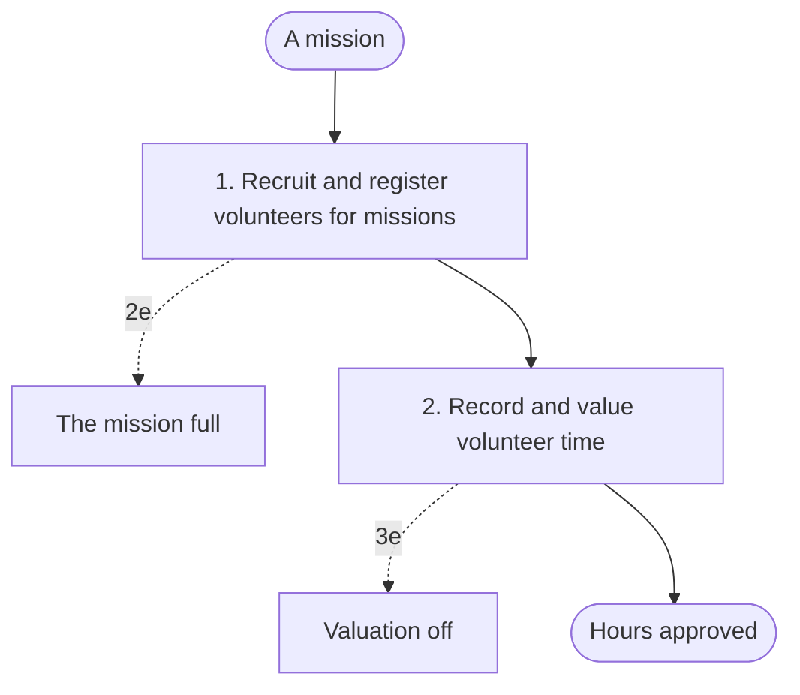

🏠 [Specs](../../../README.md) › 🏷️ [Sectors](../../README.md) › 🤲 [SC08 Non-profit association](../README.md) ›
🔀 [Flows](README.md) › 🔀 FL-SC08-04 Volunteers

# 🔀 FL-SC08-04 Volunteers

**Status:** ✅ specified

## Summary

Volunteers: missions and time. It covers
[UC-SC08-10 Recruit and register volunteers for missions](../use-cases/04-volunteers/uc-sc08-10-recruit-and-register-volunteers-for-missions.md),
[UC-SC08-11 Record and value volunteer time](../use-cases/04-volunteers/uc-sc08-11-record-and-value-volunteer-time.md).

## Personas

- [U13 Owner](../../../01-users/personas/u13-owner.md)
- [U31 Treasurer](../../../01-users/personas/u31-treasurer.md)
- [U32 Volunteer](../../../01-users/personas/u32-volunteer.md)

## Flowchart

## Sequence diagram

See each use case.

## Steps

| Step | Persona | Screen | Use case | What happens |
|---|---|---|---|---|
| 1 | U32, U13 | [S-SC08-10](../screens/04-volunteers/s-sc08-10-missions.md) | [UC-SC08-10](../use-cases/04-volunteers/uc-sc08-10-recruit-and-register-volunteers-for-missions.md) | The president publishes missions, volunteers sign up on the portal and are confirmed |
| 2 | U32, U31 | [S-SC08-11](../screens/04-volunteers/s-sc08-11-volunteer-time.md) | [UC-SC08-11](../use-cases/04-volunteers/uc-sc08-11-record-and-value-volunteer-time.md) | Volunteers record their hours, the treasurer approves them and values them in the accounts' notes if the association chooses to, expenses are repaid on proof |

### Entities and screens

| Entity | States in this flow | Shown at step and screen | Aggregated view |
|---|---|---|---|
| [E-SC08-10 Mission](../data/e-sc08-10-mission.md) | Active | 1 [S-SC08-10](../screens/04-volunteers/s-sc08-10-missions.md) | Missions |
| [E-F8-20 Volunteer contribution](../../../02-functional/f08-accounting/data/e-f08-20-volunteer-contribution.md) | Active | 2 [S-SC08-11](../screens/04-volunteers/s-sc08-11-volunteer-time.md) | Volunteer contributions |
| [E-SC08-11 Volunteer hours](../data/e-sc08-11-volunteer-hours.md) | Active | 2 [S-SC08-11](../screens/04-volunteers/s-sc08-11-volunteer-time.md) | Volunteer hours |

## Errors

- [UC-SC08-10](../use-cases/04-volunteers/uc-sc08-10-recruit-and-register-volunteers-for-missions.md) 2e. The mission
  full: the volunteer goes on the waiting list.
- [UC-SC08-10](../use-cases/04-volunteers/uc-sc08-10-recruit-and-register-volunteers-for-missions.md) 2f. A volunteer
  without consent to be contacted: only the confirmation is sent.
- [UC-SC08-11](../use-cases/04-volunteers/uc-sc08-11-record-and-value-volunteer-time.md) 3e. Valuation off: only hours
  are recorded.
- [UC-SC08-11](../use-cases/04-volunteers/uc-sc08-11-record-and-value-volunteer-time.md) 4e. An expense without receipt:
  it is refused.

## Images

Every step and error, for each persona taking part, in light and dark mode (D120). Steps are numbered as in the Steps
table; E rows are the error cases.

| Step | Persona | Device | Light | Dark |
|---|---|---|---|---|
| 1 | U32 | phone | [light](../images/04-volunteers/u32-volunteer/1-missions-phone-light.png) | [dark](../images/04-volunteers/u32-volunteer/1-missions-phone-dark.png) |
| 1 | U13 | desktop | [light](../images/04-volunteers/u13-owner/1-missions-desktop-light.png) | [dark](../images/04-volunteers/u13-owner/1-missions-desktop-dark.png) |
| 1 | U13 | phone | [light](../images/04-volunteers/u13-owner/1-missions-phone-light.png) | [dark](../images/04-volunteers/u13-owner/1-missions-phone-dark.png) |
| 2 | U31 | desktop | [light](../images/04-volunteers/u31-treasurer/2-hours-desktop-light.png) | [dark](../images/04-volunteers/u31-treasurer/2-hours-desktop-dark.png) |
| 2 | U31 | phone | [light](../images/04-volunteers/u31-treasurer/2-hours-phone-light.png) | [dark](../images/04-volunteers/u31-treasurer/2-hours-phone-dark.png) |
| 2 | U32 | phone | [light](../images/04-volunteers/u32-volunteer/2-hours-phone-light.png) | [dark](../images/04-volunteers/u32-volunteer/2-hours-phone-dark.png) |
| E1 | U32 | phone | [light](../images/04-volunteers/u32-volunteer/e1-mission-full-phone-light.png) | [dark](../images/04-volunteers/u32-volunteer/e1-mission-full-phone-dark.png) |

## Open questions

None.

---

⬅️ [FL-SC08-03 Grants](fl-sc08-03-grants.md) · ⬆️ [Up](README.md) · ➡️ [FL-SC08-05 Events](fl-sc08-05-events.md)
