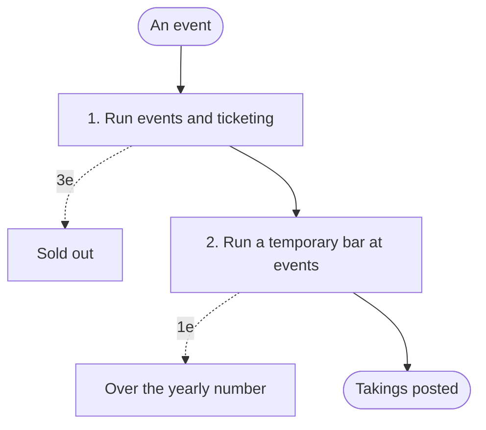

🏠 [Specs](../../../README.md) › 🏷️ [Sectors](../../README.md) › 🤲 [SC08 Non-profit association](../README.md) ›
🔀 [Flows](README.md) › 🔀 FL-SC08-05 Events

# 🔀 FL-SC08-05 Events

**Status:** ✅ specified

## Summary

Events on the shared ticketing model, and bars. It covers
[UC-SC08-12 Run events and ticketing](../use-cases/05-events/uc-sc08-12-run-events-and-ticketing.md),
[UC-SC08-13 Run a temporary bar at events](../use-cases/05-events/uc-sc08-13-run-a-temporary-bar-at-events.md).

## Personas

- [U09 Customer](../../../01-users/personas/u09-customer.md)
- [U13 Owner](../../../01-users/personas/u13-owner.md)
- [U31 Treasurer](../../../01-users/personas/u31-treasurer.md)
- [U32 Volunteer](../../../01-users/personas/u32-volunteer.md)

## Flowchart

## Sequence diagram

See each use case.

## Steps

| Step | Persona | Screen | Use case | What happens |
|---|---|---|---|---|
| 1 | U13, U09, U32 | [S-SC08-12](../screens/05-events/s-sc08-12-events.md) | [UC-SC08-12](../use-cases/05-events/uc-sc08-12-run-events-and-ticketing.md) | The president creates an event on the shared ticketing model, sells or gives tickets, and checks attendees in at the door |
| 2 | U32, U31 | [S-SC08-13](../screens/05-events/s-sc08-13-temporary-bar.md) | [UC-SC08-13](../use-cases/05-events/uc-sc08-13-run-a-temporary-bar-at-events.md) | The treasurer asks the authorisation for a temporary bar, volunteers sell within the drink groups, takings are closed |

### Entities and screens

| Entity | States in this flow | Shown at step and screen | Aggregated view |
|---|---|---|---|
| [E-SC08-13 Temporary bar](../data/e-sc08-13-temporary-bar.md) | Active | 2 [S-SC08-13](../screens/05-events/s-sc08-13-temporary-bar.md) | Temporary bars |

## Errors

- [UC-SC08-12](../use-cases/05-events/uc-sc08-12-run-events-and-ticketing.md) 3e. Sold out: guests go on a waiting list.
- [UC-SC08-12](../use-cases/05-events/uc-sc08-12-run-events-and-ticketing.md) 4e. A ticket scanned twice: the second
  scan is refused,
  [BR-F5-13](../../../02-functional/f05-social-media/business-rules/br-f05-13-a-ticket-opens-the-door-once.md).
- [UC-SC08-13](../use-cases/05-events/uc-sc08-13-run-a-temporary-bar-at-events.md) 1e. Over the yearly number: the bar
  is refused ([BR-SC08-11](../business-rules/br-sc08-11-bars-within-the-yearly-limit.md)).
- [UC-SC08-13](../use-cases/05-events/uc-sc08-13-run-a-temporary-bar-at-events.md) 2e. A drink outside the groups: the
  till refuses it.

## Images

Every step and error, for each persona taking part, in light and dark mode (D120). Steps are numbered as in the Steps
table; E rows are the error cases.

| Step | Persona | Device | Light | Dark |
|---|---|---|---|---|
| 1 | U13 | desktop | [light](../images/05-events/u13-owner/1-event-desktop-light.png) | [dark](../images/05-events/u13-owner/1-event-desktop-dark.png) |
| 1 | U13 | phone | [light](../images/05-events/u13-owner/1-event-phone-light.png) | [dark](../images/05-events/u13-owner/1-event-phone-dark.png) |
| 1 | U09 | phone | [light](../images/05-events/u09-customer/1-event-phone-light.png) | [dark](../images/05-events/u09-customer/1-event-phone-dark.png) |
| 1 | U32 | phone | [light](../images/05-events/u32-volunteer/1-event-phone-light.png) | [dark](../images/05-events/u32-volunteer/1-event-phone-dark.png) |
| 2 | U32 | phone | [light](../images/05-events/u32-volunteer/2-bar-phone-light.png) | [dark](../images/05-events/u32-volunteer/2-bar-phone-dark.png) |
| 2 | U31 | desktop | [light](../images/05-events/u31-treasurer/2-bar-desktop-light.png) | [dark](../images/05-events/u31-treasurer/2-bar-desktop-dark.png) |
| 2 | U31 | phone | [light](../images/05-events/u31-treasurer/2-bar-phone-light.png) | [dark](../images/05-events/u31-treasurer/2-bar-phone-dark.png) |
| E1 | U31 | desktop | [light](../images/05-events/u31-treasurer/e1-bar-limit-desktop-light.png) | [dark](../images/05-events/u31-treasurer/e1-bar-limit-desktop-dark.png) |
| E1 | U31 | phone | [light](../images/05-events/u31-treasurer/e1-bar-limit-phone-light.png) | [dark](../images/05-events/u31-treasurer/e1-bar-limit-phone-dark.png) |

## Open questions

None.

---

⬅️ [FL-SC08-04 Volunteers](fl-sc08-04-volunteers.md) · ⬆️ [Up](README.md) ·
➡️ [FL-SC08-06 Accounts and data](fl-sc08-06-accounts-and-data.md)
