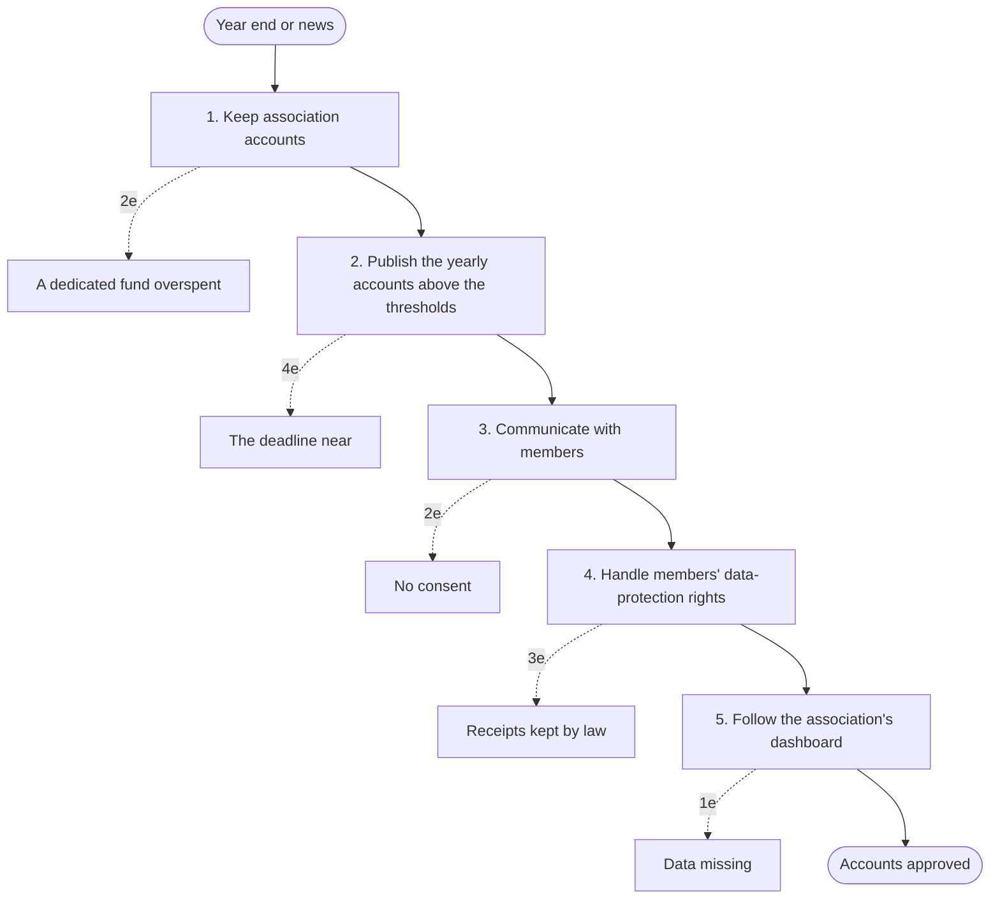

🏠 [Specs](../../../README.md) › 🏷️ [Sectors](../../README.md) › 🤲 [SC08 Non-profit association](../README.md) ›
🔀 [Flows](README.md) › 🔀 FL-SC08-06 Accounts and data

# 🔀 FL-SC08-06 Accounts and data

**Status:** ✅ specified

## Summary

Accounts, publication, news, data rights and the dashboard. It covers
[UC-SC08-14 Keep association accounts](../use-cases/06-accounts-and-data/uc-sc08-14-keep-association-accounts.md),
[UC-SC08-15 Publish the yearly accounts above the thresholds](../use-cases/06-accounts-and-data/uc-sc08-15-publish-the-yearly-accounts-above-the-thresholds.md),
[UC-SC08-17 Communicate with members](../use-cases/06-accounts-and-data/uc-sc08-17-communicate-with-members.md),
[UC-SC08-18 Handle members' data-protection rights](../use-cases/06-accounts-and-data/uc-sc08-18-handle-members-data-protection-rights.md),
[UC-SC08-19 Follow the association's dashboard](../use-cases/06-accounts-and-data/uc-sc08-19-follow-the-association-s-dashboard.md).

## Personas

- [U09 Customer](../../../01-users/personas/u09-customer.md)
- [U12 Marketing and communication](../../../01-users/personas/u12-marketing.md)
- [U13 Owner](../../../01-users/personas/u13-owner.md)
- [U31 Treasurer](../../../01-users/personas/u31-treasurer.md)

## Flowchart

## Sequence diagram

See each use case.

## Steps

| Step | Persona | Screen | Use case | What happens |
|---|---|---|---|---|
| 1 | U31, U13 | [S-SC08-14](../screens/06-accounts-and-data/s-sc08-14-association-accounts.md) | [UC-SC08-14](../use-cases/06-accounts-and-data/uc-sc08-14-keep-association-accounts.md) | The treasurer keeps the accounts under the non-profit rules with dedicated funds and contributions in kind, closes the year and presents it to the assembly |
| 2 | U31, U13 | [S-SC08-15](../screens/06-accounts-and-data/s-sc08-15-publication.md) | [UC-SC08-15](../use-cases/06-accounts-and-data/uc-sc08-15-publish-the-yearly-accounts-above-the-thresholds.md) | The treasurer checks the grant and gift thresholds, appoints the auditor when crossed, and publishes the accounts |
| 3 | U12, U13 | [S-SC08-17](../screens/06-accounts-and-data/s-sc08-17-news.md) | [UC-SC08-17](../use-cases/06-accounts-and-data/uc-sc08-17-communicate-with-members.md) | Marketing writes newsletters and news and sends them to members who agreed |
| 4 | U31, U09 | [S-SC08-18](../screens/06-accounts-and-data/s-sc08-18-data-rights.md) | [UC-SC08-18](../use-cases/06-accounts-and-data/uc-sc08-18-handle-members-data-protection-rights.md) | The treasurer receives a member's or donor's request to see, correct or erase their data, acts, and answers, keeping what the law requires |
| 5 | U13, U31 | [S-SC08-19](../screens/06-accounts-and-data/s-sc08-19-association-dashboard.md) | [UC-SC08-19](../use-cases/06-accounts-and-data/uc-sc08-19-follow-the-association-s-dashboard.md) | The president and the treasurer follow members, gifts, grants, cash and volunteers, compare years and export for the assembly |

### Entities and screens

| Entity | States in this flow | Shown at step and screen | Aggregated view |
|---|---|---|---|
| [E-F8-10 Fiscal period](../../../02-functional/f08-accounting/data/e-f08-10-fiscal-period.md) | Active | Shown elsewhere: [S-F8-01 Books setup](../../../02-functional/f08-accounting/screens/01-set-up-and-post/s-f08-01-books-setup.md) | Fiscal periods |
| [E-F5-01 Post](../../../02-functional/f05-social-media/data/e-f05-01-post.md) | Refused | Shown elsewhere: [S-F5-01 Post composer](../../../02-functional/f05-social-media/screens/01-publish-a-post/s-f05-01-post-composer.md) | Posts |
| [E-F1-01 Company](../../../02-functional/f01-administration/data/e-f01-01-company.md) | In setup, Active | Shown elsewhere: [S-F1-10 Client companies](../../../02-functional/f01-administration/screens/08-provider-and-client-companies/s-f01-10-client-companies.md) | Companies |
| [E-F8-13 Book](../../../02-functional/f08-accounting/data/e-f08-13-book.md) | Refused | Shown elsewhere: [S-F8-15 Books](../../../02-functional/f08-accounting/screens/06-benchmark-additions/s-f08-15-books.md) | Books |
| [E-F8-19 Dedicated fund](../../../02-functional/f08-accounting/data/e-f08-19-dedicated-fund.md) | Open, Closed | 1 [S-SC08-14](../screens/06-accounts-and-data/s-sc08-14-association-accounts.md) | Dedicated funds |
| [E-F8-22 Annual accounts file](../../../02-functional/f08-accounting/data/e-f08-22-annual-accounts-file.md) | Approved | Shown elsewhere: [S-F8-25 Annual accounts](../../../02-functional/f08-accounting/screens/08-year-end-duties/s-f08-25-annual-accounts.md) | Annual accounts files |
| [E-SC08-01 Member](../data/e-sc08-01-member.md) | Active | 3 [S-SC08-17](../screens/06-accounts-and-data/s-sc08-17-news.md); 4 [S-SC08-18](../screens/06-accounts-and-data/s-sc08-18-data-rights.md); 5 [S-SC08-19](../screens/06-accounts-and-data/s-sc08-19-association-dashboard.md) | Members |
| [E-F5-10 Consent and suppression record](../../../02-functional/f05-social-media/data/e-f05-10-consent-and-suppression-record.md) | Suppressed | Shown elsewhere: [S-F5-15 Consent register](../../../02-functional/f05-social-media/screens/06-audiences-consent-and-journeys/s-f05-15-consent-register.md) | Consent and suppression records |
| [E-F15-08 Data-subject request](../../../02-functional/f15-legal-assistant/data/e-f15-08-data-subject-request.md) | Received, Verified, Overdue, Answered | Shown elsewhere: [S-F15-10 Privacy and AI register](../../../02-functional/f15-legal-assistant/screens/06-privacy-and-ai-duties/s-f15-10-privacy-and-ai-register.md) | Data-subject requests |
| [E-SC08-06 Tax receipt](../data/e-sc08-06-tax-receipt.md) | Sent, Issued | Shown elsewhere: [S-SC08-06 Tax receipts](../screens/02-donations-and-receipts/s-sc08-06-tax-receipts.md) | Tax receipts |

## Errors

- [UC-SC08-14](../use-cases/06-accounts-and-data/uc-sc08-14-keep-association-accounts.md) 2e. A dedicated fund
  overspent: the treasurer is alerted.
- [UC-SC08-14](../use-cases/06-accounts-and-data/uc-sc08-14-keep-association-accounts.md) 3e. Entries unbalanced: the
  close is refused.
- [UC-SC08-15](../use-cases/06-accounts-and-data/uc-sc08-15-publish-the-yearly-accounts-above-the-thresholds.md) 4e. The
  deadline near: the treasurer is reminded.
- [UC-SC08-15](../use-cases/06-accounts-and-data/uc-sc08-15-publish-the-yearly-accounts-above-the-thresholds.md) 2e. No
  auditor appointed: publication is blocked.
- [UC-SC08-17](../use-cases/06-accounts-and-data/uc-sc08-17-communicate-with-members.md) 2e. No consent: the member is
  skipped.
- [UC-SC08-17](../use-cases/06-accounts-and-data/uc-sc08-17-communicate-with-members.md) 4e. Bounces: addresses are
  suppressed.
- [UC-SC08-18](../use-cases/06-accounts-and-data/uc-sc08-18-handle-members-data-protection-rights.md) 3e. Receipts kept
  by law: those records are kept and the person told.
- [UC-SC08-18](../use-cases/06-accounts-and-data/uc-sc08-18-handle-members-data-protection-rights.md) 4e. The answer
  delay near: the treasurer is reminded.
- [UC-SC08-19](../use-cases/06-accounts-and-data/uc-sc08-19-follow-the-association-s-dashboard.md) 1e. Data missing: it
  is shown as missing.
- [UC-SC08-19](../use-cases/06-accounts-and-data/uc-sc08-19-follow-the-association-s-dashboard.md) 4e. The export too
  large: it runs in the background.

## Images

Every step and error, for each persona taking part, in light and dark mode (D120). Steps are numbered as in the Steps
table; E rows are the error cases.

| Step | Persona | Device | Light | Dark |
|---|---|---|---|---|
| 1 | U31 | desktop | [light](../images/06-accounts-and-data/u31-treasurer/1-accounts-desktop-light.png) | [dark](../images/06-accounts-and-data/u31-treasurer/1-accounts-desktop-dark.png) |
| 1 | U31 | phone | [light](../images/06-accounts-and-data/u31-treasurer/1-accounts-phone-light.png) | [dark](../images/06-accounts-and-data/u31-treasurer/1-accounts-phone-dark.png) |
| 1 | U13 | desktop | [light](../images/06-accounts-and-data/u13-owner/1-accounts-desktop-light.png) | [dark](../images/06-accounts-and-data/u13-owner/1-accounts-desktop-dark.png) |
| 1 | U13 | phone | [light](../images/06-accounts-and-data/u13-owner/1-accounts-phone-light.png) | [dark](../images/06-accounts-and-data/u13-owner/1-accounts-phone-dark.png) |
| 2 | U31 | desktop | [light](../images/06-accounts-and-data/u31-treasurer/2-publication-desktop-light.png) | [dark](../images/06-accounts-and-data/u31-treasurer/2-publication-desktop-dark.png) |
| 2 | U31 | phone | [light](../images/06-accounts-and-data/u31-treasurer/2-publication-phone-light.png) | [dark](../images/06-accounts-and-data/u31-treasurer/2-publication-phone-dark.png) |
| 2 | U13 | desktop | [light](../images/06-accounts-and-data/u13-owner/2-publication-desktop-light.png) | [dark](../images/06-accounts-and-data/u13-owner/2-publication-desktop-dark.png) |
| 2 | U13 | phone | [light](../images/06-accounts-and-data/u13-owner/2-publication-phone-light.png) | [dark](../images/06-accounts-and-data/u13-owner/2-publication-phone-dark.png) |
| 3 | U12 | desktop | [light](../images/06-accounts-and-data/u12-marketing/3-news-desktop-light.png) | [dark](../images/06-accounts-and-data/u12-marketing/3-news-desktop-dark.png) |
| 3 | U12 | phone | [light](../images/06-accounts-and-data/u12-marketing/3-news-phone-light.png) | [dark](../images/06-accounts-and-data/u12-marketing/3-news-phone-dark.png) |
| 3 | U13 | desktop | [light](../images/06-accounts-and-data/u13-owner/3-news-desktop-light.png) | [dark](../images/06-accounts-and-data/u13-owner/3-news-desktop-dark.png) |
| 3 | U13 | phone | [light](../images/06-accounts-and-data/u13-owner/3-news-phone-light.png) | [dark](../images/06-accounts-and-data/u13-owner/3-news-phone-dark.png) |
| 4 | U31 | desktop | [light](../images/06-accounts-and-data/u31-treasurer/4-data-rights-desktop-light.png) | [dark](../images/06-accounts-and-data/u31-treasurer/4-data-rights-desktop-dark.png) |
| 4 | U31 | phone | [light](../images/06-accounts-and-data/u31-treasurer/4-data-rights-phone-light.png) | [dark](../images/06-accounts-and-data/u31-treasurer/4-data-rights-phone-dark.png) |
| 4 | U09 | phone | [light](../images/06-accounts-and-data/u09-customer/4-data-rights-phone-light.png) | [dark](../images/06-accounts-and-data/u09-customer/4-data-rights-phone-dark.png) |
| 5 | U13 | desktop | [light](../images/06-accounts-and-data/u13-owner/5-dashboard-desktop-light.png) | [dark](../images/06-accounts-and-data/u13-owner/5-dashboard-desktop-dark.png) |
| 5 | U13 | phone | [light](../images/06-accounts-and-data/u13-owner/5-dashboard-phone-light.png) | [dark](../images/06-accounts-and-data/u13-owner/5-dashboard-phone-dark.png) |
| 5 | U31 | desktop | [light](../images/06-accounts-and-data/u31-treasurer/5-dashboard-desktop-light.png) | [dark](../images/06-accounts-and-data/u31-treasurer/5-dashboard-desktop-dark.png) |
| 5 | U31 | phone | [light](../images/06-accounts-and-data/u31-treasurer/5-dashboard-phone-light.png) | [dark](../images/06-accounts-and-data/u31-treasurer/5-dashboard-phone-dark.png) |
| E1 | U31 | desktop | [light](../images/06-accounts-and-data/u31-treasurer/e1-fund-overspent-desktop-light.png) | [dark](../images/06-accounts-and-data/u31-treasurer/e1-fund-overspent-desktop-dark.png) |
| E1 | U31 | phone | [light](../images/06-accounts-and-data/u31-treasurer/e1-fund-overspent-phone-light.png) | [dark](../images/06-accounts-and-data/u31-treasurer/e1-fund-overspent-phone-dark.png) |

## Open questions

None.

---

⬅️ [FL-SC08-05 Events](fl-sc08-05-events.md) · ⬆️ [Up](README.md) ·
➡️ [FL-SC08-07](fl-sc08-07-foundations-integration-and-federations.md)
