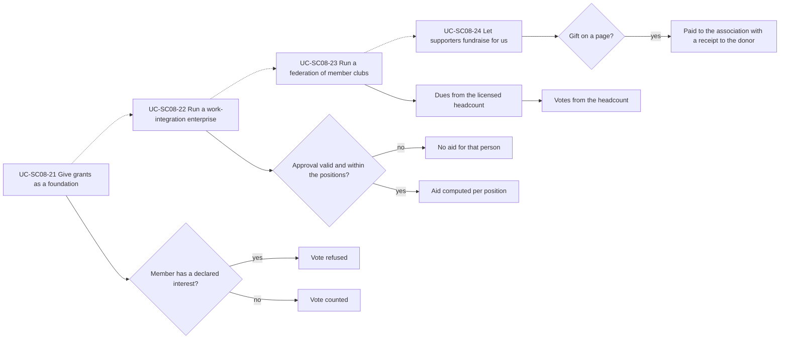
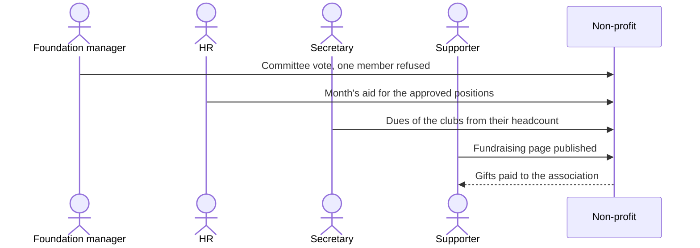

🏠 [Specs](../../../README.md) › 🏷️ [Sectors](../../README.md) › 🤲 [SC08 Non-profit association](../README.md) ›
🔀 [Flows](README.md) › 🔀 FL-SC08-07 Foundations, integration, federations, peer fundraising

# 🔀 FL-SC08-07 Foundations, integration, federations, peer fundraising

**Status:** 🔄 waiting for the owner

## Summary

Four situations of associations and foundations: giving grants with a committee free of conflicts, running a
work-integration enterprise whose aid follows the approvals, running a federation whose dues follow each club's
headcount, and letting supporters fundraise while the funds go only to the association
([D552](../../../06-decisions/sectors/d552-benchmark-gaps-sc08-non-profit.md)).

## Personas

- [U31 Treasurer](../../../01-users/personas/u31-treasurer.md), who pays the grants and invoices the dues
- [U13 Owner](../../../01-users/personas/u13-owner.md), who sits on the committee and reads the federation
- [U06 Human resources](../../../01-users/personas/u06-hr.md), who follows the pathways and the aid
- [U01 Employee](../../../01-users/personas/u01-employee.md), who follows their own steps
- [U12 Marketing and communication](../../../01-users/personas/u12-marketing.md), who reviews the fundraising pages
- [U09 Customer](../../../01-users/personas/u09-customer.md), who raises funds on their own page

## Flowchart

## Sequence diagram

## Steps

| Step | Persona | Screen | Use case | What happens |
|---|---|---|---|---|
| 1 | [U31](../../../01-users/personas/u31-treasurer.md) | [S-SC08-21](../screens/07-foundations-integration-and-federations/s-sc08-21-grant-making.md) | [UC-SC08-21](../use-cases/07-foundations-integration-and-federations/uc-sc08-21-give-grants-as-a-foundation.md) | The manager runs the call and the committee votes without the members who declared an interest |
| 2 | [U06](../../../01-users/personas/u06-hr.md) | [S-SC08-22](../screens/07-foundations-integration-and-federations/s-sc08-22-work-integration.md) | [UC-SC08-22](../use-cases/07-foundations-integration-and-federations/uc-sc08-22-run-a-work-integration-enterprise.md) | HR follows each person's approval and pathway and claims the month's aid for the approved positions |
| 3 | [U31](../../../01-users/personas/u31-treasurer.md) | [S-SC08-23](../screens/07-foundations-integration-and-federations/s-sc08-23-federation.md) | [UC-SC08-23](../use-cases/07-foundations-integration-and-federations/uc-sc08-23-run-a-federation-of-member-clubs.md) | The secretary affiliates the clubs and the treasurer invoices the dues from the headcount |
| 4 | [U12](../../../01-users/personas/u12-marketing.md) | [S-SC08-24](../screens/07-foundations-integration-and-federations/s-sc08-24-peer-fundraising.md) | [UC-SC08-24](../use-cases/07-foundations-integration-and-federations/uc-sc08-24-let-supporters-fundraise-for-us.md) | The marketing team publishes the supporters' pages and every gift goes to the association with a receipt |

### Entities and screens

| Entity | States in this flow | Shown at step and screen | Aggregated view |
|---|---|---|---|
| [E-SC08-16 Grant application](../data/e-sc08-16-grant-application.md) | Received, Eligible, Awarded, Declined, Paid | 1 [S-SC08-21](../screens/07-foundations-integration-and-federations/s-sc08-21-grant-making.md) | Grant applications |
| [E-SC08-17 Integration pathway](../data/e-sc08-17-integration-pathway.md) | Draft, Active, Completed, Ended | 2 [S-SC08-22](../screens/07-foundations-integration-and-federations/s-sc08-22-work-integration.md) | Integration pathways |
| [E-SC08-18 Member organisation](../data/e-sc08-18-member-organisation.md) | Candidate, Affiliated, Suspended, Left | 3 [S-SC08-23](../screens/07-foundations-integration-and-federations/s-sc08-23-federation.md) | Member organisations |
| [E-SC08-19 Fundraising page](../data/e-sc08-19-fundraising-page.md) | Draft, Published, Suspended, Closed | 4 [S-SC08-24](../screens/07-foundations-integration-and-federations/s-sc08-24-peer-fundraising.md) | Fundraising pages |
| [E-SC08-04 Gift](../data/e-sc08-04-gift.md) | Active | Shown elsewhere: [S-SC08-04 Donations](../screens/02-donations-and-receipts/s-sc08-04-donations.md) | Donations |
| [E-SC08-05 Fundraising campaign](../data/e-sc08-05-fundraising-campaign.md) | Active | Shown elsewhere: [S-SC08-05 Campaigns](../screens/02-donations-and-receipts/s-sc08-05-campaigns.md) | Campaigns |

## Errors

- **E1 A member has a conflict of interest.** A committee member who declared an interest in an application tries to
  vote on it: the vote is refused and recorded
  ([BR-SC08-16](../business-rules/br-sc08-16-members-with-a-conflict-do-not-vote.md), step 1).

## Images

Every step and error, for each persona taking part, in light and dark mode (D120). Steps are numbered as in the Steps
table; E rows are the error cases.

| Step | Persona | Device | Light | Dark |
|---|---|---|---|---|
| 1 | U31 | desktop | [light](../images/07-foundations-integration-and-federations/u31-treasurer/1-grant-making-desktop-light.png) | [dark](../images/07-foundations-integration-and-federations/u31-treasurer/1-grant-making-desktop-dark.png) |
| 1 | U13 | desktop | [light](../images/07-foundations-integration-and-federations/u13-owner/1-grant-making-desktop-light.png) | [dark](../images/07-foundations-integration-and-federations/u13-owner/1-grant-making-desktop-dark.png) |
| 1 | U31 | phone | [light](../images/07-foundations-integration-and-federations/u31-treasurer/1-grant-making-phone-light.png) | [dark](../images/07-foundations-integration-and-federations/u31-treasurer/1-grant-making-phone-dark.png) |
| 2 | U06 | desktop | [light](../images/07-foundations-integration-and-federations/u06-hr/2-work-integration-desktop-light.png) | [dark](../images/07-foundations-integration-and-federations/u06-hr/2-work-integration-desktop-dark.png) |
| 2 | U01 | phone | [light](../images/07-foundations-integration-and-federations/u01-employee/2-work-integration-phone-light.png) | [dark](../images/07-foundations-integration-and-federations/u01-employee/2-work-integration-phone-dark.png) |
| 3 | U31 | desktop | [light](../images/07-foundations-integration-and-federations/u31-treasurer/3-federation-desktop-light.png) | [dark](../images/07-foundations-integration-and-federations/u31-treasurer/3-federation-desktop-dark.png) |
| 3 | U13 | desktop | [light](../images/07-foundations-integration-and-federations/u13-owner/3-federation-desktop-light.png) | [dark](../images/07-foundations-integration-and-federations/u13-owner/3-federation-desktop-dark.png) |
| 3 | U31 | phone | [light](../images/07-foundations-integration-and-federations/u31-treasurer/3-federation-phone-light.png) | [dark](../images/07-foundations-integration-and-federations/u31-treasurer/3-federation-phone-dark.png) |
| 4 | U12 | desktop | [light](../images/07-foundations-integration-and-federations/u12-marketing/4-peer-fundraising-desktop-light.png) | [dark](../images/07-foundations-integration-and-federations/u12-marketing/4-peer-fundraising-desktop-dark.png) |
| 4 | U09 | phone | [light](../images/07-foundations-integration-and-federations/u09-customer/4-peer-fundraising-phone-light.png) | [dark](../images/07-foundations-integration-and-federations/u09-customer/4-peer-fundraising-phone-dark.png) |
| 4 | U12 | phone | [light](../images/07-foundations-integration-and-federations/u12-marketing/4-peer-fundraising-phone-light.png) | [dark](../images/07-foundations-integration-and-federations/u12-marketing/4-peer-fundraising-phone-dark.png) |
| E1 | U31 | desktop | [light](../images/07-foundations-integration-and-federations/u31-treasurer/e1-a-member-has-a-conflict-of-interest-desktop-light.png) | [dark](../images/07-foundations-integration-and-federations/u31-treasurer/e1-a-member-has-a-conflict-of-interest-desktop-dark.png) |
| E1 | U31 | phone | [light](../images/07-foundations-integration-and-federations/u31-treasurer/e1-a-member-has-a-conflict-of-interest-phone-light.png) | [dark](../images/07-foundations-integration-and-federations/u31-treasurer/e1-a-member-has-a-conflict-of-interest-phone-dark.png) |

## Open questions

None.

---

⬅️ [FL-SC08-06 Accounts and data](fl-sc08-06-accounts-and-data.md) · ⬆️ [Up](README.md)
