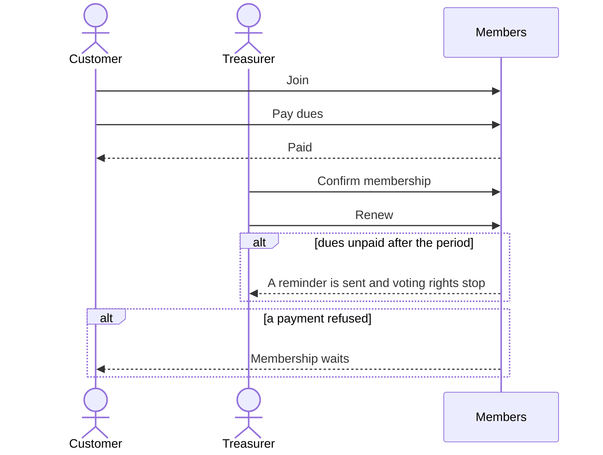

🏠 [Specs](../../../../README.md) › 🏷️ [Sectors](../../../README.md) › 🤲 [SC08 Non-profit association](../../README.md) ›
📝 [Use cases](../README.md) › 📝 [Use cases: FL-SC08-01 Members and governance](README.md) ›
📝 UC-SC08-01 Manage members and dues

# 📝 UC-SC08-01 Manage members and dues

**Status:** ✅ specified

## Summary

People join the association, pay their dues online or to the treasurer, and renew each period; membership and voting
rights follow paid dues.

## Personas

- [U31 Treasurer](../../../../01-users/personas/u31-treasurer.md)
- [U09 Customer](../../../../01-users/personas/u09-customer.md)

## Goal

An up-to-date list of members with their rights.

## Trigger

A person joins, or a period ends.

## Frequency

Daily joins; yearly renewal campaign.

## Preconditions

- The SC08 sector pack is installed for the company,
  [UC-F14-02](../../../../02-functional/f14-plugin-store/use-cases/01-find-and-install/uc-f14-02-install-a-plugin-or-sector-pack.md),
  and its users have their roles,
  [UC-F1-06](../../../../02-functional/f01-administration/use-cases/04-edit-a-role/uc-f01-06-edit-a-role-and-its-record-rules.md).

## Postconditions

- **Success:** the person is a member for the period with a card.
- **Failed:** the person stays a former member and is reminded.

## Main flow

1. The person joins on the portal on [S-SC08-01 Members](../../screens/01-members-and-governance/s-sc08-01-members.md)
   with consents.
2. The person pays by card,
   [UC-F6-07](../../../../02-functional/f06-customers-and-sales/use-cases/03-invoice-and-get-paid/uc-f06-07-get-paid-online-and-reconcile.md).
3. Membership starts for the period ([BR-SC08-04](../../business-rules/br-sc08-04-dues-make-members.md)).
4. At period end, members are invited to renew.

## Alternative flows

- 2a. Dues waived by the board: membership starts with the board's decision recorded.
- 1a. A family membership: several people share one membership.

## Error flows

- 4e. Dues unpaid after the period: a reminder is sent and voting rights stop.
- 2e. A payment refused: membership waits.
- Any step: a call to a service or an outside system fails: it is retried first
  ([BR-F3-32](../../../../02-functional/f03-assistant/business-rules/br-f03-32-retry-before-an-error.md)), then the
  error message pattern ([D122](../../../../06-decisions/ux/d122-error-message-standard.md)) says what failed; what was
  typed is kept.

## Business rules

- [BR-SC08-04 Dues make members](../../business-rules/br-sc08-04-dues-make-members.md)
- [BR-SC08-13 Communication with consent](../../business-rules/br-sc08-13-communication-with-consent.md)

## Entities

- [E-SC08-01 Member](../../data/e-sc08-01-member.md)
- [E-SC08-02 Dues payment](../../data/e-sc08-02-dues-payment.md)

## Permissions

The treasurer and customer roles; the record rules of their role and site apply,
[UC-F1-06](../../../../02-functional/f01-administration/use-cases/04-edit-a-role/uc-f01-06-edit-a-role-and-its-record-rules.md).

## Notifications

None beyond the in-app updates of the records concerned.

## Audit events

Every creation, change and state change of member, dues payment records, with who, when and the values before and after
(T3).

## AI involvement

The AI assistant answers questions on the member, dues payment records of this use case, with links, and prepares them
as drafts the user confirms. It works within the user's rights,
[BR-F3-34](../../../../02-functional/f03-assistant/business-rules/br-f03-34-every-capability-is-reachable-from-the-assistant.md),
and never deletes or does anything irreversible without the user's confirmation,
[BR-F3-07](../../../../02-functional/f03-assistant/business-rules/br-f03-07-no-deletes-no-irreversible-acts.md).

## API, MCP and A2A exposure

Through the API and webhooks (T5) and the MCP and A2A gateway (T6), with the caller's rights,
[BR-F3-34](../../../../02-functional/f03-assistant/business-rules/br-f03-34-every-capability-is-reachable-from-the-assistant.md),
reading, creating and changing the records of this use case; nothing irreversible without a person's confirmation.

## Screens

- [S-SC08-01 Members](../../screens/01-members-and-governance/s-sc08-01-members.md)

## Flowchart

See [FL-SC08-01 Members and governance](../../flows/fl-sc08-01-members-and-governance.md#flowchart).

## Sequence diagram

## Acceptance criteria

1. **Given** the example association's J. Martin paying 30 EUR by card for 2026 **when** it is recorded **then** he is a
   member for 2026 with voting rights.
2. **Given** J. Martin without 2027 dues **when** 1 January 2027 passes **then** a reminder is sent and voting rights
   stop.

## Non-functional notes

[D408](../../../../06-decisions/technical/d408-performance-and-profiles.md)'s targets
([performance](../../../../05-non-functional/performance.md)): 95 % of screens within 1 second; lists paged on the
server, the first page within 1 second; reports within 5 seconds or in the background. WCAG 2.2 AA and RGAA
([D46](../../../../06-decisions/ux/d46-accessibility-standard.md)).

## Regulatory references

None specific to this use case; the sector's legal rules are listed in [SC08 regulatory](../../regulatory.md).

## Related use cases

- [UC-SC08-02 Run the general assembly](uc-sc08-02-run-the-general-assembly.md)

## Open questions

None.

---

⬆️ [Up](README.md) · ➡️ [UC-SC08-02 Run the general assembly](uc-sc08-02-run-the-general-assembly.md)
