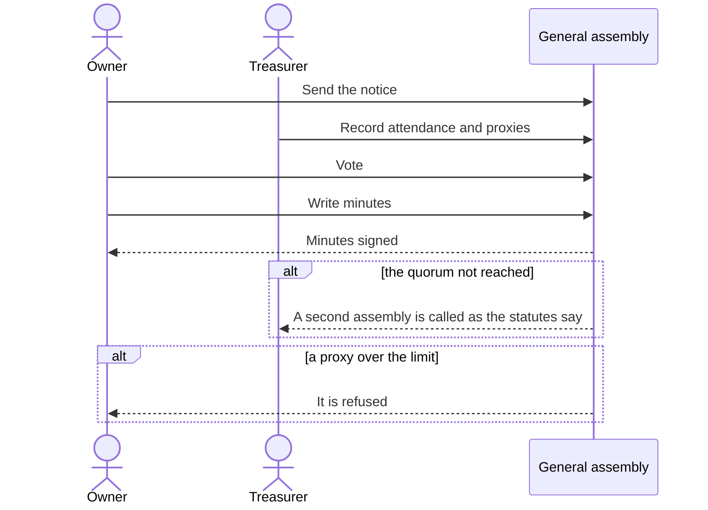

🏠 [Specs](../../../../README.md) › 🏷️ [Sectors](../../../README.md) › 🤲 [SC08 Non-profit association](../../README.md) ›
📝 [Use cases](../README.md) › 📝 [Use cases: FL-SC08-01 Members and governance](README.md) ›
📝 UC-SC08-02 Run the general assembly

# 📝 UC-SC08-02 Run the general assembly

**Status:** ✅ specified

## Summary

The board sends the notice, records attendance and proxies, runs the votes and writes the minutes, following the
statutes entered as settings.

## Personas

- [U13 Owner](../../../../01-users/personas/u13-owner.md)
- [U31 Treasurer](../../../../01-users/personas/u31-treasurer.md)

## Goal

An assembly valid under the statutes, its votes recorded.

## Trigger

The yearly assembly or an extraordinary one.

## Frequency

Yearly.

## Preconditions

- The SC08 sector pack is installed for the company,
  [UC-F14-02](../../../../02-functional/f14-plugin-store/use-cases/01-find-and-install/uc-f14-02-install-a-plugin-or-sector-pack.md),
  and its users have their roles,
  [UC-F1-06](../../../../02-functional/f01-administration/use-cases/04-edit-a-role/uc-f01-06-edit-a-role-and-its-record-rules.md).

## Postconditions

- **Success:** the minutes record the votes and are filed.
- **Failed:** a second assembly is called.

## Main flow

1. The president sends the notice to members on
   [S-SC08-02 General assembly](../../screens/01-members-and-governance/s-sc08-02-general-assembly.md) within the
   statutes' delay.
2. Attendance and proxies are recorded; quorum is computed
   ([BR-SC08-05](../../business-rules/br-sc08-05-assembly-follows-the-statutes.md)).
3. Each resolution is voted and counted.
4. The minutes are drafted from the meeting's record,
   [UC-F4-03](../../../../02-functional/f04-meetings/use-cases/02-record-in-person-or-by-phone/uc-f04-03-record-an-in-person-meeting.md),
   [UC-F4-05](../../../../02-functional/f04-meetings/use-cases/03-review-a-meeting/uc-f04-05-review-a-meeting.md), and
   signed.

## Alternative flows

- 2a. An online assembly: members vote online and attendance is recorded by sign-in.

## Error flows

- 2e. The quorum not reached: a second assembly is called as the statutes say.
- 3e. A proxy over the limit: it is refused.
- Any step: a call to a service or an outside system fails: it is retried first
  ([BR-F3-32](../../../../02-functional/f03-assistant/business-rules/br-f03-32-retry-before-an-error.md)), then the
  error message pattern ([D122](../../../../06-decisions/ux/d122-error-message-standard.md)) says what failed; what was
  typed is kept.

## Business rules

- [BR-SC08-05 The assembly follows the statutes](../../business-rules/br-sc08-05-assembly-follows-the-statutes.md)

## Entities

- [E-SC08-03 Assembly or board meeting](../../data/e-sc08-03-assembly-or-board-meeting.md)

## Permissions

The owner and treasurer roles; the record rules of their role and site apply,
[UC-F1-06](../../../../02-functional/f01-administration/use-cases/04-edit-a-role/uc-f01-06-edit-a-role-and-its-record-rules.md).

## Notifications

None beyond the in-app updates of the records concerned.

## Audit events

Every creation, change and state change of assembly or board meeting records, with who, when and the values before and
after (T3).

## AI involvement

The AI assistant answers questions on the assembly or board meeting records of this use case, with links, and prepares
them as drafts the user confirms. It works within the user's rights,
[BR-F3-34](../../../../02-functional/f03-assistant/business-rules/br-f03-34-every-capability-is-reachable-from-the-assistant.md),
and never deletes or does anything irreversible without the user's confirmation,
[BR-F3-07](../../../../02-functional/f03-assistant/business-rules/br-f03-07-no-deletes-no-irreversible-acts.md).

## API, MCP and A2A exposure

Through the API and webhooks (T5) and the MCP and A2A gateway (T6), with the caller's rights,
[BR-F3-34](../../../../02-functional/f03-assistant/business-rules/br-f03-34-every-capability-is-reachable-from-the-assistant.md),
reading, creating and changing the records of this use case; nothing irreversible without a person's confirmation.

## Screens

- [S-SC08-02 General assembly](../../screens/01-members-and-governance/s-sc08-02-general-assembly.md)

## Flowchart

See [FL-SC08-01 Members and governance](../../flows/fl-sc08-01-members-and-governance.md#flowchart).

## Sequence diagram

## Acceptance criteria

1. **Given** the example association's assembly on 20 March with 64 present and 18 proxies of 150 members, quorum a
   quarter **when** attendance is closed **then** the quorum is reached.
2. **Given** 64 present and 18 proxies of 200 members with a half quorum **when** the quorum is computed **then** a
   second assembly is called as the statutes say.

## Non-functional notes

[D408](../../../../06-decisions/technical/d408-performance-and-profiles.md)'s targets
([performance](../../../../05-non-functional/performance.md)): 95 % of screens within 1 second; lists paged on the
server, the first page within 1 second; reports within 5 seconds or in the background. WCAG 2.2 AA and RGAA
([D46](../../../../06-decisions/ux/d46-accessibility-standard.md)).

## Regulatory references

None specific to this use case; the sector's legal rules are listed in [SC08 regulatory](../../regulatory.md).

## Related use cases

- [UC-SC08-03 Run the board and its decisions](uc-sc08-03-run-the-board-and-its-decisions.md)

## Open questions

None.

---

⬅️ [UC-SC08-01 Manage members and dues](uc-sc08-01-manage-members-and-dues.md) · ⬆️ [Up](README.md) ·
➡️ [UC-SC08-03 Run the board and its decisions](uc-sc08-03-run-the-board-and-its-decisions.md)
