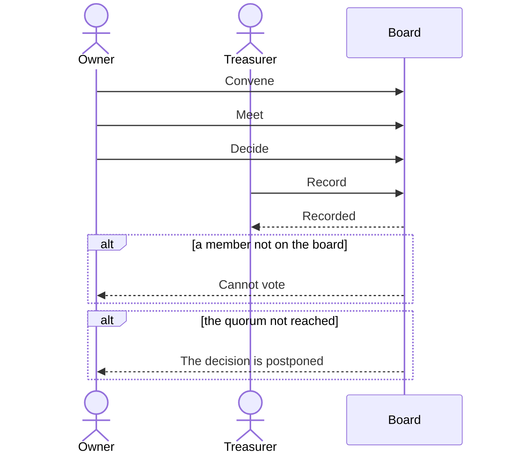

🏠 [Specs](../../../../README.md) › 🏷️ [Sectors](../../../README.md) › 🤲 [SC08 Non-profit association](../../README.md) ›
📝 [Use cases](../README.md) › 📝 [Use cases: FL-SC08-01 Members and governance](README.md) ›
📝 UC-SC08-03 Run the board and its decisions

# 📝 UC-SC08-03 Run the board and its decisions

**Status:** ✅ specified

## Summary

The board meets, decides and records its decisions; only board members vote.

## Personas

- [U13 Owner](../../../../01-users/personas/u13-owner.md)
- [U31 Treasurer](../../../../01-users/personas/u31-treasurer.md)

## Goal

Board decisions recorded and followed.

## Trigger

A board meeting.

## Frequency

Monthly or quarterly.

## Preconditions

- The SC08 sector pack is installed for the company,
  [UC-F14-02](../../../../02-functional/f14-plugin-store/use-cases/01-find-and-install/uc-f14-02-install-a-plugin-or-sector-pack.md),
  and its users have their roles,
  [UC-F1-06](../../../../02-functional/f01-administration/use-cases/04-edit-a-role/uc-f01-06-edit-a-role-and-its-record-rules.md).

## Postconditions

- **Success:** decisions are recorded with their votes.
- **Failed:** the decision is postponed.

## Main flow

1. The president convenes the board on [S-SC08-03 Board](../../screens/01-members-and-governance/s-sc08-03-board.md).
2. The board meets; the meeting is recorded,
   [UC-F4-01](../../../../02-functional/f04-meetings/use-cases/01-record-an-online-meeting/uc-f04-01-record-an-online-meeting-with-the-bot.md).
3. Each decision is voted by board members.
4. The decisions are recorded and their actions assigned.

## Alternative flows

- 3a. A decision by email: board members vote online within a delay.

## Error flows

- 3e. A member not on the board: cannot vote.
- 2e. The quorum not reached: the decision is postponed.
- Any step: a call to a service or an outside system fails: it is retried first
  ([BR-F3-32](../../../../02-functional/f03-assistant/business-rules/br-f03-32-retry-before-an-error.md)), then the
  error message pattern ([D122](../../../../06-decisions/ux/d122-error-message-standard.md)) says what failed; what was
  typed is kept.

## Business rules

- [BR-SC08-05 The assembly follows the statutes](../../business-rules/br-sc08-05-assembly-follows-the-statutes.md)

## Entities

- [E-SC08-03 Assembly or board meeting](../../data/e-sc08-03-assembly-or-board-meeting.md)

## Permissions

The owner and treasurer roles; the record rules of their role and site apply,
[UC-F1-06](../../../../02-functional/f01-administration/use-cases/04-edit-a-role/uc-f01-06-edit-a-role-and-its-record-rules.md).

## Notifications

None beyond the in-app updates of the records concerned.

## Audit events

Every creation, change and state change of assembly or board meeting records, with who, when and the values before and
after (T3).

## AI involvement

The AI assistant answers questions on the assembly or board meeting records of this use case, with links, and prepares
them as drafts the user confirms. It works within the user's rights,
[BR-F3-34](../../../../02-functional/f03-assistant/business-rules/br-f03-34-every-capability-is-reachable-from-the-assistant.md),
and never deletes or does anything irreversible without the user's confirmation,
[BR-F3-07](../../../../02-functional/f03-assistant/business-rules/br-f03-07-no-deletes-no-irreversible-acts.md).

## API, MCP and A2A exposure

Through the API and webhooks (T5) and the MCP and A2A gateway (T6), with the caller's rights,
[BR-F3-34](../../../../02-functional/f03-assistant/business-rules/br-f03-34-every-capability-is-reachable-from-the-assistant.md),
reading, creating and changing the records of this use case; nothing irreversible without a person's confirmation.

## Screens

- [S-SC08-03 Board](../../screens/01-members-and-governance/s-sc08-03-board.md)

## Flowchart

See [FL-SC08-01 Members and governance](../../flows/fl-sc08-01-members-and-governance.md#flowchart).

## Sequence diagram

## Acceptance criteria

1. **Given** the example association's board of 7 with 5 present **when** a gift in kind is accepted by 4 votes **then**
   the decision is recorded as accepted.
2. **Given** a member invited as guest **when** votes are counted **then** cannot vote.

## Non-functional notes

[D408](../../../../06-decisions/technical/d408-performance-and-profiles.md)'s targets
([performance](../../../../05-non-functional/performance.md)): 95 % of screens within 1 second; lists paged on the
server, the first page within 1 second; reports within 5 seconds or in the background. WCAG 2.2 AA and RGAA
([D46](../../../../06-decisions/ux/d46-accessibility-standard.md)).

## Regulatory references

None specific to this use case; the sector's legal rules are listed in [SC08 regulatory](../../regulatory.md).

## Related use cases

- [UC-SC08-16 Manage bequests and gifts in kind](../02-donations-and-receipts/uc-sc08-16-manage-bequests-and-gifts-in-kind.md)

## Open questions

None.

---

⬅️ [UC-SC08-02 Run the general assembly](uc-sc08-02-run-the-general-assembly.md) · ⬆️ [Up](README.md) ·
➡️ [UC-SC08-04](../02-donations-and-receipts/uc-sc08-04-collect-donations-online-and-offline.md)
