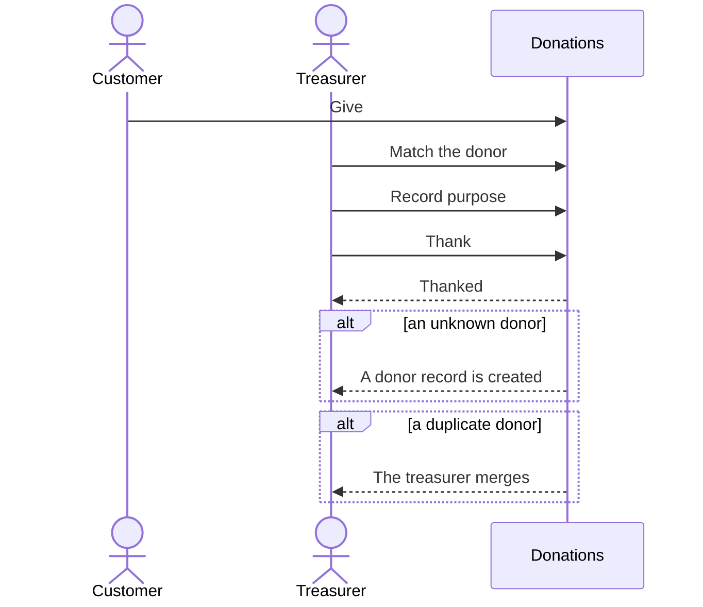

🏠 [Specs](../../../../README.md) › 🏷️ [Sectors](../../../README.md) › 🤲 [SC08 Non-profit association](../../README.md) ›
📝 [Use cases](../README.md) › 📝 [Use cases: FL-SC08-02 Donations and receipts](README.md) ›
📝 UC-SC08-04 Collect donations online and offline

# 📝 UC-SC08-04 Collect donations online and offline

**Status:** ✅ specified

## Summary

The treasurer receives gifts by card, transfer, cheque or platforms, matches each to its donor, and thanks them.

## Personas

- [U31 Treasurer](../../../../01-users/personas/u31-treasurer.md)
- [U09 Customer](../../../../01-users/personas/u09-customer.md)

## Goal

Every gift recorded with its donor and purpose.

## Trigger

A gift arrives.

## Frequency

Daily.

## Preconditions

- The SC08 sector pack is installed for the company,
  [UC-F14-02](../../../../02-functional/f14-plugin-store/use-cases/01-find-and-install/uc-f14-02-install-a-plugin-or-sector-pack.md),
  and its users have their roles,
  [UC-F1-06](../../../../02-functional/f01-administration/use-cases/04-edit-a-role/uc-f01-06-edit-a-role-and-its-record-rules.md).

## Postconditions

- **Success:** the gift is recorded, posted and thanked.
- **Failed:** the gift waits to be matched.

## Main flow

1. The donor gives on the donation page on
   [S-SC08-04 Donations](../../screens/02-donations-and-receipts/s-sc08-04-donations.md).
2. The treasurer matches gifts by transfer or cheque to donors.
3. A gift for a purpose goes to its dedicated fund,
   [UC-F8-23](../../../../02-functional/f08-accounting/use-cases/07-client-money-grants-and-non-profits/uc-f08-23-keep-non-profit-accounts.md).
4. The donor gets a thank-you and, if entitled, a receipt ([UC-SC08-06](uc-sc08-06-issue-tax-receipts-for-gifts.md)).

## Alternative flows

- 1a. A platform import: gifts come through the platform's connector (T12).

## Error flows

- 2e. An unknown donor: a donor record is created.
- 2f. A duplicate donor: the treasurer merges.
- Any step: a call to a service or an outside system fails: it is retried first
  ([BR-F3-32](../../../../02-functional/f03-assistant/business-rules/br-f03-32-retry-before-an-error.md)), then the
  error message pattern ([D122](../../../../06-decisions/ux/d122-error-message-standard.md)) says what failed; what was
  typed is kept.

## Business rules

- [BR-SC08-02 Receipts only when entitled](../../business-rules/br-sc08-02-receipts-only-when-entitled.md)
- [BR-F8-15 Dedicated funds keep their purpose](../../../../02-functional/f08-accounting/business-rules/br-f08-15-dedicated-funds-keep-their-purpose.md)

## Entities

- [E-SC08-04 Gift](../../data/e-sc08-04-gift.md)

## Permissions

The treasurer and customer roles; the record rules of their role and site apply,
[UC-F1-06](../../../../02-functional/f01-administration/use-cases/04-edit-a-role/uc-f01-06-edit-a-role-and-its-record-rules.md).

## Notifications

None beyond the in-app updates of the records concerned.

## Audit events

Every creation, change and state change of gift records, with who, when and the values before and after (T3).

## AI involvement

The AI assistant answers questions on the gift records of this use case, with links, and prepares them as drafts the
user confirms. It works within the user's rights,
[BR-F3-34](../../../../02-functional/f03-assistant/business-rules/br-f03-34-every-capability-is-reachable-from-the-assistant.md),
and never deletes or does anything irreversible without the user's confirmation,
[BR-F3-07](../../../../02-functional/f03-assistant/business-rules/br-f03-07-no-deletes-no-irreversible-acts.md).

## API, MCP and A2A exposure

Through the API and webhooks (T5) and the MCP and A2A gateway (T6), with the caller's rights,
[BR-F3-34](../../../../02-functional/f03-assistant/business-rules/br-f03-34-every-capability-is-reachable-from-the-assistant.md),
reading, creating and changing the records of this use case; nothing irreversible without a person's confirmation.

## Screens

- [S-SC08-04 Donations](../../screens/02-donations-and-receipts/s-sc08-04-donations.md)

## Flowchart

See [FL-SC08-02 Donations and receipts](../../flows/fl-sc08-02-donations-and-receipts.md#flowchart).

## Sequence diagram

## Acceptance criteria

1. **Given** the example association's gift of 100 EUR by card from J. Martin on 12 November for the school **when** it
   is recorded **then** it shows in the winter campaign and the school's dedicated fund.
2. **Given** a cheque from a new donor **when** it is recorded **then** a donor record is created.

## Non-functional notes

[D408](../../../../06-decisions/technical/d408-performance-and-profiles.md)'s targets
([performance](../../../../05-non-functional/performance.md)): 95 % of screens within 1 second; lists paged on the
server, the first page within 1 second; reports within 5 seconds or in the background. WCAG 2.2 AA and RGAA
([D46](../../../../06-decisions/ux/d46-accessibility-standard.md)).

## Regulatory references

None specific to this use case; the sector's legal rules are listed in [SC08 regulatory](../../regulatory.md).

## Related use cases

- [UC-SC08-06 Issue tax receipts for gifts](uc-sc08-06-issue-tax-receipts-for-gifts.md)

## Open questions

None.

---

⬅️ [UC-SC08-03](../01-members-and-governance/uc-sc08-03-run-the-board-and-its-decisions.md) · ⬆️ [Up](README.md) ·
➡️ [UC-SC08-05 Run fundraising campaigns](uc-sc08-05-run-fundraising-campaigns.md)
