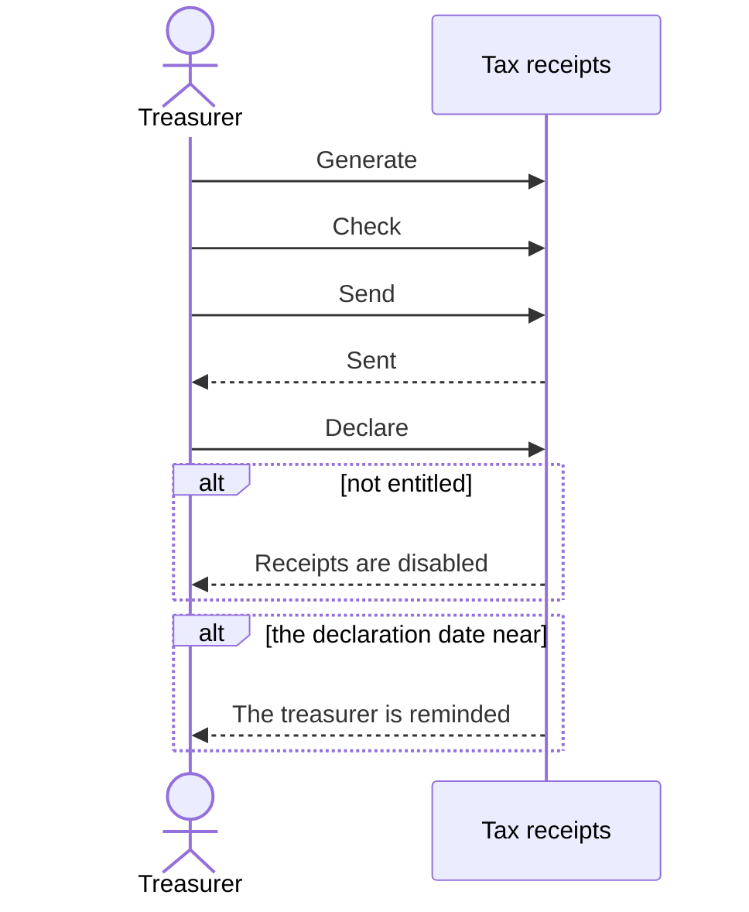

🏠 [Specs](../../../../README.md) › 🏷️ [Sectors](../../../README.md) › 🤲 [SC08 Non-profit association](../../README.md) ›
📝 [Use cases](../README.md) › 📝 [Use cases: FL-SC08-02 Donations and receipts](README.md) ›
📝 UC-SC08-06 Issue tax receipts for gifts

# 📝 UC-SC08-06 Issue tax receipts for gifts

**Status:** ✅ specified

## Summary

The treasurer generates tax receipts per gift or yearly, on the official model, checks and sends them, and declares them
after the year end.

## Personas

- [U31 Treasurer](../../../../01-users/personas/u31-treasurer.md)

## Goal

Donors get their receipts; the association stays entitled.

## Trigger

A gift, or the year end.

## Frequency

Per gift or yearly.

## Preconditions

- The SC08 sector pack is installed for the company,
  [UC-F14-02](../../../../02-functional/f14-plugin-store/use-cases/01-find-and-install/uc-f14-02-install-a-plugin-or-sector-pack.md),
  and its users have their roles,
  [UC-F1-06](../../../../02-functional/f01-administration/use-cases/04-edit-a-role/uc-f01-06-edit-a-role-and-its-record-rules.md).

## Postconditions

- **Success:** receipts are sent and declared.
- **Failed:** no receipt is issued.

## Main flow

1. The treasurer generates receipts on
   [S-SC08-06 Tax receipts](../../screens/02-donations-and-receipts/s-sc08-06-tax-receipts.md).
2. The treasurer checks amounts and numbering
   ([BR-SC08-02](../../business-rules/br-sc08-02-receipts-only-when-entitled.md)).
3. Receipts go to donors.
4. After the year end, the number and total are declared
   ([BR-SC08-03](../../business-rules/br-sc08-03-receipts-declared-yearly.md)).

## Alternative flows

- 1a. A corrected receipt: a new number replaces it and the old one is cancelled.

## Error flows

- 1e. Not entitled: receipts are disabled.
- 4e. The declaration date near: the treasurer is reminded.
- Any step: a call to a service or an outside system fails: it is retried first
  ([BR-F3-32](../../../../02-functional/f03-assistant/business-rules/br-f03-32-retry-before-an-error.md)), then the
  error message pattern ([D122](../../../../06-decisions/ux/d122-error-message-standard.md)) says what failed; what was
  typed is kept.

## Business rules

- [BR-SC08-02 Receipts only when entitled](../../business-rules/br-sc08-02-receipts-only-when-entitled.md)
- [BR-SC08-03 Receipts declared yearly](../../business-rules/br-sc08-03-receipts-declared-yearly.md)

## Entities

- [E-SC08-06 Tax receipt](../../data/e-sc08-06-tax-receipt.md)

## Permissions

The treasurer roles; the record rules of their role and site apply,
[UC-F1-06](../../../../02-functional/f01-administration/use-cases/04-edit-a-role/uc-f01-06-edit-a-role-and-its-record-rules.md).

## Notifications

None beyond the in-app updates of the records concerned.

## Audit events

Every creation, change and state change of tax receipt records, with who, when and the values before and after (T3).

## AI involvement

The AI assistant answers questions on the tax receipt records of this use case, with links, and prepares them as drafts
the user confirms. It works within the user's rights,
[BR-F3-34](../../../../02-functional/f03-assistant/business-rules/br-f03-34-every-capability-is-reachable-from-the-assistant.md),
and never deletes or does anything irreversible without the user's confirmation,
[BR-F3-07](../../../../02-functional/f03-assistant/business-rules/br-f03-07-no-deletes-no-irreversible-acts.md).

## API, MCP and A2A exposure

Through the API and webhooks (T5) and the MCP and A2A gateway (T6), with the caller's rights,
[BR-F3-34](../../../../02-functional/f03-assistant/business-rules/br-f03-34-every-capability-is-reachable-from-the-assistant.md),
reading, creating and changing the records of this use case; nothing irreversible without a person's confirmation.

## Screens

- [S-SC08-06 Tax receipts](../../screens/02-donations-and-receipts/s-sc08-06-tax-receipts.md)

## Flowchart

See [FL-SC08-02 Donations and receipts](../../flows/fl-sc08-02-donations-and-receipts.md#flowchart).

## Sequence diagram

## Acceptance criteria

1. **Given** the example association's gift of 100 EUR from J. Martin **when** the receipt is issued **then** receipt
   R-2026-0418 states 100 EUR.
2. **Given** an association without entitlement **when** a receipt is asked **then** receipts are disabled.

## Non-functional notes

[D408](../../../../06-decisions/technical/d408-performance-and-profiles.md)'s targets
([performance](../../../../05-non-functional/performance.md)): 95 % of screens within 1 second; lists paged on the
server, the first page within 1 second; reports within 5 seconds or in the background. WCAG 2.2 AA and RGAA
([D46](../../../../06-decisions/ux/d46-accessibility-standard.md)).

## Regulatory references

Legal values from the France country pack:
[CR-FR-124 Tax receipts for gifts and their yearly declaration](../../../../10-country-packs/france/non-profit/cr-fr-124-gift-tax-receipts.md).

## Related use cases

- [UC-SC08-04 Collect donations online and offline](uc-sc08-04-collect-donations-online-and-offline.md)

## Open questions

None.

---

⬅️ [UC-SC08-05 Run fundraising campaigns](uc-sc08-05-run-fundraising-campaigns.md) · ⬆️ [Up](README.md) ·
➡️ [UC-SC08-07 Manage regular donors](uc-sc08-07-manage-regular-donors.md)
